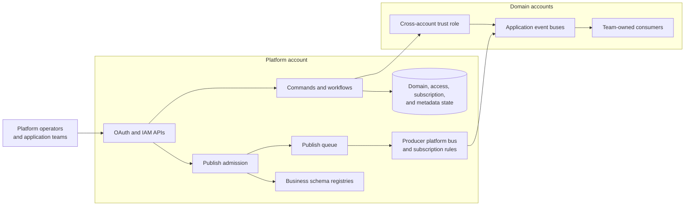

# Architecture overview

[Documentation home](../README.md)

Konductor for Amazon EventBridge is a governance and routing platform for event
domains. This overview explains the accounts, boundaries, and major flows.
Follow a topic link for implementation detail; deployment commands belong in
the [operations guides](../operations/README.md).

## The problem

Cross-account event delivery needs resources and permissions on both sides.
Without shared coordination, application teams repeat that work and platform
teams lose a consistent view of ownership and routing.

Konductor separates domain intent from the AWS resources that implement it.
Teams register domains, publish events, and subscribe to schema contracts.
The platform coordinates approval, provisioning, and delivery.

## Accounts and boundaries

This diagram shows boundaries, not every API integration or workflow step.
For the detailed deployment topology, see [platform boundaries](platform-boundaries.md).

| Boundary | Responsibility |
|---|---|
| Platform account | Control-plane state, API surfaces, workflows, registries, and platform-side delivery resources |
| Domain account | Application-side buses and integration queues, plus the trust role Konductor assumes |
| Platform operators | Installation, approval, access administration, and operational recovery |
| Application teams | Domain ownership, business schemas, publishes, subscriptions, and processing on their own buses |

The platform is a singleton deployment. Domain resource sets are environment
scoped. See [resources and naming](../reference/resources.md) for the distinction
between `konductor-*` and `{org}-{env}-{domain}-*`.

## Major flows

### Register, approve, and provision

A registration records domain intent. Human approval precedes infrastructure
creation. Provisioning coordinates per-environment resources and compensation.

- [Domain ownership and approval](domain-lifecycle.md)
- [Provisioning and rollback](provisioning.md)
- [Domain status reference](../reference/domain-statuses.md)

### Authenticate and authorize

OAuth represents interactive identities; IAM represents automation callers.
Bindings authorize principals to act for a domain. Entitlements govern access
to producer contracts. These are separate from cross-account IAM trust.

- [Identity, ownership, and grant engine](authorization.md)
- [Entitlements and revocation](entitlements.md)
- [Cross-account trust](cross-account-trust.md)

### Publish and deliver

Admission validates before queueing. Delivery consumes the admitted command and
builds the event envelope. Business schema versions and platform metadata
revisions are independent.

- [Admission and delivery guarantees](publish-validation.md)
- [Schema management and compatibility](schemas.md)
- [Platform metadata composition](metadata.md)
- [Canonical event envelope](../reference/event-envelope.md)

### Subscribe and materialize

Subscriptions record consumer intent. EventBridge rules implement delivery
from the producer's platform bus to the consumer's application bus.

- [Subscription materialization and schema discovery](subscriptions.md)
- [Storage keys and access patterns](../reference/data-model.md)
- [Internal lifecycle events](../reference/lifecycle-events.md)

## Design context and limits

Read the [relevant decisions](../decisions/README.md) before changing a boundary.
The [side-effects reference](../development/side-effects/README.md) records
durability classifications and failure walks, including deferred migrations.

The [discrepancy register](../reference/documentation-discrepancies.md) tracks
conflicts retained during reorganization. In particular, subscription activation,
approval recovery, and trust-role recipes need separate review. Organization
guardrails remain [separately authorized and enforcement-unverified](../operations/guardrails.md).
