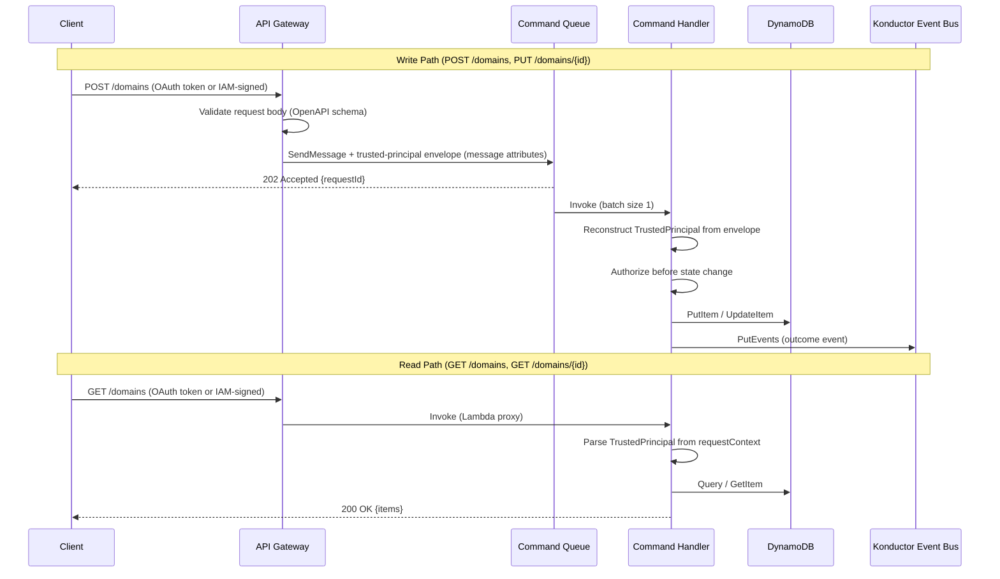

# API identity and authorization

[Documentation home](../README.md)

How OAuth and IAM identity reach handlers, and how ownership and bindings authorize resource actions. For login steps, see [authentication](../guides/authentication.md).

> **Review pending:** [D05](../reference/documentation-discrepancies.md#d05), [D08](../reference/documentation-discrepancies.md#d08) records conflicting or unverified guidance retained from the previous documentation. This reorganization does not resolve it.

## API layer

Konductor exposes two separate API Gateway surfaces, each with its own OpenAPI contract and authorization model. Both serve **environment-named stages** (`dev`, `staging`, `prod`): the stage is the environment selector for every environment-scoped operation—publishers and schema managers never name an environment, registry, or bus in a request.

- **OAuth surface** (`api/openapi-oauth.yaml`): interactive users authenticate via a Cognito user pool with controlled groups (`platform-admin`, `platform-auditor`). A REQUEST-type Lambda authorizer validates the Cognito access token (signature, issuer, expiration, `token_use`, client/audience), maps `cognito:groups` to global roles, preserves other groups as opaque team-group identifiers, and emits route-scoped allow/deny policies. Authorizer context is never cached by default (token-specific cache keys if enabled). Write operations are asynchronous (API Gateway validates the body and pushes to SQS); the decide endpoint is a direct Lambda proxy.

- **IAM surface** (`api/openapi-iam.yaml`): AWS-native automation callers authenticate with SigV4. The caller's AWS account ID serves as the principal identifier. Read endpoints (list, describe) and publisher/subscription management are available on this surface. Approval is OAuth-only and not exposed on the IAM surface.

Both surfaces inject a versioned **trusted-principal envelope** into Amazon Simple Queue Service (Amazon SQS) message attributes. Velocity Template Language (VTL) mapping templates source identity from API Gateway authorization context: `$context.authorizer.*` for OAuth and `$context.identity.*` for IAM. They never use the request body for identity.

The publish path is the exception to this mapping mechanism. Its admission Lambda builds the same envelope synchronously before enqueueing. See [Event publishing](publish-validation.md#3-the-two-halves-admission-and-delivery).

Consumer Lambda handlers reconstruct `TrustedPrincipal` and invoke resource authorization before changing state. The grant engine (`DynamoGrantEngine`, backed by `konductor-authorization-bindings`) authorizes publishing, schema writes, and subscription commands and reads.

OAuth domain registration requires an owning team group. Updates require an owner binding or a platform role. IAM automation on both paths remains unchanged.

### Identity and authorization

Konductor separates **interactive identity** (OAuth/Cognito) from **automation identity** (IAM/AWS account). The `TrustedPrincipal` contract normalizes both: the OAuth variant carries the Cognito subject, controlled global roles, and trusted team-group identifiers; the IAM variant carries the AWS account ID as the principal identifier with optional principal ARN audit provenance.

The OAuth authorizer maps exact `cognito:groups` values to global roles (`platform-admin` -> `PlatformAdmin`, `platform-auditor` -> `PlatformAuditor`) and preserves all other validated group names as opaque team-group identifiers without assigning permissions. Route-level access is enforced by the authorizer: `platform-admin` may access any method, `platform-auditor` may only GET. The approval (decide) endpoint is OAuth POST-only and additionally requires `platform-admin` in the handler (defense-in-depth).

Approval decisions derive `decidedBy` from the trusted OAuth principal context, not from caller-supplied input. The `decidedBy` field is removed from the `DecideRequest` schema and rejected by `deny_unknown_fields`. The email-link bearer GET approval path has been removed; approval notification emails direct operators to sign in to Konductor rather than providing unauthenticated decision URLs. Task tokens remain the Step Functions callback mechanism, supplied in the authenticated POST body.

The resource-authorization interface (`ResourceAuthorizer` trait) accepts `TrustedPrincipal` and returns `Allow` or `Deny`. The production implementation is `DynamoGrantEngine`, which evaluates additive role bindings from the `konductor-authorization-bindings` table with strongly consistent reads and fails closed on errors; `InMemoryGrantEngine` is its fixture-fed twin for tests and local development.

**Ownership and scoped reads.** The grant engine recognizes an `owner` role in addition to `publisher` and `subscriber`. An OAuth caller registers a domain by setting `owningTeam` to one of its team groups. Platform groups are not team groups, so platform teams cannot own domains.

The approval workflow commits the `APPROVED` transition, owner binding, and audit record in one DynamoDB transaction. Management reads enforce these boundaries:

- Platform roles and IAM automation see all domains.
- Team callers list and describe domains their teams own. Cross-team requests return `404`, just like requests for missing domains.
- `GET /domains?view=directory` provides a names-only projection to any authenticated caller for domain pickers.

Team owners can update descriptions, emails, and tags. Only platform administrators can enable or disable a domain through `POST /domains/{domainName}/state`. This switches between `ACTIVE` and `INACTIVE` without removing resources. Mutation paths reject inactive domains.

Platform administrators use the OAuth-only `GET /domains/registrations/pending` inbox. It returns the workflow `taskToken`, which other reads exclude.

### Grant engine

The grant engine answers "may this principal perform this action on this resource?" from **role bindings**: a typed principal (an issuer-qualified Cognito team group for OAuth callers, or a twelve-digit AWS account for IAM callers) holds a role (`publisher` or `subscriber`) on a domain. Bindings are additive—any one applicable binding allows—and global (domain-less) bindings are unrepresentable.

The `konductor-authorization-bindings` table stores two item types:

- **RoleBinding**—`PK = PRINCIPAL#{type}#{id}`, `SK = ROLE#{role}#DOMAIN#{domain}`. Decisions are strongly consistent point reads on these keys (one per candidate principal: each team group, or the account). Two sparse GSIs serve administration only and never feed an allow decision: `by-domain` (enumeration) and `by-binding-id` (revoke lookup).
- **AuditRecord**—`PK = GRANT#{bindingId}#AUDIT`, `SK = TS#{rfc3339}`. Every mutation commits with its audit record in one `TransactWriteItems`, so the audit trail cannot diverge from grant state. Audit items carry mutation type, trusted actor, timestamp, and before/after summary—never tokens, claims material, or principal ARNs.

Creates are conditioned on `attribute_not_exists` (identical re-creates are idempotent and answer the stored binding; a concurrent-revoke race answers 409). Revokes are durable deletes conditioned on existence and active state (unknown or raced revokes answer 404). Revocation takes effect on the next decision; there is no reconciliation worker because publisher bindings gate nothing materialized.

**Binding administration** is flat-verb, OAuth-only, and platform-admin-only: `POST /bindings`, `GET /bindings?domain=…`, `DELETE /bindings/{bindingId}`, served by the `binding-admin` Lambda. The `platform-admin` global role resolves from the controlled Cognito group, never from the grant table, so administration cannot deadlock against an empty table. The IAM surface has no binding routes—IAM callers are *governed by* bindings, they do not govern them.

**Consumer wiring**: the publish consumer, schema-admin handlers, and all subscription paths (commands and reads) authorize through `DynamoGrantEngine`, with subscription create/enable additionally gated by entitlement coverage. Domain registration and update authorize OAuth callers through ownership (register: `owningTeam` membership; update: `owner` binding or platform role); the bridging `IamOnlyAuthorizer` (allows IAM, denies OAuth) remains only on paths that are platform-operated by definition (entitlement administration on the IAM surface). A manifest-seeded parity suite (from the `evaluate-authorization-engine` spike's frozen fixtures) proves `InMemoryGrantEngine` and `DynamoGrantEngine` decide identically.

## Related contracts

- [Access-token claims](../reference/authentication.md)
- [API contracts](../reference/api.md), instead of a copied endpoint inventory
- [Entitlements and revocation](entitlements.md)
- [User and access administration](../operations/access-administration.md)
- [Authorization decisions](../decisions/README.md#identity-and-access)
