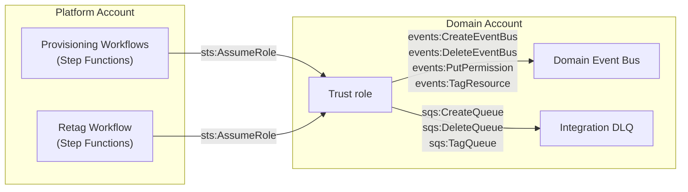

# Cross-account trust

[Documentation home](../README.md)

Trust grants Konductor access to domain accounts. Organization guardrails are a separate deny ceiling, not a replacement for trust.

## Cross-account trust model

Konductor provisions resources in domain accounts by assuming a trust role. Each domain account deploys a **trust stack** (CloudFormation template) that creates the IAM role with scoped permissions. Two kinds of platform workflow assume it: the provisioning workflows, which create and delete each environment's app-side resources, and the retag workflow, which applies a changed `costCenter` tag to them.

### Trust role permissions

The trust role (`{org}-konductor-trust-role`) is environment-independent—a single role in each domain account covers every env the platform provisions into. It grants three scoped policies:

| Policy | Actions | Resource scope |
|--------|---------|---------------|
| EventBusManagement | `events:CreateEventBus`, `DeleteEventBus`, `DescribeEventBus`, `PutPermission`, `RemovePermission`, `TagResource`, `UntagResource` | `{org}-*` event buses in the account |
| DlqManagement | `sqs:CreateQueue`, `DeleteQueue`, `GetQueueUrl`, `GetQueueAttributes`, `SetQueueAttributes`, `TagQueue`, `UntagQueue` | `{org}-*` queues in the account |
| BusToBusRoleManagement | `iam:CreateRole`, `DeleteRole`, `GetRole`, `PutRolePolicy`, `DeleteRolePolicy` | `{org}-*-b2b-*` roles. Unused: no workflow creates these roles, and subscription delivery relies on the bus resource policy described below. The policy is retained for template compatibility. |

### Subscription delivery authorization

Cross-account subscription delivery does **not** use per-subscription IAM roles. During `provision-env`, the trust role attaches a resource policy to the app-side domain bus permitting the **platform account** to `events:PutEvents` (`SetAppBusDeliveryPolicy` step). That single grant covers every current and future subscription targeting the bus—subscribe and unsubscribe never touch the consumer account. EventBridge delivers matched events using the platform-side `konductor-subscription-delivery-role`. Every domain receives this policy at provisioning time (no pre-policy domains exist; the product shipped with the step in place).

The trust role's `AssumeRolePolicyDocument` names the platform account root as principal, constrained by an `ArnEquals` condition on `aws:PrincipalArn` to exactly three roles:

1. The **Konductor function role** (`konductor-function-role`), a dedicated trust anchor. No Lambda function runs as it; the trust stack takes the platform account ID from its ARN.
2. The **Provisioning workflow role** (`konductor-provisioning-workflow-role`), which the provisioning and deprovisioning workflows use to create and delete the app-side bus and DLQ and to set the bus delivery policy.
3. The **Retag workflow role** (`konductor-retag-workflow-role`), which retags the app-side bus and DLQ when a domain's `costCenter` changes.

The condition form (rather than role-ARN principals) is deliberate: IAM pins role-ARN principals to unique IDs at save time, which would sever trust every time the core stack is redeployed. `aws:PrincipalArn` is string-matched per request, and the platform role names are fixed, so trust survives platform redeploys without any trust stack update.

The retag role arrived after the first two. A trust stack deployed before it lacks the third ARN, so retagging app-side resources fails with an assume-role denial until the stack is redeployed with `RetagWorkflowRoleArn` (see the [installation handoff](../operations/trust-stack-deployment.md#installation-handoff-three-role-recipe)).

## Onboarding and guardrails

Use [trust-stack deployment](../operations/trust-stack-deployment.md) for onboarding. The [guardrail runbook](../operations/guardrails.md) owns policy attachment, recovery-first bootstrap, acceptance evidence, coverage limits, and rollback. See the [guardrail decision](../decisions/protect-domain-managed-resources.md) for rationale.
