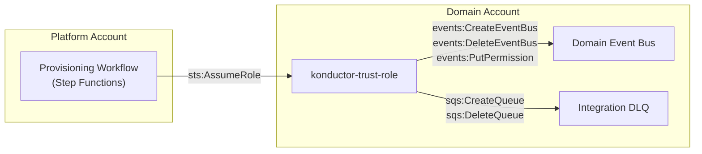

# Cross-account trust

[Documentation home](../README.md)

Trust grants Konductor access to domain accounts. Organization guardrails are a separate deny ceiling, not a replacement for trust.

> **Review pending:** [D03](../reference/documentation-discrepancies.md#d03), [D09](../reference/documentation-discrepancies.md#d09) records conflicting or unverified guidance retained from the previous documentation. This reorganization does not resolve it.

## Cross-account trust model

Konductor provisions resources in domain accounts by assuming a trust role. Each domain account deploys a **trust stack** (CloudFormation template) that creates the IAM role with scoped permissions.

### Trust role permissions

The trust role (`{org}-konductor-trust-role`) is environment-independent—a single role in each domain account covers every env the platform provisions into. It grants three scoped policies:

| Policy | Actions | Resource scope |
|--------|---------|---------------|
| EventBusManagement | `events:Create/Delete/Describe/PutPermission/RemovePermission` | `{org}-*` event buses |
| DlqManagement | `sqs:Create/Delete/Set/GetQueueAttributes` | `{org}-*` queues |
| BusToBusRoleManagement | `iam:Create/Delete/Put/DeleteRolePolicy/GetRole` | `{org}-b2b-*` roles (unused—retained for template compatibility; subscription delivery uses the provision-time resource policy instead) |

### Subscription delivery authorization

Cross-account subscription delivery does **not** use per-subscription IAM roles. During `provision-env`, the trust role attaches a resource policy to the app-side domain bus permitting the **platform account** to `events:PutEvents` (`SetAppBusDeliveryPolicy` step). That single grant covers every current and future subscription targeting the bus—subscribe and unsubscribe never touch the consumer account. EventBridge delivers matched events using the platform-side `konductor-subscription-delivery-role`. Every domain receives this policy at provisioning time (no pre-policy domains exist; the product shipped with the step in place).

The trust role's `AssumeRolePolicyDocument` names the platform account root as principal, constrained by an `ArnEquals` condition on `aws:PrincipalArn` to exactly two roles:

1. The **Konductor function role** (trust anchor for Lambda-based operations)
2. The **Provisioning workflow role** (for Step Functions SDK integrations)

The condition form (rather than role-ARN principals) is deliberate: IAM pins role-ARN principals to unique IDs at save time, which would sever trust every time the core stack is redeployed. `aws:PrincipalArn` is string-matched per request, and the platform role names are fixed, so trust survives platform redeploys without any trust stack update.

## Onboarding and guardrails

Use [trust-stack deployment](../operations/trust-stack-deployment.md) for onboarding. The [guardrail runbook](../operations/guardrails.md) owns policy attachment, recovery-first bootstrap, acceptance evidence, coverage limits, and rollback. See the [guardrail decision](../decisions/protect-domain-managed-resources.md) for rationale.
