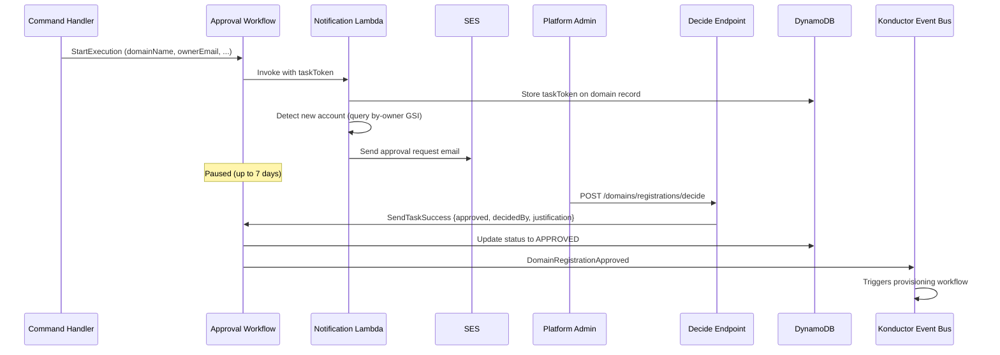

# Domain lifecycle and approval

[Documentation home](../README.md)

How domain ownership, registration, and approval fit together. For API tasks, use the [domain guide](../guides/domains.md).

> **Review pending:** [D02](../reference/documentation-discrepancies.md#d02) records conflicting or unverified guidance retained from the previous documentation. This reorganization does not resolve it.

## Account-per-domain ownership model

Konductor follows an **account-per-domain** principle: one AWS account hosts one domain's application-side resources. The trust stack is deployed once per account, and the `{org}-{env}-{domain}-*` resource naming convention assumes no two domains share an account. This keeps blast radius bounded and trust-role IAM policies simple.

Each domain has a **primary owner** (the account that hosts the resources) and at least one required **secondary owner** who acts as co-manager and backup decision-maker. Secondary owners can approve changes and provide a fallback if the primary owner is unavailable.

Domain names are globally unique and serve as the sole domain identifier. There is no separate universally unique identifier (UUID). This follows domain-driven design (DDD) and event-driven architecture (EDA) principles: the domain name identifies the bounded context. Conditional writes on the partition key enforce uniqueness atomically in Amazon DynamoDB.

## Status model

See [domain statuses](../reference/domain-statuses.md) for the state diagram, status meanings, and owner actions.

## Approval workflow

Domain registration requires human approval before any infrastructure is created. The approval workflow uses the Step Functions **waitForTaskToken** pattern to pause execution until a platform administrator calls the decide endpoint.

**Rejection path:** If the admin rejects, the decide Lambda calls `SendTaskFailure` with error `RegistrationRejected` and a JSON cause carrying `decidedBy`/`justification`. The workflow catches that error by name, parses the decision metadata from the cause (falling back to `decidedBy: unknown` if the cause is malformed), updates status to `REJECTED`, and emits `DomainRegistrationRejected`—an EventBridge rule then triggers the rejection notification Lambda to email the domain owner.

**Failure paths are separated by catch route.** The wait state distinguishes three outcomes that must not be conflated:

| Outcome | Signal | Terminal status | Event |
|---|---|---|---|
| Human rejection | `RegistrationRejected` custom error | `REJECTED` | `DomainRegistrationRejected` |
| 7-day timeout | `States.Timeout` | `REJECTED` (`decidedBy: system:timeout`) | `DomainRegistrationRejected` |
| Notification delivery failure | residual `States.ALL` (for example, SES identity unverified) | `APPROVAL_NOTIFICATION_FAILED` | `DomainApprovalNotificationFailed` (owner-facing "registration delayed" email + operator SNS; no technical detail) |

The registration context is captured in a Pass state *before* the wait (Task `Assign` only applies on success, so capturing it on the wait state would leave failure paths without it). Every execution path ends with a terminal status write and exactly one lifecycle event.

**New account detection:** The notification Lambda queries the `by-owner` GSI to check if the owner account has any existing `ACTIVE` domains. If this is the first domain for that account, the approval email flags it with a trust-stack deployment advisory.

> Workflow definition: `domain-management/state-machines/approval.asl.yaml`

## After approval

[Provisioning](provisioning.md) owns resource creation and rollback. [Domain recovery](../operations/domain-recovery.md) contains troubleshooting and teardown procedures.
