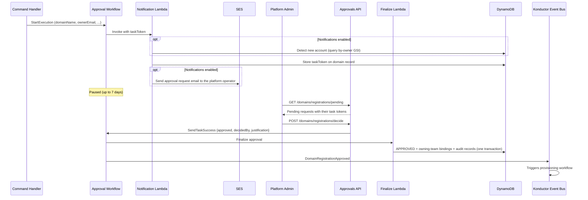

# Domain lifecycle and approval

[Documentation home](../README.md)

How domain ownership, registration, and approval fit together. For API tasks, use the [domain guide](../guides/domains.md).

## Account-per-domain ownership model

Konductor follows an **account-per-domain** principle: one AWS account hosts one domain's application-side resources. The trust stack is deployed once per account, and the `{org}-{env}-{domain}-*` resource naming convention assumes no two domains share an account. This keeps blast radius bounded and trust-role IAM policies simple.

Each domain records an **owner account** (`ownerAccountId`, which hosts the application-side resources unless `environmentAccounts` names another account for an environment), a primary **owner email**, and at least one required **secondary owner email**. Every owner notification goes to all of these addresses, so a secondary owner is the backup contact when the primary owner is unavailable. The addresses grant no permissions. Role bindings decide who can manage the domain, starting with the bindings that approval creates for the registration's `owningTeam` (see [authorization](authorization.md)).

Domain names are globally unique and serve as the sole domain identifier. There is no separate universally unique identifier (UUID). This follows domain-driven design (DDD) and event-driven architecture (EDA) principles: the domain name identifies the bounded context. Conditional writes on the partition key enforce uniqueness atomically in Amazon DynamoDB.

## Status model

See [domain statuses](../reference/domain-statuses.md) for the state diagram, status meanings, and owner actions.

## Registration admission

`POST /domains` is accepted at the edge and processed asynchronously: the API enqueues the command to Amazon SQS and returns a `requestId`, and the domain command handler consumes it. Admission runs before any approval workflow starts, and resolves to one of three outcomes.

**Refused, no record.** Checks that depend only on the request reject it outright: an OAuth caller's `owningTeam` authorization, the naming rules (including reserved names like `konductor`), the `environmentAccounts` keys and values, and the `costCenter` value. The handler emits `RegisterDomainFailed` and writes nothing.

**Recorded as `REJECTED`.** The resource-name collision check depends on platform state. It confirms that the names the domain would occupy are free: each environment's platform event bus and the `/namespace/{domainName}` parameter. If any of them is taken, the handler records the request as `REJECTED` with `decidedBy: system` and a justification that lists the colliding resources. It emits `RegisterDomainFailed` and never starts approval. Like an accepted registration, a new `REJECTED` record counts toward the [domain ceiling](../reference/data-model.md#domain-count-ceiling), and the name stays re-registrable. If the deployment is already at the ceiling, the handler writes nothing and `RegisterDomainFailed` reports the ceiling instead.

**Accepted.** The handler writes the `PENDING_APPROVAL` record and charges the deployment's domain counter in a single DynamoDB transaction. The transaction fails if a live record already holds the name (the global-uniqueness guarantee) or if the deployment has reached its domain ceiling. Re-registering a name whose record is `REJECTED` replaces that record without charging the counter again. The accepted record stamps the platform's current environment list, which is snapshotted here and never re-read, so a later change to the platform's environments does not alter an existing domain. The handler then starts the approval workflow below.

## Approval workflow

Domain registration requires human approval before any infrastructure is created. The approval workflow uses the Step Functions **waitForTaskToken** pattern to pause execution until a platform administrator calls the decide endpoint.

The platform administrator decides from the console's **Pending approvals** inbox, which reads the same pending list and task tokens. The approval email only points the platform operator to that inbox; it carries no approve or reject links. With notifications disabled, the notification Lambda stores the task token and sends nothing, and the request waits in the inbox.

**Approval path:** the finalize Lambda commits the `APPROVED` status in one transaction with, when the registration named an `owningTeam`, that team's `owner`, `publisher`, and `subscriber` bindings and their audit records. A domain therefore never reaches `APPROVED` without its ownership. The workflow then emits `DomainRegistrationApproved`, which starts provisioning and, when notifications are enabled, the approval email to the owners.

**Rejection path:** If the admin rejects, the decide Lambda calls `SendTaskFailure` with error `RegistrationRejected` and a JSON cause carrying `decidedBy`/`justification`. The workflow catches that error by name, parses the decision metadata from the cause (falling back to `decidedBy: unknown` if the cause is malformed), updates status to `REJECTED`, and emits `DomainRegistrationRejected`. When notifications are enabled, an EventBridge rule then triggers the rejection notification Lambda, which emails the owner and secondary owners.

**Failure paths are separated by catch route.** The wait state distinguishes three outcomes that must not be conflated:

| Outcome | Signal | Terminal status | Event |
|---|---|---|---|
| Human rejection | `RegistrationRejected` custom error | `REJECTED` | `DomainRegistrationRejected` |
| 7-day timeout | `States.Timeout` | `REJECTED` (`decidedBy: system:timeout`) | `DomainRegistrationRejected` |
| Notification failure | residual `States.ALL`: the notification Lambda failed (for example, an SES service error or a failed task-token write) | `APPROVAL_NOTIFICATION_FAILED` | `DomainApprovalNotificationFailed` (with notifications enabled: an operator SNS message and an owner-facing "registration delayed" email, without technical detail) |

A permanent SES rejection does not take the failure route. The notification Lambda logs `MessageRejected` or `BadRequestException` and returns success, so the request stays `PENDING_APPROVAL` in the inbox without an email, and the 7-day timeout still applies.

The registration context is captured in a Pass state *before* the wait (Task `Assign` only applies on success, so capturing it on the wait state would leave failure paths without it). Every execution path ends with a terminal status write and exactly one lifecycle event.

**New account detection:** When notifications are enabled, the notification Lambda queries the `by-owner` GSI to check if the owner account has any existing `ACTIVE` domains. If this is the first domain for that account, the approval email flags it with a trust-stack deployment advisory.

> Workflow definition: `domain-management/state-machines/approval.asl.yaml`

## After approval

[Provisioning](provisioning.md) owns resource creation and rollback. [Domain recovery](../operations/domain-recovery.md) contains troubleshooting and teardown procedures.
