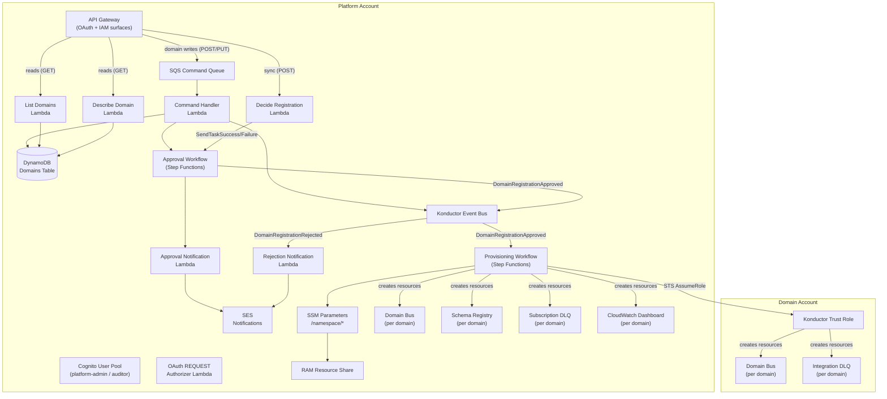

# Platform boundaries

[Documentation home](../README.md)

Account layout and deployment boundaries. Start with the [architecture overview](README.md); use this page for the detailed topology.

## System overview

Konductor runs in a dedicated **platform account** and provisions domain resources into **domain accounts** via cross-account IAM roles. All control-plane state lives in the platform account; domain accounts only contain the resources their domains need.

### Key design decisions

The platform uses the following design boundaries:

- **Three-stack deployment model**: `notifications-stack.yaml` (optional, SES identities), `konductor-core-stack.yaml` (core platform resources, with conditional notification resources), and `trust-stack.yaml` (per domain account). A fourth, separately authorized package—`guardrail-stack.yaml` (organization-admin SCPs)—exists outside the ordinary deployment path; see [Organization Guardrails](../operations/guardrails.md).
- **Konductor is a singleton per org**—one deployment of `konductor-core-stack.yaml` per AWS organization. Most platform resources use the fixed `konductor-*` naming (no org or env segment). The domain-account trust role (`{org}-konductor-trust-role`, org-scoped for cross-org uniqueness), the Cognito resources, the public system-events bus, and the web console resources carry the org prefix instead; see [Resources and naming](../reference/resources.md#resource-namespace-convention). Domain resources use `{org}-{env}-{domain}-*` and are provisioned per environment from the platform-configured `Environments` list.
- **Small, focused Lambda functions**—one per API operation or closely related route group (for example, binding administration), with least-privilege IAM
- **Reads are synchronous; domain and subscription commands are queued.** Reads run API Gateway -> Lambda -> DynamoDB. Domain registration and update and subscription commands run API Gateway -> SQS -> Lambda and answer `202`. Publishing validates the event synchronously in an admission Lambda before it enqueues delivery. Other writes, such as approval decisions and binding administration, are synchronous Lambda calls. See [API layer](authorization.md#api-layer).
- **Step Functions for workflows**—JSONata states with AWS SDK integrations for most AWS API calls, plus Lambda tasks for notifications, the approval transaction, system-topic management, and per-environment schema and subscription steps

For the rationale, see the [Decision log](../decisions/README.md).
