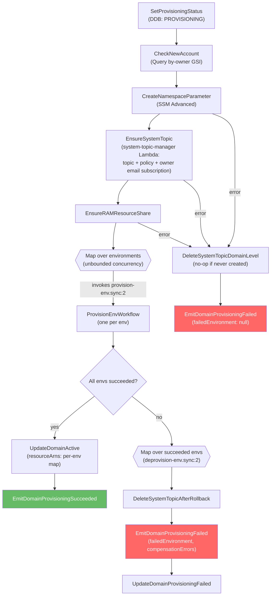
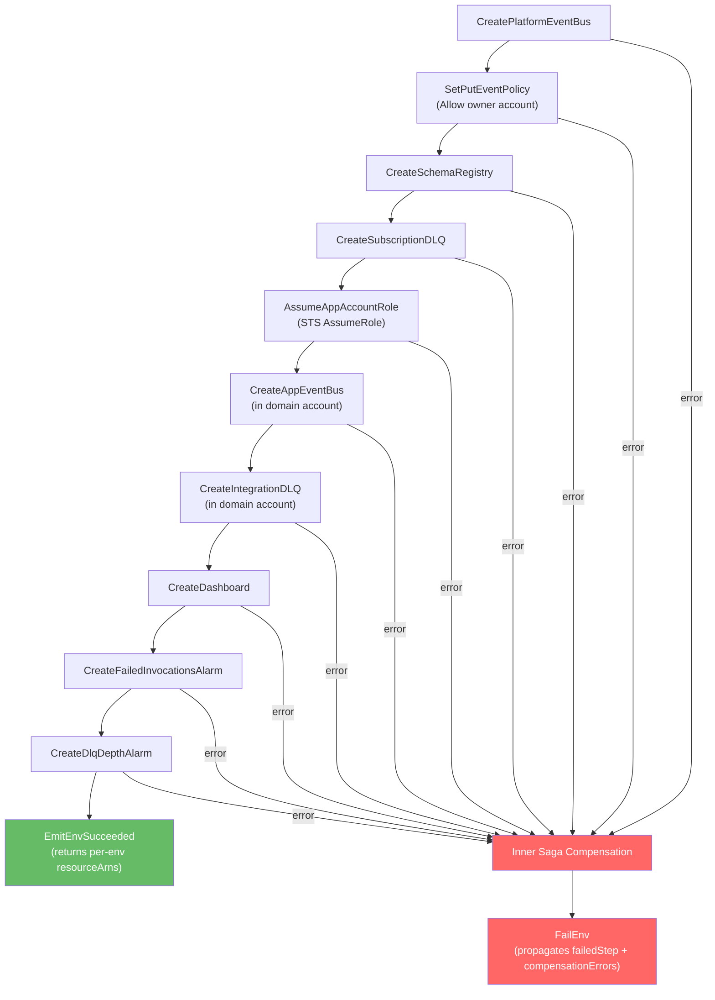

# Domain provisioning and rollback

[Documentation home](../README.md)

The domain provisioning workflow creates resource sets across configured environments. This is separate from subscription activation.

## Provisioning workflow

The provisioning workflow is triggered by the `DomainRegistrationApproved` event on the konductor bus. It creates all domain infrastructure across both the platform and domain accounts using Step Functions SDK integrations (no intermediate Lambdas).

Since approved domains are provisioned into every environment configured on the platform (for example, `dev,staging,prod`), provisioning is split across **three state machines**:

| State machine | Role |
|---------------|------|
| `provision-domain.asl.yaml` (outer) | Coordinator. Sets status, creates the domain-level namespace + RAM share, then fans out one inner execution per environment via a `Map` state with unbounded concurrency (`MaxConcurrency: 0`). Runs rollback if any env fails. |
| `provision-env.asl.yaml` (inner) | Creates all per-env resources across platform + domain accounts, with an inner saga for rollback of partial state inside a single env. |
| `deprovision-env.asl.yaml` | Idempotent teardown of a single env's resource set. Used by the outer workflow's rollback path, and reusable by a future `DELETE /domains` flow. |

**Platform-configured environments.** The list of environments to provision is set once at platform deploy time via the `Environments` SAM parameter (`CommaDelimitedList`, default `dev,staging,prod`). It is NOT supplied per registration request—registration requests only carry `domainName`, `ownerAccountId`, and `ownerEmail`. The command handler stamps the current platform env list onto the domain record at registration time so approvals and provisioning work from a stable snapshot.

**All-or-nothing contract.** The outer workflow produces one of two outcomes:

- **All envs succeed** → domain moves to `ACTIVE`, `DomainProvisioningSucceeded` event emitted with a `resourceArns` map keyed by environment.
- **Any env fails** → deprovision-env runs over every env that *did* succeed, domain moves to `PROVISIONING_FAILED`, and `DomainProvisioningFailed` is emitted with `failedEnvironment` plus any `compensationErrors` aggregated across rollback runs. The aggregation uses a JSONata array constructor (`[$rollbackResults.compensationErrors]`) rather than `$reduce`: when no env succeeded (empty rollback set) or when rollback ran cleanly, `$reduce` returns undefined and kills the state with `QueryEvaluationError`—the failure event then never fires and the domain sticks in `PROVISIONING`.

Failures in the domain-level steps (namespace parameter, RAM share) that happen **before** the Map never leave per-env artifacts behind, so their failure path updates status and emits `DomainProvisioningFailed` with `failedEnvironment: null`.

**Retry posture.** Every SDK task state in the four domain-management state machines carries a `Retry` policy (evaluated before `Catch`): throttle-prone APIs (CloudWatch alarms/dashboards, Schemas registries) retry 5 times from 2 s with full jitter; standard control-plane calls (EventBridge, SQS, SSM, RAM, DynamoDB, `putEvents`, `startExecution`) retry 3 times from 1 s. Deterministic business errors (`ResourceAlreadyExistsException`, conditional-check failures) are excluded and fail fast into compensation. Compensation steps carry the same retries—a throttled delete would otherwise record a spurious compensation error and leak the resource.

**Namespace + RAM persistence.** The SSM parameter (`/namespace/{domain}`) and the RAM resource share are created at the domain level, above the Map—they are environment-independent and are **never** rolled back. This makes the outer workflow safe to rerun on the same domain after a partial failure: the idempotent upserts avoid duplicates, and the existing shared namespace continues to be reused.

### Outer workflow (provision-domain)

### Inner workflow (provision-env)

Per-env resource creation runs in this order, with an inner saga that rolls back anything created so far if any step fails:

### Resources created per domain

See the [resource inventory](../reference/resources.md#provisioned-resources).

### Saga compensation (rollback)

There are **two layers** of compensation:

1. **Inner saga** (`provision-env`): if a per-env step fails, the inner workflow walks backwards through the resources already created **in that env** and deletes them. Best-effort—delete failures are captured in `compensationErrors` so the env fails deterministically instead of hanging.
2. **Outer rollback** (`provision-domain`): if any env's inner execution fails, the outer workflow starts `deprovision-env` for every env that had already reported success. Each deprovision is idempotent (treats "already gone" as a no-op) and collects its own per-step `compensationErrors`, which the outer workflow aggregates into the `DomainProvisioningFailed` event payload.
3. **Domain-level topic cleanup**: every failure path (domain-level step failure, or rollback after environment failures — including zero successful environments) deletes the managed `{org}-{domain}-system-events` SNS topic through the `system-topic-manager` Lambda, which verifies the Konductor ownership tags before deleting (topic deletion removes its subscriptions, including the default owner email one). A cleanup failure is recorded in `compensationErrors`; a missing topic is a no-op, so paths that failed before `EnsureSystemTopic` stay safe. The ACTIVE commit records the ARN as top-level `systemEventsTopicArn` on the domain record. `EnsureSystemTopic` also subscribes the domain owner email as the topic's default endpoint; the subscription stays pending until the owner confirms the SNS email. A later committed owner-email change re-points that default subscription through the `konductor-domain-owner-email-change` rule.

> Workflow definitions:
>
> - Outer: `domain-management/state-machines/provision-domain.asl.yaml`
> - Per-env provision: `domain-management/state-machines/provision-env.asl.yaml`
> - Per-env deprovision: `domain-management/state-machines/deprovision-env.asl.yaml`

`deprovision-env` is intentionally standalone—it is the right primitive for a future `DELETE /domains` flow, which would iterate over the domain record's `environments` and tear down each env before removing the domain-level namespace + RAM association (scope: not included in this change).

## Related decisions

- [Multi-environment provisioning](../decisions/multi-env-domain-provisioning.md)
- [Failure-path hardening](../decisions/harden-workflow-failure-paths.md)
