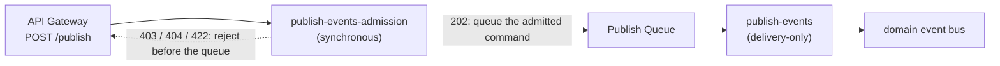
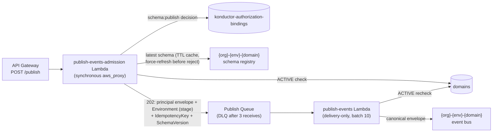

# Publish validation

Konductor for Amazon EventBridge validates publish requests before accepting
them for delivery. This document explains the admission checks, delivery
guarantees, and failure cases that shaped the design.

Read this if you are about to modify the publish path, review a change to it,
or explain its behavior to a producer team. For the producer-facing how-to,
see [Publish events](../guides/publishing-events.md). For the `validate-at-ingest`
decision, see the [Decision log](../decisions/README.md).

## 1. The failure this design eliminates

The earlier publish path queued requests in Amazon Simple Queue Service
(Amazon SQS) before validating them. Amazon API Gateway returned a response
before an AWS Lambda consumer checked authorization and payload conformance:

```text
POST /publish ──▶ API Gateway ──▶ SQS queue ──▶ consumer Lambda ──▶ domain bus
                   (202 here)                      │
                                                   └─ authorization, schema
                                                      resolution, and payload
                                                      handling happened HERE
```

API Gateway returned `202 Accepted` when a well-formed request reached the
queue. The asynchronous consumer later checked publisher bindings, domain
status, schema existence, and payload conformance. The caller could not
observe those checks.

As a result, producers could not distinguish failed publishes from delayed
delivery. The caller received `202` and logged success. Consumer teams then
had to trace missing events backward through platform logs.

One incident made the cost concrete: a producer appended a schema version that
*removed* a field (a breaking change disguised as an append). Events stamped
with the new version no longer matched what consumers expected, and nothing in
the platform flagged it—nothing ever checked conformance. The append itself
was legal; there was no enforcement point anywhere in the pipeline.

The design goal is to detect every decidable failure before queueing the
event. If the platform can determine that a publish cannot succeed, it must
return enough detail for the caller to fix the request.

## 2. The promise of `202`

The redesign turns `202 Accepted` from "your request is queued" into a promise:

> A `202` means the caller was authenticated and authorized, the target domain
> is live, the payload conforms to the schema's latest version, and the event
> is durably queued. Delivery from that point is the platform's problem.

Admission performs every check that it can complete synchronously. Two
delivery-time failures remain:

- A domain might be disabled between admission and delivery. Delivery
  rechecks the domain status.
- Amazon EventBridge might return a transient failure. The queue retains
  the event for retry.

## 3. The two halves: admission and delivery

The publish path is now two Lambda functions with a queue between them:



**Admission** (`publish-events-admission`) runs synchronously behind
`POST /publish`. It performs every check that can fail, in a deliberate order,
and enqueues only publishes that passed all of them. Its single write—the
`SendMessage` to the queue—*is* the commit: once that succeeds, the event is
durable and the caller gets `202`.

**Delivery** (`publish-events`) consumes the queue. It performs no
authorization, no schema fetch, and no payload validation. It rechecks domain
liveness, builds the canonical envelope, and calls `PutEvents`.

Separate functions preserve three properties:

- **The queue boundary is worth keeping.** It absorbs publish bursts, decouples
  ingest availability from EventBridge availability, and gives delivery retries
  somewhere durable to live. A fully synchronous path would re-introduce
  backpressure coupling the queue exists to remove.
- **Failure isolation.** A delivery bug delays events but does not block
  admission. An admission bug returns visible `503` responses rather than
  silently accepting events that the platform cannot validate.
- **Least privilege.** Delivery no longer needs to read the authorization
  bindings table or the schema registry, so its AWS Identity and Access
  Management (IAM) role loses both permissions. The queue enforces the same
  boundary: IAM grants `SendMessage` to the admission role only. A resource
  policy on the queue denies `sqs:SendMessage` to every other principal, so
  even a same-account workload with broad SQS permissions cannot inject a
  command that skips validation. The deliberate trade-off:
  dead-letter queue (DLQ) redrive through the console or command line is
  also denied. Republish through `/publish` instead. The DLQ retains the
  original message body, and admission validates it again.

## 4. What admission checks, and why in that order

Admission checks each request in the following order:

1. **Request shape (`400`).** The body must be exactly
   `{domain, eventName, data, idempotencyKey?}`. Unknown fields are rejected —
   a caller who believes they supplied a version, a registry, or a source must
   learn immediately that the platform ignored nothing by accident.
2. **Authorization (`403`).** The grant engine decides `schema:publish` on the
   domain *before* the domain is looked up. This is deliberate: checking
   existence first would let an unauthorized caller probe which domains and
   schemas exist by comparing `403` and `404`. Denial before access discloses
   nothing.
3. **Domain liveness (`404`).** The domain must exist and be `ACTIVE`. A
   disabled domain rejects all publishes—this is how platform operators drain
   a domain without touching bindings.
4. **Schema resolution (`404`).** The latest version of `{org}-{domain}@{eventName}`
   is resolved from the stage-selected environment's registry. The schema is
   the contract the payload is about to be checked against; without it there is
   nothing to validate.
5. **Payload conformance (`422`).** `data` is validated against that schema
   document, compiled as JSON Schema draft-4. Violations come back as a list of
   human-readable, instance-located messages (`"total": -5 is less than the
   minimum of 0`), capped so a pathological payload cannot produce an unbounded
   response.
6. **Envelope deliverability (`400`).** Admission constructs the exact
   EventBridge entry the delivery step would send—same source, detail-type,
   version stamp, and payload—and rejects the request if it fails structural
   or size validation (256 KiB entry limit). Without this step, a conforming
   but oversized payload would earn a `202` and then fail deterministically on
   every delivery retry until it reached the DLQ.
7. **Enqueue (`202`).** Only now does anything durable happen.

Steps 2–6 each answer *before* touching anything the caller is not entitled to
know about, and no step writes anything except the last.

## 5. Reading the answers

Use the status code to distinguish invalid requests from platform failures.

| Status | Meaning | What the caller should do |
|--------|---------|---------------------------|
| `400` | The request body is malformed, or the generated entry would exceed the EventBridge size limit | Fix the request shape or reduce the payload size |
| `403` | No publisher binding for this principal on this domain | Ask the platform team for a binding |
| `404` | Domain missing/inactive, or no schema for this event in this environment | Check domain status; register the schema first |
| `422` | The payload violates the schema's latest version | Fix the payload (violations are listed in `message`) |
| `503` | The platform could not *evaluate* the request (registry unreachable, stored schema unusable, queue write failed) | Retry with backoff—this is never a rejection |

Two distinctions determine how callers respond:

**`422` versus `400`.** A `400` says "this is not a well-formed publish
request". A `422` says "this is a perfectly good publish request whose payload
breaks the event contract". Keeping them separate lets monitoring distinguish
client bugs (400—the caller's HTTP code is wrong) from contract drift (422 —
the caller's *data* diverged from the schema). These have different owners and
different urgencies.

**`503` is never a rejection.** A `503` means Konductor could not determine
whether the publish is valid. The registry might have timed out, or a stored
schema might not compile. The retryable response avoids both silent
acceptance and an incorrect claim that the producer supplied invalid data.

## 6. The schema cache and the refresh-before-reject rule

Calling the Schemas API on every publish would add a network hop and a hard
dependency to the hot path. Admission therefore keeps an in-memory cache keyed
by `(environment, schema)` holding `{version, content, fetchedAt}`, with a
time to live (TTL) of at most 60 seconds.

A cache introduces an obvious hazard: what if a producer appends schema version
4, immediately publishes a version-4-shaped payload, and the cache still holds
version 3? The new payload fails validation against the stale schema and gets a
spurious `422`. This is not a corner case—"append schema, publish new shape"
is the *normal* evolution workflow.

The rule is: **a cached schema can admit a payload, but it cannot reject
one.** When validation fails against a cached entry, admission force-fetches
the schema from the registry and validates once more against the authoritative
latest version. The `422` is returned only if the payload fails against the
fresh schema too. A false rejection caused by cache staleness is therefore
impossible; the cache only ever saves the *admission* path a registry call.

What about the symmetric case—a payload that passes the stale schema but
would fail the fresh one? The platform's evolution norm is additive-only: new
versions add fields and loosen constraints; they never remove. Under that norm,
any payload valid under version N is valid under every later version. Stale
*acceptance* therefore cannot admit anything the current schema forbids. The
norm is enforced mechanically: `POST /schemas/versions` only appends a
candidate that provably accepts every payload the current latest version
accepts. This is the append-time compatibility gate, `gate-schema-promotion`,
hardened by `harden-schema-compatibility-checker` to fail closed on anything
its bounded proof cannot establish. A stale cache entry can therefore only
ever lag behind on loosenings—exactly the direction the force-fetch on
rejection already covers.

One scope limit matters: the gate's proof is *pairwise*. It compares the
candidate against the latest version the append handler read, and that read
is not atomically bound to the registry write. Two appends racing the same
schema could each prove compatibility against the same predecessor and
commit in an order whose combined transition was never proven. This cache
argument assumes the pairwise invariant holds per append; serializing
competing appends (or an equivalent conditional-commit protocol) is tracked
as separate follow-up work, not provided by the gate.

One boundary is absolute: **the registry is the only authority on schema
content.** The cache is an availability hedge, refreshed on any doubt; no
DynamoDB projection or denormalized copy is ever consulted for the conformance
decision. A platform with two sources of truth for the contract will
eventually disagree with itself.

## 7. The earned stamp

Every event Konductor delivers carries `metadata.schemaVersion`, and consumers
use it to interpret the payload. For that stamp to mean anything, it must be
*earned*: the version recorded must be the version the payload was actually
validated against.

Admission sets the `SchemaVersion` SQS message attribute to the version it
validated. Delivery copies that attribute into the envelope **verbatim** —
it never re-resolves "latest" at delivery time. The alternative (resolve at
delivery) would break the invariant whenever a version is appended while a
message sits in the queue. The event would then carry a stamp for a version
its payload was never checked against.

The accepted consequence: if version 5 is appended between admission and
delivery, the event is stamped version 4—the version it provably conforms
to. Consumers migrating to version 5 should treat the stamp as a statement
about the payload, not about the registry's current state.

## 8. What the delivery consumer still does

"Delivery-only" does not mean "trusts blindly." Three responsibilities remain:

- **Domain liveness recheck.** A domain can be disabled in the seconds between
  admission and delivery; that transition must take effect for events already
  queued. This is the one synchronous check that cannot be moved to admission,
  because the race is real.
- **Envelope structural validation.** Before `PutEvents`, the constructed
  envelope is checked (positive version, non-empty identity, serializable,
  within the 256 KB entry limit for EventBridge). An invalid *generated* envelope
  means the platform's own code is broken—it is reported for retry, never
  partially delivered.
- **Retry semantics, unchanged.** Transient `PutEvents` failures are reported
  for retry; retries exhaust to the publish DLQ with all attributes intact.
  `publishedAt` derives from the SQS `SentTimestamp`, which is fixed when the
  message is first sent and survives every in-queue retry—so automatic
  retries always keep the original publish time. The one exception is a DLQ
  *redrive*, which re-sends as a new message with a new `SentTimestamp`. Given
  the queue's admission-only write policy, the sanctioned re-drive path is
  re-publishing through `/publish`, which stamps a fresh ingest time by
  definition.

## 9. Metadata in the admitted command (format 2)

Platform metadata adds a generated `metadata` block to every admitted event. The
queue message therefore became an explicitly versioned **format-2 envelope**.
It carries the supported publisher body, the resolved business/schema identity
and target, and the selected metadata revision and digest. It also carries the
generated extension values and the compiled metadata schema (or a bounded
validation descriptor) the delivery path will need. Metadata lives in the message body, not SQS attributes—the
attribute surface stays bounded and the trusted-principal attributes are
preserved unchanged.

The selection boundary is a single strongly-consistent pointer read, after
authorization:

- A request whose read lands before an activation commit may complete afterward
  under the old revision. A request reading after the commit gets the new one.
  No cross-store atomicity between DynamoDB and SQS is promised, and no
  in-flight work is invalidated.
- Missing or unreadable configuration is `503`—never a fallback to an older
  cached revision. The mutable active pointer is never TTL-cached; immutable
  revision contents cache indefinitely keyed by revision and digest.

Every generated field except `publishedAt` is a **frozen value** at enqueue.
`publishedAt` is the queue-time exception: the SQS acceptance time is unknowable
before SQS accepts. Preflight therefore uses the fixed-width UTC-millisecond
representation, and no configurable constraint may depend on its eventual value.
Delivery derives it from the recorded queue message and checks it against the
frozen built-in rule.

Delivery reads only recorded values—the format-2 body carries everything, so
a retry cannot drift and no consumer path performs configuration reads or
"repairs" a message with fresh UUIDs. A format-2 message with missing or
inconsistent fields fails processing; only an actual legacy wrapper takes the
old three-field path. Absence is legacy *recognition*, never recovery from a
malformed new-format message.

An important limitation remains: a client retry after an ambiguous enqueue
outcome is a **new admission**. For example, a request might time out after
the client has sent it. The retry might generate a new universally unique
identifier (UUID), even with the same idempotency key. The application-level
deduplication key is `idempotencyKey`; UUID metadata is not an exactly-once
guarantee. The older claim that every non-`202` proves nothing queued is
stronger than distributed enqueue can promise and is not repeated here.

## 10. Why schemas are draft-4 only, enforced at write time

Validation is only as reliable as the stored schemas. Suppose a registry could
hold a document that does not compile—malformed JSON, a non-object, an OpenAPI
3.0 document, a draft-2020-12 schema using draft-4-incompatible keywords. Then
every publish against it would fail at admission with `503`, forever. The
platform would have traded "events silently dropped" for "events rejected
loudly for a reason nobody can fix at publish time."

So the invariant is enforced at the only two places schemas enter the system:
`POST /schemas` and `POST /schemas/versions` reject any `schemaType` other than
`JSONSchemaDraft4` (`400`), and compile the content as draft-4 before writing
(`400` on failure). **Nothing unvalidatable is ever stored**, which is what
makes "admission can always validate" a guarantee rather than a hope. Draft-4
specifically is what EventBridge Schemas supports; compilation is pinned to
draft-4 semantics regardless of the document's `$schema` keyword, so ambiguity
is a defect (`503`), never a silent reinterpretation.

An audit of every org registry before rollout found exactly one schema
(`acme-billing@OrderNotification`, already draft-4), so the transitional
carve-out for legacy OpenAPI 3.0 content was dropped rather than shipped.

## 11. What this design deliberately does not do

The design excludes the following alternatives:

- **Caller-declared or pinned schema versions.** Producers cannot publish
  "against version 3." Allowing it would couple producers to consumer migration
  schedules and make the stamp meaningless (declared, not earned). The contract
  is always the latest version.
- **Overlap windows** (accept either of the last N versions). Weakens the
  contract to a union that no consumer can rely on, for marginal producer
  convenience the refresh-before-reject rule already provides.
- **Validating at delivery and DLQ-ing invalid events.** Preserves the
  silent-drop failure mode with extra steps: the publisher still learns
  nothing, and now operations owns a DLQ full of contract violations.
- **Schema-on-read** (consumers validate). Spreads the enforcement cost across
  every consumer, guarantees inconsistent enforcement, and answers the
  producer's "was my event valid?" question never.
- **API Gateway request validators.** They check request shape against a static
  model; they cannot compile a registry-resolved draft-4 document or evaluate
  `data` against it. Shape checking stays at the edge (and in serde);
  conformance checking needs the schema, which only admission has.

## 12. Where things live

The following files implement and test the publish path. The links open the
source on GitHub.

| Piece | Location |
|-------|----------|
| Admission handler | [`event-streams/functions/publish-events-admission/`](../../event-streams/functions/publish-events-admission/) |
| Delivery consumer | [`event-streams/functions/publish-events/`](../../event-streams/functions/publish-events/) |
| Validation, cache, draft-4 compile gate | [`lib/konductor-common/src/schema_validation.rs`](../../lib/konductor-common/src/schema_validation.rs) |
| Principal envelope serialization | [`lib/konductor-common/src/principal_context.rs`](../../lib/konductor-common/src/principal_context.rs) (`to_sqs_attributes`) |
| Schema write gates (draft-4 rejected with `400`) | [`event-streams/functions/schema-admin/`](../../event-streams/functions/schema-admin/) |
| Infrastructure (queue policy, IAM, alarm) | [`konductor-core-stack.yaml`](../../konductor-core-stack.yaml) |
| API contracts (`/publish` responses) | [`api/openapi-oauth.yaml`](../../api/openapi-oauth.yaml), [`api/openapi-iam.yaml`](../../api/openapi-iam.yaml) |
| Contract tests | [`lib/konductor-common/tests/api_surfaces.rs`](../../lib/konductor-common/tests/api_surfaces.rs) |

Operations: a `PublishUnavailable` metric filter on the admission log feeds the
`konductor-publish-admission-unavailable-alarm`—any firing means ingest is
degraded (registry outage, unusable stored schema, or queue failure) and
publishers are receiving `503` responses.

## Integration map

This diagram locates admission's dependencies and the delivery boundary.


