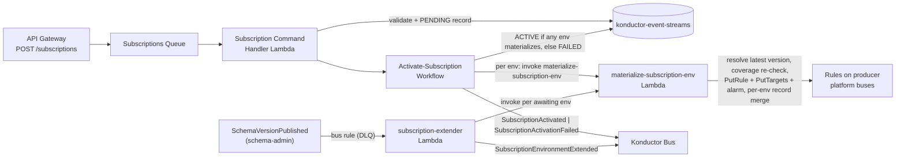

# Subscription materialization

[Documentation home](../README.md)

How subscription intent becomes EventBridge delivery rules. For consumer tasks, see [subscribing to events](../guides/subscriptions.md).

> **Review pending:** [D01](../reference/documentation-discrepancies.md#d01) records conflicting or unverified guidance retained from the previous documentation. This reorganization does not resolve it.

## Event subscriptions (schema-first)

Consumers subscribe to a **schema**—the contract—not to a bus or an endpoint: `Subscribe(consumerDomain, producerDomain, schemaName)`. The subscription always binds to the **latest** schema version in each environment's registry, pinned at subscribe time. There is only one representation of an event at any point in time; version pinning makes contract transitions observable and bounded rather than letting subscribers choose versions.

## Subscription materialization

Each subscription materializes as **one rule per environment** on the producer's platform-side bus:

- Rule name: `{consumerDomain}-{detailType}`. A version advancement updates the pattern on the same rule with `PutRule`, without deleting and recreating it.
- Version pattern: the rule matches `detail.metadata.schemaVersion` against `[pinned, pinned + 1]`—the pin plus a one-version lookahead. A producer can append and immediately publish the next version without waiting for any re-pin; the lookahead slot is what makes re-pinning asynchronous. EventBridge enforces unique rule names within each bus, preventing duplicate subscriptions. `PutRule` upserts make workflow retries idempotent.
- Target: the consumer's app-side domain bus (same env), delivered via the `konductor-subscription-delivery-role`, with `DeadLetterConfig` on the producer's per-env subscription DLQ.
- Delivery authorization: a resource policy on the consumer's app-side bus granting the **platform account** `events:PutEvents`, attached once during `provision-env` (`SetAppBusDeliveryPolicy` step). No per-subscription IAM.
- A per-subscription **zero-events alarm** (24 h without a delivery, missing data = breaching) flags silently-stopped streams—the failure mode when a producer bumps versions past a pinned subscriber.

### Re-pinning (widen, drain, narrow)

Advancing a pin never swaps a rule's pattern in place. Both pin transitions—an append in the authoring environment and a promotion landing in a later one—run the same three steps against a per-schema, per-environment `REPIN` item in the promotions table:

1. **Widen** records `[min(existing floor, current pin) ..= target + 1]` as the pattern and bumps a generation counter, then applies that pattern to every affected rule (`mode: repin` on the shared materialize function, which preserves a disabled rule's state and touches nothing but the pattern).
2. **Drain** waits out the producer flush SLA (`SchemaRepinDrainSeconds`, default 300 s, minimum 120): events already accepted under the old version keep matching the widened pattern while producers finish publishing it.
3. **Narrow** commits `[to, to + 1]` per rule and records the new pin, but only on the generation its own widen wrote—a newer widen supersedes an older narrow, so two quick appends (or an append racing a promotion) converge instead of flapping.

The generation is the coordination token: the REPIN item's conditional writes make the widen→narrow sequence safe under retries and overlapping flows. Failed per-entry re-pins are counted on the promotion's record (`repinFailed`) and surfaced by the zero-events alarm.

## Subscription flow



Activation is **independent per environment**: each producer environment materializes through the shared `materialize-subscription-env` function (resolve latest version → final coverage recheck → rule upsert → consumer-bus target → zero-events alarm → per-env record merge). There is no cross-environment compensation. The stream becomes `ACTIVE` when at least one environment materializes; it becomes `FAILED` only when the schema exists in **no** producer environment (almost always a caller typo) or every materialization fails. Where the schema is absent from an environment, that entry is recorded `AWAITING_PROMOTION`—no rule is created there—and the failure cause of a materialized attempt is recorded on the entry's `errorDetail`. A per-env `FAILED` entry is healed by re-enabling it (`POST /subscriptions/state`), which re-invokes materialization; re-subscribing an `ACTIVE` stream is an idempotent no-op.

**Promotion-following extension.** Every committed schema create/append emits `SchemaVersionPublished` from `schema-admin`; a bus rule (with DLQ) invokes the subscription extender, which extends every `ACTIVE` subscription on that schema whose record still awaits the promoted environment—materializing it with the recorded desired-enabled flag (a pre-declared pause survives promotion). Extension is idempotent: already-materialized environments are no-ops, so appends to existing environments never re-pin. The final coverage recheck inside materialization closes the revoke-between-promotion-and-extension race, fail-closed. Unsubscribe removes targets, rules, and alarms for **every producer environment** (not just recorded ones—an orphaned rule from a crashed materialization has no record entry), idempotently, then marks the record `REMOVED`, retained 90 days via TTL. Orphaned integration rules on the consumer's own bus are the application team's responsibility.

**Subscription authorization** splits by composite resource: `subscription:environment:{id}:{env}` create/enable decisions require both a `subscriber` binding on the consumer domain *and* entitlement coverage of the target detail type (self-subscription within a domain skips the coverage check—a domain always sees its own schemas); disable and unsubscribe require the binding alone, so a lapsed entitlement can never wedge a subscription. Entitlement revocation later disables the subscription's rules in every environment via the revocation pipeline—the subscription record, its pinned version, and its enabled flags are retained, and re-granting coverage does not re-enable automatically: the consumer re-enables explicitly.

Per-environment **enable/disable** maps to native rule state (for example, subscribe with prod paused during development; kill switch during incidents). Disabled ≠ removed: the contract stays signed and the pinned version is retained.

## Subscription lifecycle

```text
PENDING ──any env materializes──> ACTIVE ──unsubscribe──> REMOVED (TTL 90d)
   └────no env materializes─────> FAILED
```

Per-environment entries carry their own status—`PENDING`, `ACTIVE`, `AWAITING_PROMOTION` (schema not yet in that environment; extends automatically when it arrives), `FAILED` (materialization failed; heal by re-enabling)—which may diverge from the overall status and from each other.

## Schema discovery (subscriber catalog)

`GET /schemas?consumerDomain={domain}` is the **subscriber catalog**: the caller's current entitlements are expanded against the producers' per-environment registries—`*` grants list the whole registry, prefix grants list and filter, exact grants look the schema up directly. Overlapping grants deduplicate into one entry per schema reporting the latest version per environment, so version skew is visible before subscribing. Every entry is, by construction, currently subscribable by the caller.

Pagination is a **watermark cursor**, not an offset: the caller's sources are ordered by producer domain, each page resumes at the watermark, and listing stops when the page fills (max 50). The cursor carries only the watermark plus a hash of the filter set—no authorization state—so coverage granted mid-sequence behind the watermark never appears on later pages, and revoked coverage cannot be re-emitted. A filter mismatch answers 400. `GET /schemas/{schemaName}?consumerDomain=…&domain=…` runs the same coverage check and returns the latest content per environment; uncovered targets answer 403, absent ones 404. Platform roles (`platform-admin`, `platform-auditor`) omit `consumerDomain` and receive the platform-wide catalog sourced from ACTIVE domains; non-platform callers must name a consumer domain they hold a `subscriber` binding on. Read-only; schema writes go through the publisher schema-management endpoints above.

## Related topics

- [Canonical event envelope](../reference/event-envelope.md)
- [Entitlement revocation](entitlements.md)
- [Promotion-following decision](../decisions/follow-schema-promotion.md)
- [Subscription write-path records](../development/side-effects/subscriptions.md)
