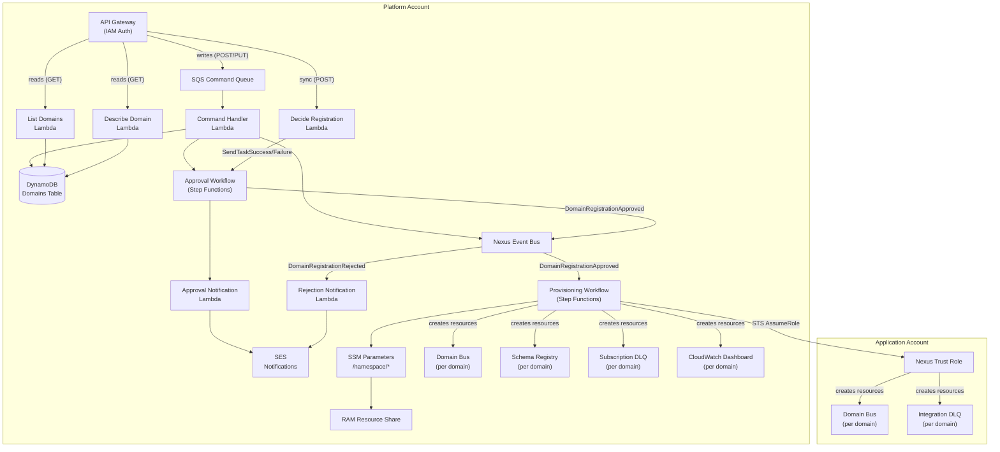
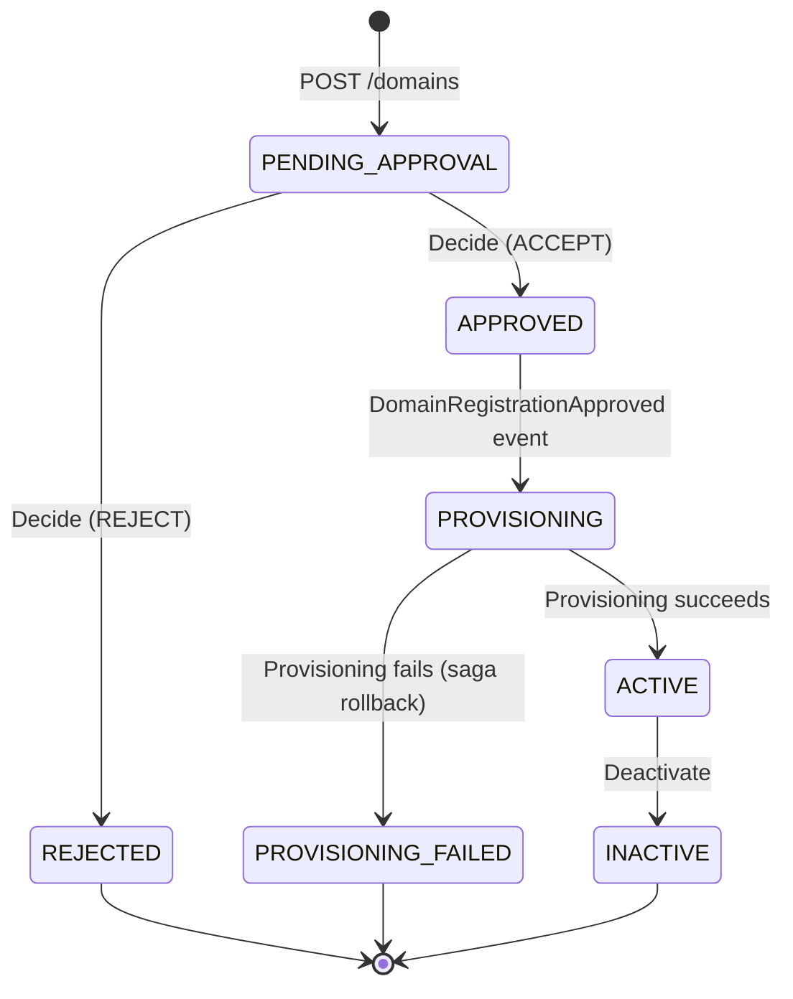
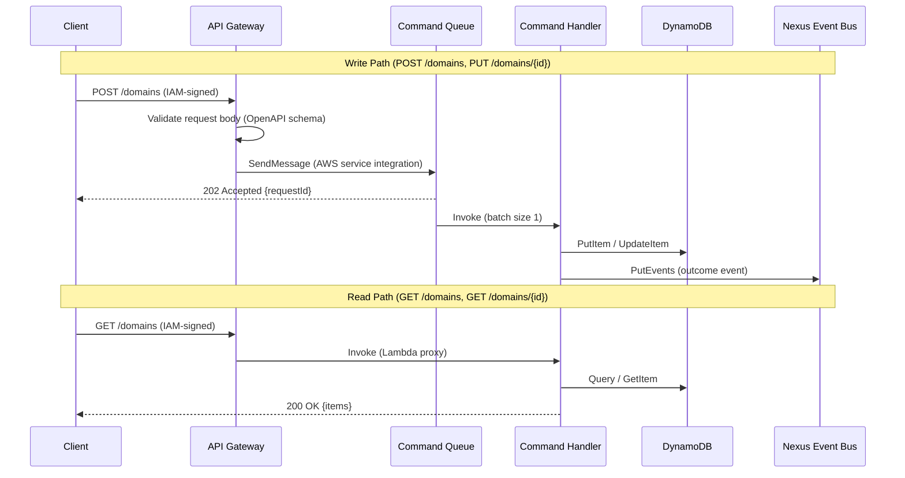
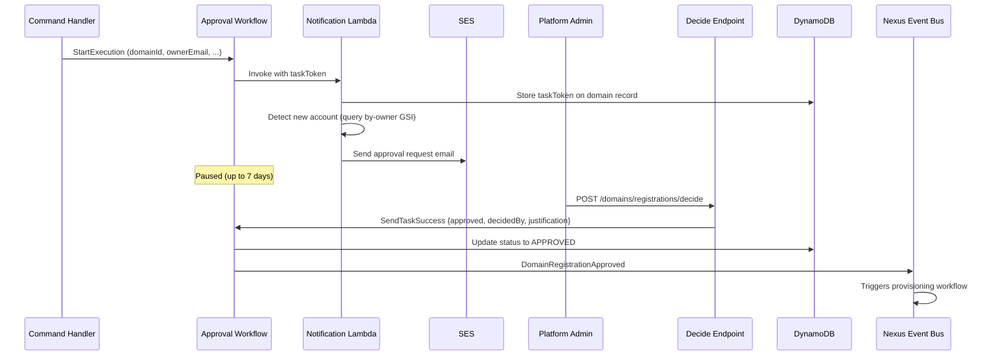
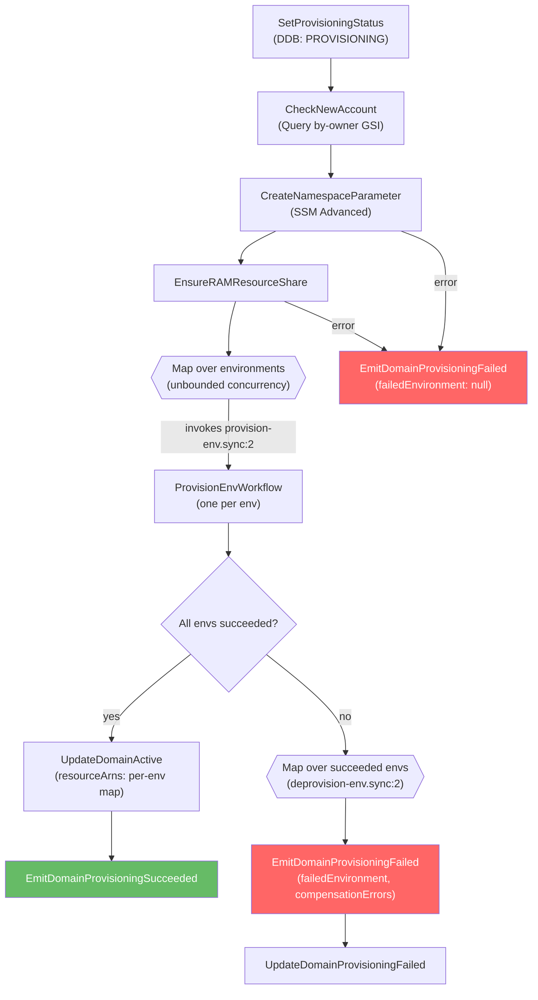
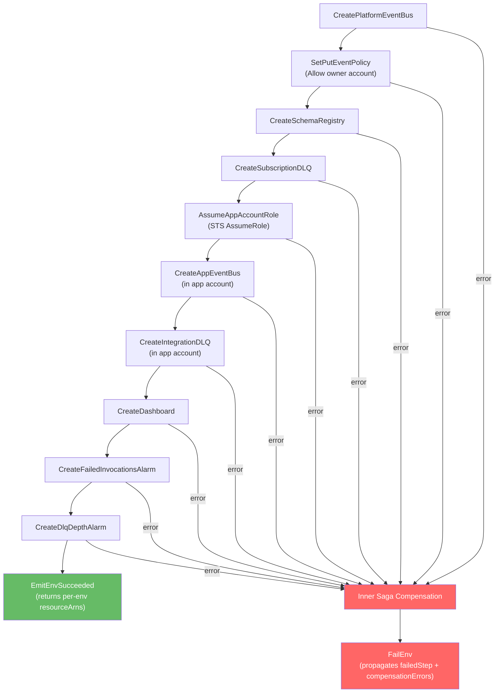
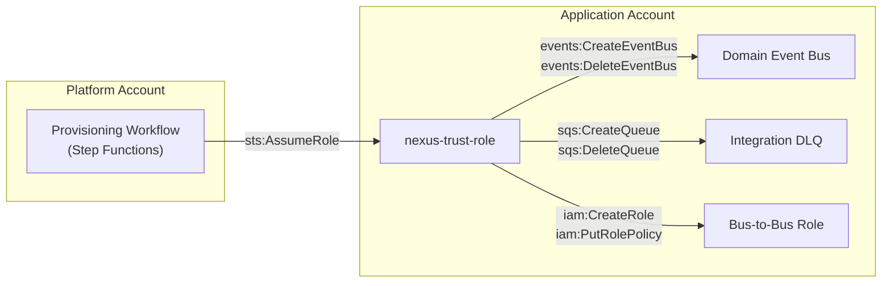
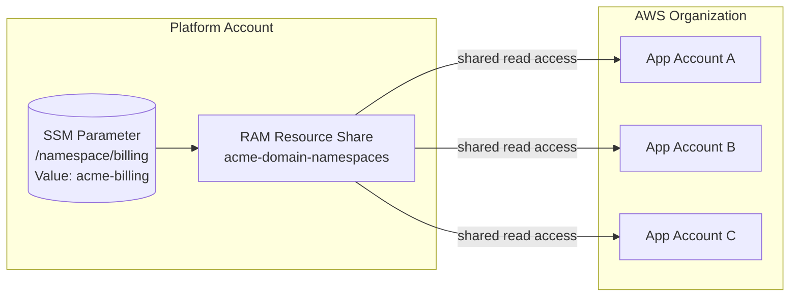

# EventBridge Nexus Architecture

## The Problem

Cross-account EventBridge is powerful but operationally expensive. Setting up event routing between accounts requires creating event buses, rules, IAM roles, resource policies, DLQs, and monitoring in both producer and consumer accounts. For a single domain integration:

- A developer manages **12+ AWS resources** across two accounts
- First-event latency is **1-2 days** of infrastructure wrangling
- Each team reinvents the same resource topology with subtle drift
- Platform teams have no visibility into which domains exist or who owns them

EventBridge Nexus eliminates this complexity. It gives platform teams a governance layer for domains and routing, while application teams get a simple API to register, publish, and subscribe to events without ever touching EventBridge resources directly.

---

## System Overview

Nexus runs in a dedicated **platform account** and provisions domain resources into **application accounts** via cross-account IAM roles. All control-plane state lives in the platform account; application accounts only contain the resources their domains need.



### Key Design Decisions

- **Three-stack deployment model**: `notifications-stack.yaml` (optional, SES identities), `nexus-core-stack.yaml` (core platform resources, with conditional notification resources), and `trust-stack.yaml` (per application account)
- **Nexus is a singleton per org** — one deployment of `nexus-core-stack.yaml` per AWS Organization. Platform resources use the fixed `nexus-*` naming (no org or env segment). The app-account trust role is the one exception (`{org}-nexus-trust-role`, org-scoped for cross-org uniqueness). Domain resources use `{org}-{env}-{domain}-*` and are provisioned per environment from the platform-configured `Environments` list.
- **One Lambda per API operation** — small, focused functions with least-privilege IAM
- **Reads are synchronous** (API Gateway -> Lambda -> DynamoDB); writes are asynchronous (API Gateway -> SQS -> Lambda -> EventBridge)
- **Step Functions for workflows** — no intermediate Lambdas for AWS API calls; uses SDK integrations with JSONata

> For the rationale behind these decisions, see [decisions.md](decisions.md).

---

## Account-Per-Domain Ownership Model

Nexus follows an **account-per-domain** principle: one AWS account hosts one domain's application-side resources. The trust stack is deployed once per account, and the `{org}-{env}-{domain}-*` resource naming convention assumes no two domains share an account. This keeps blast radius bounded and trust-role IAM policies simple.

Each domain has a **primary owner** (the account that hosts the resources) and optional **secondary owners** who act as co-managers and backup decision-makers. Secondary owners can approve changes and provide a fallback if the primary owner is unavailable.

Domain names are **globally unique** and serve as the sole domain identifier throughout the system — there is no separate UUID. This follows DDD/EDA principles where the domain name IS the bounded context identifier. Uniqueness is enforced atomically by DynamoDB's partition key constraint.

---

## Domain Lifecycle

A domain moves through a well-defined status progression from registration to active use:



| Status | Meaning |
|--------|---------|
| `PENDING_APPROVAL` | Registration submitted, awaiting human decision |
| `APPROVED` | Approved by platform admin, provisioning not yet started |
| `REJECTED` | Registration denied, owner notified via email |
| `PROVISIONING` | Infrastructure creation in progress |
| `ACTIVE` | All resources created, domain is operational |
| `PROVISIONING_FAILED` | Infrastructure creation failed, compensating transactions completed |
| `INACTIVE` | Domain deactivated, resources remain but domain is non-operational |

---

## API Layer

The REST API uses IAM authorization and is defined in `api/openapi.yaml`. Write operations are asynchronous — API Gateway validates the request body and pushes it directly to SQS without invoking a Lambda.



### Endpoints

| Method | Path | Type | Handler |
|--------|------|------|---------|
| `POST` | `/domains` | Async (SQS) | `domain-registrations` (register) |
| `GET` | `/domains` | Sync (Lambda proxy) | `list-domains` |
| `GET` | `/domains/{domainId}` | Sync (Lambda proxy) | `describe-domain` |
| `PUT` | `/domains/{domainId}` | Async (SQS) | `domain-registrations` (update) |
| `POST` | `/domains/registrations/decide` | Sync (Lambda proxy) | `decide-registration` |

The command handler Lambda receives SQS messages with a `HttpMethod` message attribute and dispatches to the appropriate handler (`register` for POST, `update` for PUT).

---

## Approval Workflow

Domain registration requires human approval before any infrastructure is created. The approval workflow uses the Step Functions **waitForTaskToken** pattern to pause execution until a platform administrator calls the decide endpoint.



**Rejection path:** If the admin rejects, the workflow updates status to `REJECTED`, emits `DomainRegistrationRejected`, and an EventBridge rule triggers the rejection notification Lambda to email the domain owner.

**New account detection:** The notification Lambda queries the `by-owner` GSI to check if the owner account has any existing `ACTIVE` domains. If this is the first domain for that account, the approval email flags it with a trust-stack deployment advisory.

> Workflow definition: `domain-management/state-machines/approval.asl.yaml`

---

## Provisioning Workflow

The provisioning workflow is triggered by the `DomainRegistrationApproved` event on the nexus bus. It creates all domain infrastructure across both the platform and application accounts using Step Functions SDK integrations (no intermediate Lambdas).

Since approved domains are provisioned into every environment configured on the platform (e.g., `dev,staging,prod`), provisioning is split across **three state machines**:

| State machine | Role |
|---------------|------|
| `provision-domain.asl.yaml` (outer) | Coordinator. Sets status, creates the domain-level namespace + RAM share, then fans out one inner execution per environment via a `Map` state with unbounded concurrency (`MaxConcurrency: 0`). Runs rollback if any env fails. |
| `provision-env.asl.yaml` (inner) | Creates all per-env resources across platform + app accounts, with an inner saga for rollback of partial state inside a single env. |
| `deprovision-env.asl.yaml` | Idempotent teardown of a single env's resource set. Used by the outer workflow's rollback path, and reusable by a future `DELETE /domains` flow. |

**Platform-configured environments.** The list of environments to provision is set once at platform deploy time via the `Environments` SAM parameter (`CommaDelimitedList`, default `dev,staging,prod`). It is NOT supplied per registration request — registration requests only carry `domainName`, `ownerAccountId`, and `ownerEmail`. The command handler stamps the current platform env list onto the domain record at registration time so approvals and provisioning work from a stable snapshot.

**All-or-nothing contract.** The outer workflow produces one of two outcomes:

- **All envs succeed** → domain moves to `ACTIVE`, `DomainProvisioningSucceeded` event emitted with a `resourceArns` map keyed by environment.
- **Any env fails** → deprovision-env runs over every env that *did* succeed, domain moves to `PROVISIONING_FAILED`, and `DomainProvisioningFailed` is emitted with `failedEnvironment` plus any `compensationErrors` aggregated across rollback runs.

Failures in the domain-level steps (namespace parameter, RAM share) that happen **before** the Map never leave per-env artefacts behind, so their failure path updates status and emits `DomainProvisioningFailed` with `failedEnvironment: null`.

**Namespace + RAM persistence.** The SSM parameter (`/namespace/{domain}`) and the RAM resource share are created at the domain level, above the Map — they are environment-independent and are **never** rolled back. This makes the outer workflow safe to re-run on the same domain after a partial failure: the idempotent upserts avoid duplicates, and the existing shared namespace continues to be reused.

### Outer Workflow (provision-domain)



### Inner Workflow (provision-env)

Per-env resource creation runs in this order, with an inner saga that rolls back anything created so far if any step fails:



### Resources Created Per Domain

| Resource | Scope | Account | Naming Convention |
|----------|-------|---------|-------------------|
| SSM parameter | Domain (shared across envs) | Platform | `/namespace/{domain}` |
| RAM resource share | Domain (shared across envs) | Platform | `{org}-domain-namespaces` (shared) |
| Event bus | Per-env | Platform | `{org}-{env}-{domain}-event-bus` |
| PutEvents policy | Per-env | Platform | Allows owner account to publish |
| Schema registry | Per-env | Platform | `{org}-{env}-{domain}-schema-registry` |
| Subscription DLQ | Per-env | Platform | `{org}-{env}-{domain}-subscription-dlq` |
| Event bus | Per-env | App | `{org}-{env}-{domain}-event-bus` |
| Integration DLQ | Per-env | App | `{org}-{env}-{domain}-integration-dlq` |
| CloudWatch dashboard | Per-env | Platform | `{org}-{env}-{domain}-dashboard` |
| Failed invocations alarm | Per-env | Platform | `{org}-{env}-{domain}-failed-invocations-alarm` |
| DLQ depth alarm | Per-env | Platform | `{org}-{env}-{domain}-dlq-depth-alarm` |

### Saga Compensation (Rollback)

There are **two layers** of compensation:

1. **Inner saga** (`provision-env`): if a per-env step fails, the inner workflow walks backwards through the resources already created **in that env** and deletes them. Best-effort — delete failures are captured in `compensationErrors` so the env fails deterministically instead of hanging.
2. **Outer rollback** (`provision-domain`): if any env's inner execution fails, the outer workflow starts `deprovision-env` for every env that had already reported success. Each deprovision is idempotent (treats "already gone" as a no-op) and collects its own per-step `compensationErrors`, which the outer workflow aggregates into the `DomainProvisioningFailed` event payload.

> Workflow definitions:
>
> - Outer: `domain-management/state-machines/provision-domain.asl.yaml`
> - Per-env provision: `domain-management/state-machines/provision-env.asl.yaml`
> - Per-env deprovision: `domain-management/state-machines/deprovision-env.asl.yaml`

`deprovision-env` is intentionally standalone — it is the right primitive for a future `DELETE /domains` flow, which would iterate over the domain record's `environments` and tear down each env before removing the domain-level namespace + RAM association (scope: not included in this change).

---

## Cross-Account Trust Model

Nexus provisions resources in application accounts by assuming a trust role. Each application account deploys a **trust stack** (CloudFormation template) that creates the IAM role with scoped permissions.



### Trust Role Permissions

The trust role (`{org}-nexus-trust-role`) is environment-independent — a single role in each app account covers every env the platform provisions into. It grants three scoped policies:

| Policy | Actions | Resource Scope |
|--------|---------|---------------|
| EventBusManagement | `events:Create/Delete/Describe/PutPermission/RemovePermission` | `{org}-*` event buses |
| DlqManagement | `sqs:Create/Delete/Set/GetQueueAttributes` | `{org}-*` queues |
| BusToBusRoleManagement | `iam:Create/Delete/Put/DeleteRolePolicy/GetRole` | `{org}-b2b-*` roles |

The trust role's `AssumeRolePolicyDocument` allows two principals from the platform account:

1. The **Nexus function role** (trust anchor for Lambda-based operations)
2. The **Provisioning workflow role** (for Step Functions SDK integrations)

### Onboarding a New Application Account

1. Deploy `trust-stack.yaml` in the application account
2. Pass the Nexus stack outputs (`NexusFunctionRoleArn`, `ProvisioningWorkflowRoleArn`) as parameters
3. The trust role is immediately available for Nexus to assume

> See [trust-stack-deployment.md](../trust-stack-deployment.md) for step-by-step onboarding instructions.

---

## Resource Namespace Convention

Nexus distinguishes **platform resources** (the singleton control plane) from **domain resources** (one set per environment per domain).

**Platform resources** — fixed `nexus-*` pattern, no org or environment segment (Nexus is a singleton per AWS account):

```text
nexus-bus                             (nexus event bus)
nexus-domains                         (domains table)
nexus-api                             (API Gateway)
nexus-function-role                   (Lambda trust-anchor role)
nexus-provisioning-workflow-role      (Step Functions execution role)
```

The app-account **trust role** is the one exception: it carries the org prefix as `{org}-nexus-trust-role` (e.g., `acme-nexus-trust-role`) so multiple organizations sharing an app account don't collide.

**Domain resources** — `{org}-{env}-{domain}-*`, one set per environment in the `Environments` platform parameter:

```text
acme-prod-billing-event-bus           (EventBridge bus)
acme-prod-billing-schema-registry     (Schema registry)
acme-prod-billing-subscription-dlq    (Platform DLQ)
acme-prod-billing-integration-dlq     (App account DLQ)
acme-prod-billing-dashboard           (CloudWatch dashboard)
```

The domain pattern is configurable via the `NamespacePattern` SAM parameter (default: `{org}-{env}-{domain}`). The `NamespaceResolver` in `lib/nexus-common/src/namespace.rs` handles domain-resource name generation. The platform pattern (`nexus-*`) is fixed.

The `nexus` name is reserved — the register-domain handler rejects it so no domain can collide with the platform namespace.

### Domain Namespace (Environment-Independent)

Each domain also has an environment-independent **namespace identity**: `{org}-{domain}` (e.g., `acme-billing`). This is stored as an SSM Advanced Parameter at `/namespace/{domain}` and shared across the entire AWS Organization via RAM resource share.



Application accounts can discover domains by reading SSM parameters locally, without any cross-account IAM configuration.

---

## Event Bus and Lifecycle Events

The **nexus bus** (`nexus-bus`) carries all internal lifecycle events. It is a platform resource — a single bus per Nexus deployment, not per env. It is the backbone for workflow orchestration — events trigger Step Functions executions and EventBridge rules invoke notification Lambdas.

### Event Catalog

| Detail Type | Source | Emitted By | Triggers |
|------------|--------|-----------|----------|
| `RegisterDomainSucceeded` | `nexus.domain-management` | Command handler (register) | — |
| `RegisterDomainFailed` | `nexus.domain-management` | Command handler (register) | — |
| `UpdateDomainSucceeded` | `nexus.domain-management` | Command handler (update) | — |
| `UpdateDomainFailed` | `nexus.domain-management` | Command handler (update) | — |
| `DomainRegistrationApproved` | `nexus.domain-management` | Approval workflow | Provision-domain workflow (outer) |
| `DomainRegistrationRejected` | `nexus.domain-management` | Approval workflow | Rejection notification Lambda |
| `DomainProvisioningSucceeded` | `nexus.domain-management` | Provision-domain workflow | — |
| `DomainProvisioningFailed` | `nexus.domain-management` | Provision-domain workflow | Provisioning-failed notification Lambda |

The `DomainProvisioningFailed` payload carries `failedEnvironment` (or `null` for domain-level failures), `failedStep`, `errorCode`, `errorMessage`, and an aggregated `compensationErrors` array from any rollback runs.

All events use the source prefix `nexus.domain-management`. The `DomainRegistrationApproved` event is the key orchestration trigger — it initiates the provisioning workflow via an EventBridge rule on the nexus bus.

---

## Data Model

A single `domains` DynamoDB table stores both domain metadata and registration state. This was a deliberate choice over separate tables — the domain entity and its registration lifecycle are the same concern.

### Table Schema

| Attribute | Type | Key |
|-----------|------|-----|
| `domainId` | String | Partition key (PK) |
| `domainName` | String | GSI: `by-name` (PK) |
| `ownerAccountId` | String | GSI: `by-owner` (PK) |
| `status` | String | GSI: `by-status` (PK) |
| `description` | String | — |
| `ownerEmail` | String | — |
| `tags` | Map | — |
| `environments` | List<String> | — (stamped at registration time from the platform `Environments` parameter) |
| `resourceArns` | Map<env, PerEnvResourceArns> | — (populated after provisioning; keyed by environment) |
| `namespaceParameter` | String | — (e.g. `/namespace/billing`) |
| `taskToken` | String | — (Step Functions task token) |
| `decidedBy` | String | — |
| `justification` | String | — |
| `createdAt` | String (ISO 8601) | — |
| `updatedAt` | String (ISO 8601) | — |
| `approvedAt` | String (ISO 8601) | — |
| `rejectedAt` | String (ISO 8601) | — |
| `errorDetail` | String | — |

### Access Patterns

| Pattern | Index | Key Condition |
|---------|-------|---------------|
| Get domain by ID | Table (PK) | `domainId = :id` |
| Check domain name uniqueness | `by-name` | `domainName = :name` |
| List domains by owner | `by-owner` | `ownerAccountId = :acct` |
| List domains by status | `by-status` | `status = :status` |
| Detect new account | `by-owner` | `ownerAccountId = :acct` + filter `status = ACTIVE` |

The table uses `PAY_PER_REQUEST` billing with point-in-time recovery enabled and a `Retain` deletion policy.

---

## Infrastructure as Code

All infrastructure is defined across three CloudFormation templates. The core platform resources use AWS SAM (`nexus-core-stack.yaml`); SES email identities are managed by an optional sibling stack (`notifications-stack.yaml`); and per-application-account trust roles use plain CloudFormation (`trust-stack.yaml`). Step Functions workflows are defined in YAML with JSONata query language.

### Project Structure

```text
evb-nexus/
├── api/
│   └── openapi.yaml                          # OpenAPI 3.0 contract (embedded in SAM)
├── domain-management/
│   ├── functions/
│   │   ├── decide-registration/              # Sync: approve/reject decisions
│   │   ├── describe-domain/                  # Sync: get domain by ID
│   │   ├── domain-registrations/           # Async: register + update commands
│   │   ├── list-domains/                     # Sync: list/filter domains
│   │   ├── send-approval-request-notification/  # Approval request email (invoked by workflow)
│   │   ├── send-rejection-outcome-notification/ # Rejection outcome email (EventBridge rule)
│   │   └── send-provisioning-failed-notification/ # Provisioning failure email (EventBridge rule)
│   └── state-machines/
│       ├── approval.asl.yaml                 # Human-in-the-loop approval
│       ├── provision-domain.asl.yaml         # Outer coordinator (fan-out over environments)
│       ├── provision-env.asl.yaml            # Per-env resource creation + inner saga
│       └── deprovision-env.asl.yaml          # Idempotent per-env teardown
├── lib/
│   └── nexus-common/                         # Shared library (models, DDB helpers, API, validation, namespace)
├── docs/
│   ├── development/
│   │   ├── architecture.md                   # This document
│   │   ├── decisions.md                      # Decision log
│   │   └── testing.md                        # Testing strategy
│   └── trust-stack-deployment.md             # App account onboarding guide
├── nexus-core-stack.yaml                     # SAM template (core platform resources)
├── notifications-stack.yaml                  # Optional SES identity stack
├── trust-stack.yaml                          # CloudFormation for app account trust role
├── samconfig-core.toml                       # SAM config for core stack
├── samconfig-notifications.toml              # SAM config for notifications stack
└── Cargo.toml                                # Rust workspace root
```

### Tech Stack

| Layer | Technology |
|-------|-----------|
| Language | Rust (cargo-lambda, aws-sdk-rust, serde, tokio) |
| API | REST via API Gateway with IAM authorization |
| Database | DynamoDB (PAY_PER_REQUEST, single table) |
| Workflows | Step Functions (YAML, JSONata, SDK integrations) |
| Notifications | SES (approval and rejection emails, optional via notifications-stack.yaml) |
| Namespace sharing | SSM Advanced Parameters + RAM |
| IaC | AWS SAM / CloudFormation |
| Runtime | `provided.al2023` (ARM64, 256 MB) |

---

## Cross-References

| Document | Purpose |
|----------|---------|
| [decisions.md](decisions.md) | Why things are built this way — architectural decision log |
| [testing.md](testing.md) | Testing strategy, smithy-mocks patterns, TDD workflow |
| [installation.md](../installation.md) | End-to-end installation guide (prerequisites, deploy, smoke test, uninstall) |
| [trust-stack-deployment.md](../trust-stack-deployment.md) | Step-by-step guide for onboarding application accounts |
| [api/openapi.yaml](../../api/openapi.yaml) | Full API contract with request/response schemas |
| [nexus-core-stack.yaml](../../nexus-core-stack.yaml) | SAM template — core platform resources (notification resources conditional) |
| [notifications-stack.yaml](../../notifications-stack.yaml) | Optional SES identity stack |
| [trust-stack.yaml](../../trust-stack.yaml) | Trust role CloudFormation template |
