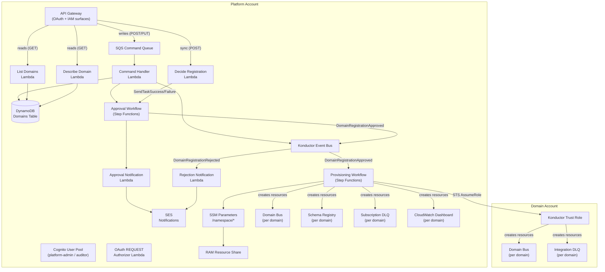
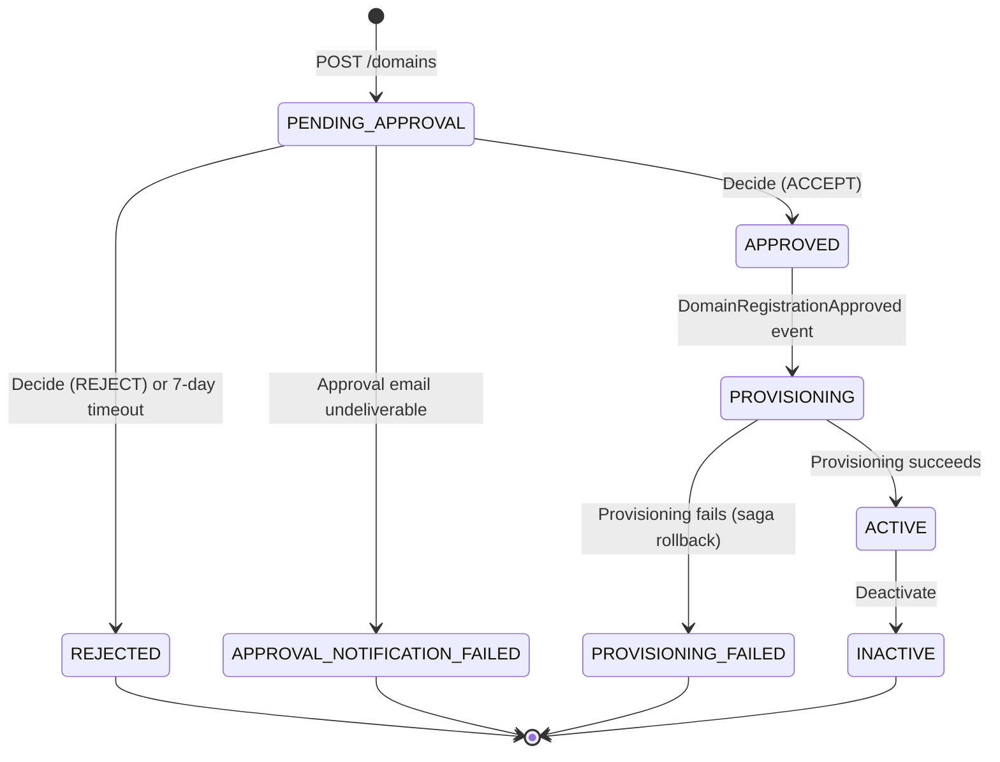
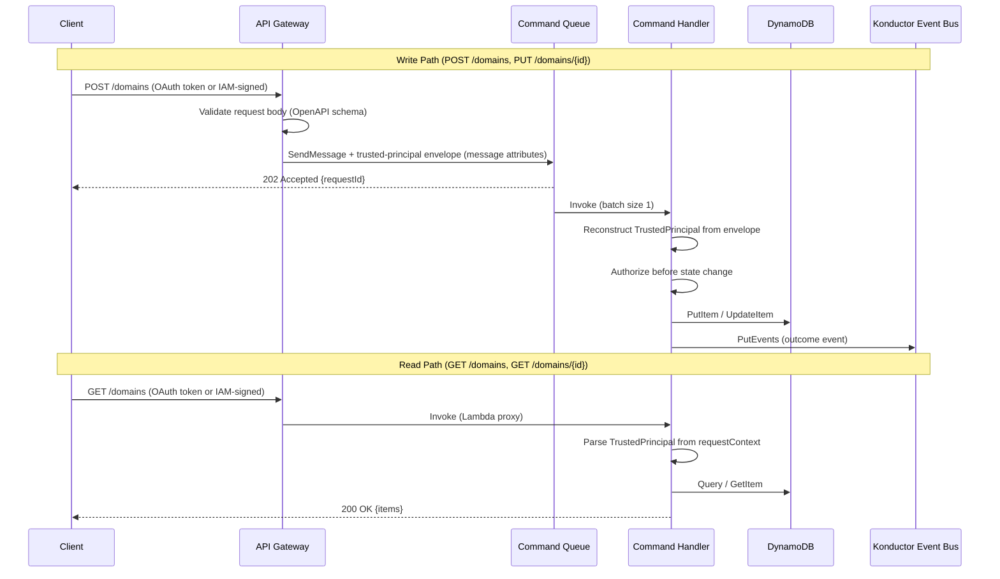
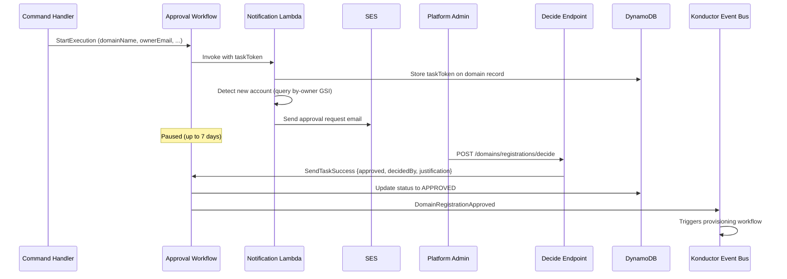
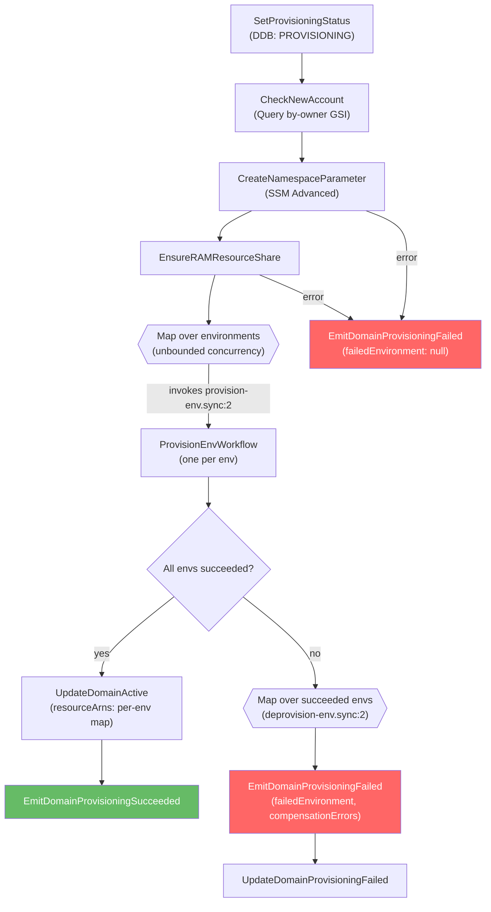
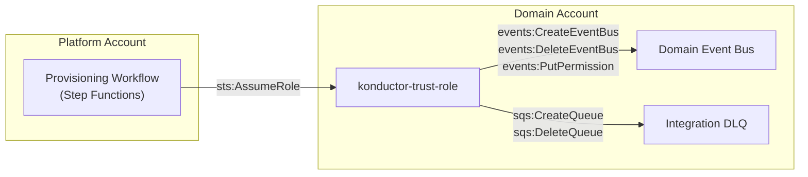
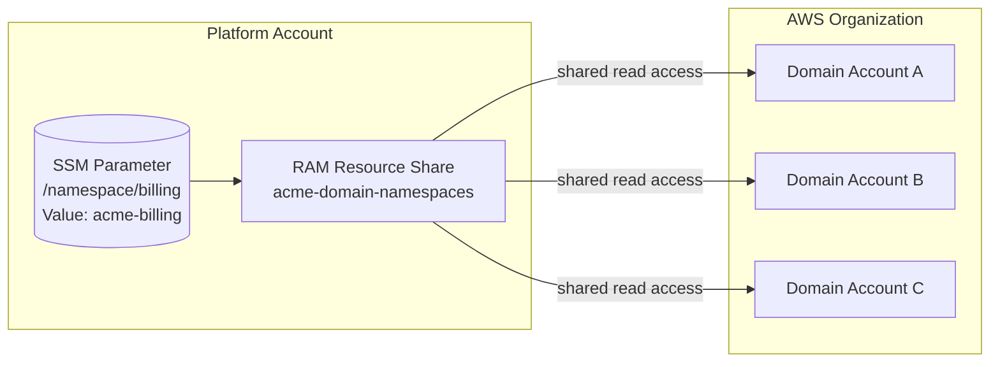
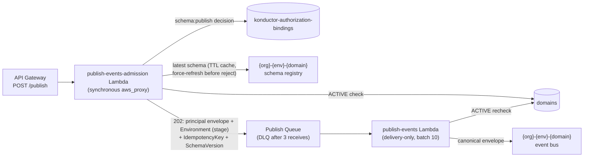
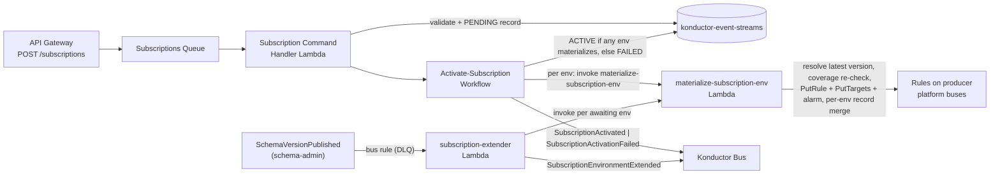

# Konductor for Amazon EventBridge Architecture

## The Problem

Cross-account EventBridge is powerful but operationally expensive. Setting up event routing between accounts requires creating event buses, rules, IAM roles, resource policies, DLQs, and monitoring in both producer and consumer accounts. For a single domain integration:

- A developer manages **12+ AWS resources** across two accounts
- First-event latency is **1-2 days** of infrastructure wrangling
- Each team reinvents the same resource topology with subtle drift
- Platform teams have no visibility into which domains exist or who owns them

Konductor for Amazon EventBridge eliminates this complexity. It gives platform teams a governance layer for domains and routing, while application teams get a simple API to register, publish, and subscribe to events without ever touching EventBridge resources directly.

---

## System Overview

Konductor runs in a dedicated **platform account** and provisions domain resources into **domain accounts** via cross-account IAM roles. All control-plane state lives in the platform account; domain accounts only contain the resources their domains need.



### Web console component layer

The console is a statically generated Nuxt/Vue SPA served through S3 and CloudFront. Product pages use the Konductor-owned `Nx*` component kit and semantic Tailwind tokens. Reka UI provides unstyled Dialog, AlertDialog, and Toast primitives behind those wrappers; pages do not import Reka directly. Native inputs, selects, and buttons retain browser form semantics. This layer does not change routing, Cognito authorization, API contracts, or the content-security policy.

Pages own modal open state and asynchronous work. `NxModal` and `NxConfirm` adapt controlled state and focus restoration, with confirmations preventing user dismissal while busy. `useToast` owns the app-wide queue; one `NxToasts` provider/viewport renders it. Each rendered item owns one local lifetime timer, paused by the union of hover, focus, and window inactivity. Reka automatic expiry is disabled to avoid overlapping-pause behavior in version 2.10.4.

The `/design-system` gallery is the shared review surface. Focused Playwright tests exercise the kit without authenticated service calls. See [design-system.md](./design-system.md) and [testing.md](./testing.md#web-component-behavior).

### Key Design Decisions

- **Three-stack deployment model**: `notifications-stack.yaml` (optional, SES identities), `konductor-core-stack.yaml` (core platform resources, with conditional notification resources), and `trust-stack.yaml` (per domain account)
- **Konductor is a singleton per org** — one deployment of `konductor-core-stack.yaml` per AWS Organization. Platform resources use the fixed `konductor-*` naming (no org or env segment). The domain-account trust role is the one exception (`{org}-konductor-trust-role`, org-scoped for cross-org uniqueness). Domain resources use `{org}-{env}-{domain}-*` and are provisioned per environment from the platform-configured `Environments` list.
- **One Lambda per API operation** — small, focused functions with least-privilege IAM
- **Reads are synchronous** (API Gateway -> Lambda -> DynamoDB); writes are asynchronous (API Gateway -> SQS -> Lambda -> EventBridge)
- **Step Functions for workflows** — no intermediate Lambdas for AWS API calls; uses SDK integrations with JSONata

> For the rationale behind these decisions, see [decisions.md](decisions.md).

---

## Account-Per-Domain Ownership Model

Konductor follows an **account-per-domain** principle: one AWS account hosts one domain's application-side resources. The trust stack is deployed once per account, and the `{org}-{env}-{domain}-*` resource naming convention assumes no two domains share an account. This keeps blast radius bounded and trust-role IAM policies simple.

Each domain has a **primary owner** (the account that hosts the resources) and at least one required **secondary owner** who acts as co-manager and backup decision-maker. Secondary owners can approve changes and provide a fallback if the primary owner is unavailable.

Domain names are **globally unique** and serve as the sole domain identifier throughout the system — there is no separate UUID. This follows DDD/EDA principles where the domain name IS the bounded context identifier. Uniqueness is enforced atomically by DynamoDB's partition key constraint.

---

## Domain Lifecycle

A domain moves through a well-defined status progression from registration to active use:



| Status | Meaning |
|--------|---------|
| `PENDING_APPROVAL` | Registration submitted, awaiting human decision |
| `APPROVED` | Approved by platform admin, provisioning not yet started |
| `REJECTED` | Registration denied by approver (or expired unanswered after 7 days), owner notified via email |
| `APPROVAL_NOTIFICATION_FAILED` | Approval request email could not be delivered — no decision was made; operator intervention needed |
| `PROVISIONING` | Infrastructure creation in progress |
| `ACTIVE` | All resources created, domain is operational |
| `PROVISIONING_FAILED` | Infrastructure creation failed, compensating transactions completed |
| `INACTIVE` | Domain deactivated, resources remain but domain is non-operational |

---

## API Layer

Konductor exposes two separate API Gateway surfaces, each with its own OpenAPI contract and authorization model. Both serve **environment-named stages** (`dev`, `staging`, `prod`): the stage is the environment selector for every environment-scoped operation — publishers and schema managers never name an environment, registry, or bus in a request.

- **OAuth surface** (`api/openapi-oauth.yaml`): interactive users authenticate via a Cognito user pool with controlled groups (`platform-admin`, `platform-auditor`). A REQUEST-type Lambda authorizer validates the Cognito access token (signature, issuer, expiration, `token_use`, client/audience), maps `cognito:groups` to global roles, preserves other groups as opaque team-group identifiers, and emits route-scoped allow/deny policies. Authorizer context is never cached by default (token-specific cache keys if enabled). Write operations are asynchronous (API Gateway validates the body and pushes to SQS); the decide endpoint is a direct Lambda proxy.

- **IAM surface** (`api/openapi-iam.yaml`): AWS-native automation callers authenticate with SigV4. The caller's AWS account ID serves as the principal identifier. Read endpoints (list, describe) and publisher/subscription management are available on this surface. Approval is OAuth-only and not exposed on the IAM surface.

Both surfaces inject a versioned **trusted-principal envelope** into SQS message attributes via VTL mapping templates, sourcing every identity field from API Gateway authorization context (`$context.authorizer.*` for OAuth, `$context.identity.*` for IAM), never from the request body — with one exception: the publish path routes through the admission Lambda, which builds the same envelope synchronously before enqueue (see Event Publishing below). Consumer Lambda handlers reconstruct the `TrustedPrincipal` from this envelope and invoke the resource-authorization interface before any state change. The grant engine (`DynamoGrantEngine`, backed by the `konductor-authorization-bindings` table) is the production authorizer for every path that represents a domain owner (publish, schema writes, all subscription commands and reads). Domain registration and update are OAuth-enabled: registration requires the caller to name an owning team group, and update authorizes owner bindings or platform roles; IAM automation on both paths is byte-for-byte unaffected.



### Identity and Authorization

Konductor separates **interactive identity** (OAuth/Cognito) from **automation identity** (IAM/AWS account). The `TrustedPrincipal` contract normalizes both: the OAuth variant carries the Cognito subject, controlled global roles, and trusted team-group identifiers; the IAM variant carries the AWS account ID as the principal identifier with optional principal ARN audit provenance.

The OAuth authorizer maps exact `cognito:groups` values to global roles (`platform-admin` -> `PlatformAdmin`, `platform-auditor` -> `PlatformAuditor`) and preserves all other validated group names as opaque team-group identifiers without assigning permissions. Route-level access is enforced by the authorizer: `platform-admin` may access any method, `platform-auditor` may only GET. The approval (decide) endpoint is OAuth POST-only and additionally requires `platform-admin` in the handler (defense-in-depth).

Approval decisions derive `decidedBy` from the trusted OAuth principal context, not from caller-supplied input. The `decidedBy` field is removed from the `DecideRequest` schema and rejected by `deny_unknown_fields`. The email-link bearer GET approval path has been removed; approval notification emails direct operators to sign in to Konductor rather than providing unauthenticated decision URLs. Task tokens remain the Step Functions callback mechanism, supplied in the authenticated POST body.

The resource-authorization interface (`ResourceAuthorizer` trait) accepts `TrustedPrincipal` and returns `Allow` or `Deny`. The production implementation is `DynamoGrantEngine`, which evaluates additive role bindings from the `konductor-authorization-bindings` table with strongly consistent reads and fails closed on errors; `InMemoryGrantEngine` is its fixture-fed twin for tests and local development.

**Ownership and scoped reads.** Beyond `publisher` and `subscriber`, the grant engine recognizes an `owner` role for domains. An OAuth caller registers a domain by naming `owningTeam`, one of its team groups (platform groups are never team groups, so platform teams cannot own domains); the approval workflow's finalize step commits the domain's `APPROVED` transition, the owner binding, and its audit record in a single DynamoDB transaction. Management reads are scoped by ownership: platform roles and IAM automation see everything, team callers see the domains their teams own (list and describe; cross-team describes answer 404 exactly like a missing domain), and `GET /domains?view=directory` exposes a names-only projection to any authenticated caller for pickers. Team owners can update description/emails/tags; enable/disable (`POST /domains/{domainName}/state`, a shallow `ACTIVE` ⇄ `INACTIVE` flip that all mutation paths already reject on) is platform-admin-only. Platform administrators work pending registrations through `GET /domains/registrations/pending`, an OAuth-only inbox that projects the workflow `taskToken` never returned by other reads.

### Grant Engine

The grant engine answers "may this principal perform this action on this resource?" from **role bindings**: a typed principal (an issuer-qualified Cognito team group for OAuth callers, or a twelve-digit AWS account for IAM callers) holds a role (`publisher` or `subscriber`) on a domain. Bindings are additive — any one applicable binding allows — and global (domain-less) bindings are unrepresentable.

The `konductor-authorization-bindings` table stores two item types:

- **RoleBinding** — `PK = PRINCIPAL#{type}#{id}`, `SK = ROLE#{role}#DOMAIN#{domain}`. Decisions are strongly consistent point reads on these keys (one per candidate principal: each team group, or the account). Two sparse GSIs serve administration only and never feed an allow decision: `by-domain` (enumeration) and `by-binding-id` (revoke lookup).
- **AuditRecord** — `PK = GRANT#{bindingId}#AUDIT`, `SK = TS#{rfc3339}`. Every mutation commits with its audit record in one `TransactWriteItems`, so the audit trail cannot diverge from grant state. Audit items carry mutation type, trusted actor, timestamp, and before/after summary — never tokens, claims material, or principal ARNs.

Creates are conditioned on `attribute_not_exists` (identical re-creates are idempotent and answer the stored binding; a concurrent-revoke race answers 409). Revokes are durable deletes conditioned on existence and active state (unknown or raced revokes answer 404). Revocation takes effect on the next decision; there is no reconciliation worker because publisher bindings gate nothing materialized.

**Binding administration** is flat-verb, OAuth-only, and platform-admin-only: `POST /bindings`, `GET /bindings?domain=…`, `DELETE /bindings/{bindingId}`, served by the `binding-admin` Lambda. The `platform-admin` global role resolves from the controlled Cognito group, never from the grant table, so administration cannot deadlock against an empty table. The IAM surface has no binding routes — IAM callers are *governed by* bindings, they do not govern them.

**Consumer wiring**: the publish consumer, schema-admin handlers, and all subscription paths (commands and reads) authorize through `DynamoGrantEngine`, with subscription create/enable additionally gated by entitlement coverage. Domain registration and update authorize OAuth callers through ownership (register: `owningTeam` membership; update: `owner` binding or platform role); the bridging `IamOnlyAuthorizer` (allows IAM, denies OAuth) remains only on paths that are platform-operated by definition (entitlement administration on the IAM surface). A manifest-seeded parity suite (from the `evaluate-authorization-engine` spike's frozen fixtures) proves `InMemoryGrantEngine` and `DynamoGrantEngine` decide identically.

### Entitlements

Where bindings answer "may this principal act for this domain?", **entitlements** answer "which producer event contracts may this consumer domain see?". They live in a second table, `konductor-authorization-entitlements`, because their revocation semantics differ: a binding gates nothing materialized, but revoking an entitlement can strand active subscriptions that must be converged.

| Attribute | Type | Key |
|-----------|------|-----|
| `consumerDomain` | String | Partition key (PK) |
| `grant` | String (`{producerDomain}#{scopePattern}`) | Sort key (SK) |
| `producerDomain` | String | GSI: `by-producer` (PK) |
| `entitlementId` | String | GSI: `by-entitlement` (PK) |
| `scopePattern` | String | — |
| `grantedBy` / `grantedAt` / `revokedAt` | — | audit provenance |
| `expiresAt` | Number (epoch, optional) | TTL — removal can lag expiry by days; expiry is also evaluated logically at read time |

The **scope pattern** is a single additive grammar reused by coverage checks, subscription authorization, and catalog expansion: `*` covers the producer's whole domain (including future schemas), an exact detail type covers every version of one schema (including future versions), and a `*` suffix covers a prefix family (including future members). `DynamoGrantEngine::covers()` evaluates coverage against ACTIVE entitlements; `list_entitlements()` feeds the catalog expansion.

**Revocation pipeline.** Revoke is a durable conditional delete in the admin transaction — effective at the *next decision* immediately. Converging already-materialized subscriptions is event-driven off the table's DynamoDB stream:

1. **Stream consumer** (`entitlement-stream-consumer`) claims each REMOVE image with a conditional idempotency-marker put (a replayed record is a no-op), enqueues a revocation message to the `EntitlementRevocationQueue` (DLQ after 3 receives), and forwards audit records to `konductor-bus`. The stream carries **change records**, never business events.
2. **Worker** (`entitlement-revocation-worker`) re-reads the consumer's remaining entitlements (fail-closed), finds candidate streams via exact, schema-prefix, or whole-partition queries narrowed by the revoked pattern, and disables the subscription's rules in every environment — the subscription record and its pinned version are retained so re-granting can re-enable.
3. **Sweep** (`entitlement-coverage-sweep`, hourly `rate(1 hour)`) scans the event-streams table, re-evaluates coverage per stream, and disables any ACTIVE stream that lost coverage — bounding out-of-band drift and covering missed fast-path deliveries. Drift disablements are alarmed; steady state is zero.

**Entitlement administration** mirrors binding administration: flat verbs, platform-admin-only, with a dual surface — OAuth for operators (`POST /entitlements`, `GET /entitlements`, `DELETE /entitlements/{entitlementId}`) and IAM for platform service roles under `IamOnlyAuthorizer`. Creates are deterministic-key conditioned (identical re-creates answer 200 with the stored entitlement); revokes are state-conditioned deletes; every mutation commits with its token-free `AuditRecord` in one `TransactWriteItems`.

### Endpoints

| Method | Path | Type | Handler |
|--------|------|------|---------|
| `POST` | `/domains` | Async (SQS) | `domain-registrations` (register) |
| `GET` | `/domains` | Sync (Lambda proxy) | `list-domains` |
| `GET` | `/domains/{domainName}` | Sync (Lambda proxy) | `describe-domain` |
| `PUT` | `/domains/{domainName}` | Async (SQS) | `domain-registrations` (update) |
| `POST` | `/domains/registrations/decide` | Sync (Lambda proxy) | `decide-registration` |
| `POST` | `/subscriptions` | Async (SQS) | `subscriptions` (subscribe) |
| `POST` | `/subscriptions/state` | Async (SQS) | `subscriptions` (enable/disable per env) |
| `GET` | `/subscriptions` | Sync (Lambda proxy) | `list-subscriptions` (direction-scoped) |
| `GET` | `/subscriptions/{subscriptionId}` | Sync (Lambda proxy) | `describe-subscription` |
| `DELETE` | `/subscriptions/{subscriptionId}` | Async (SQS) | `subscriptions` (unsubscribe) |
| `GET` | `/schemas` | Sync (Lambda proxy) | `list-schemas` (entitlement-expanded catalog) |
| `GET` | `/schemas/{schemaName}` | Sync (Lambda proxy) | `describe-schema` |
| `POST` | `/publish` | Sync admission + async delivery | `publish-events-admission` (validate-and-stamp) → `publish-events` (delivery) |
| `POST` | `/schemas` | Sync (Lambda proxy) | `schema-admin` (create schema, version 1) |
| `POST` | `/schemas/versions` | Sync (Lambda proxy) | `schema-admin` (append schema version) |
| `POST` | `/bindings` | Sync (Lambda proxy, OAuth only) | `binding-admin` (create) |
| `GET` | `/bindings` | Sync (Lambda proxy, OAuth only) | `binding-admin` (list by domain) |
| `DELETE` | `/bindings/{bindingId}` | Sync (Lambda proxy, OAuth only) | `binding-admin` (revoke) |
| `POST` | `/entitlements` | Sync (Lambda proxy, OAuth + IAM) | `entitlement-admin` (create) |
| `GET` | `/entitlements` | Sync (Lambda proxy, OAuth + IAM) | `entitlement-admin` (list) |
| `DELETE` | `/entitlements/{entitlementId}` | Sync (Lambda proxy, OAuth + IAM) | `entitlement-admin` (revoke) |

Each command handler Lambda receives SQS messages with a `HttpMethod` message attribute and dispatches accordingly (`domain-registrations`: register/update; `subscriptions`: subscribe/update-state/unsubscribe). Subscription commands carry the versioned trusted-principal envelope in message attributes; the handler reconstructs the principal and authorizes via `DynamoGrantEngine` before any state change.

---

## Approval Workflow

Domain registration requires human approval before any infrastructure is created. The approval workflow uses the Step Functions **waitForTaskToken** pattern to pause execution until a platform administrator calls the decide endpoint.



**Rejection path:** If the admin rejects, the decide Lambda calls `SendTaskFailure` with error `RegistrationRejected` and a JSON cause carrying `decidedBy`/`justification`. The workflow catches that error by name, parses the decision metadata from the cause (falling back to `decidedBy: unknown` if the cause is malformed), updates status to `REJECTED`, and emits `DomainRegistrationRejected` — an EventBridge rule then triggers the rejection notification Lambda to email the domain owner.

**Failure paths are separated by catch route.** The wait state distinguishes three outcomes that must not be conflated:

| Outcome | Signal | Terminal status | Event |
|---|---|---|---|
| Human rejection | `RegistrationRejected` custom error | `REJECTED` | `DomainRegistrationRejected` |
| 7-day timeout | `States.Timeout` | `REJECTED` (`decidedBy: system:timeout`) | `DomainRegistrationRejected` |
| Notification delivery failure | residual `States.ALL` (e.g., SES identity unverified) | `APPROVAL_NOTIFICATION_FAILED` | `DomainApprovalNotificationFailed` (owner-facing "registration delayed" email + operator SNS; no technical detail) |

The registration context is captured in a Pass state *before* the wait (Task `Assign` only applies on success, so capturing it on the wait state would leave failure paths without it). Every execution path ends with a terminal status write and exactly one lifecycle event.

**New account detection:** The notification Lambda queries the `by-owner` GSI to check if the owner account has any existing `ACTIVE` domains. If this is the first domain for that account, the approval email flags it with a trust-stack deployment advisory.

> Workflow definition: `domain-management/state-machines/approval.asl.yaml`

---

## Provisioning Workflow

The provisioning workflow is triggered by the `DomainRegistrationApproved` event on the konductor bus. It creates all domain infrastructure across both the platform and domain accounts using Step Functions SDK integrations (no intermediate Lambdas).

Since approved domains are provisioned into every environment configured on the platform (e.g., `dev,staging,prod`), provisioning is split across **three state machines**:

| State machine | Role |
|---------------|------|
| `provision-domain.asl.yaml` (outer) | Coordinator. Sets status, creates the domain-level namespace + RAM share, then fans out one inner execution per environment via a `Map` state with unbounded concurrency (`MaxConcurrency: 0`). Runs rollback if any env fails. |
| `provision-env.asl.yaml` (inner) | Creates all per-env resources across platform + domain accounts, with an inner saga for rollback of partial state inside a single env. |
| `deprovision-env.asl.yaml` | Idempotent teardown of a single env's resource set. Used by the outer workflow's rollback path, and reusable by a future `DELETE /domains` flow. |

**Platform-configured environments.** The list of environments to provision is set once at platform deploy time via the `Environments` SAM parameter (`CommaDelimitedList`, default `dev,staging,prod`). It is NOT supplied per registration request — registration requests only carry `domainName`, `ownerAccountId`, and `ownerEmail`. The command handler stamps the current platform env list onto the domain record at registration time so approvals and provisioning work from a stable snapshot.

**All-or-nothing contract.** The outer workflow produces one of two outcomes:

- **All envs succeed** → domain moves to `ACTIVE`, `DomainProvisioningSucceeded` event emitted with a `resourceArns` map keyed by environment.
- **Any env fails** → deprovision-env runs over every env that *did* succeed, domain moves to `PROVISIONING_FAILED`, and `DomainProvisioningFailed` is emitted with `failedEnvironment` plus any `compensationErrors` aggregated across rollback runs. The aggregation uses a JSONata array constructor (`[$rollbackResults.compensationErrors]`) rather than `$reduce`: when no env succeeded (empty rollback set) or when rollback ran cleanly, `$reduce` returns undefined and kills the state with `QueryEvaluationError` — the failure event then never fires and the domain sticks in `PROVISIONING`.

Failures in the domain-level steps (namespace parameter, RAM share) that happen **before** the Map never leave per-env artefacts behind, so their failure path updates status and emits `DomainProvisioningFailed` with `failedEnvironment: null`.

**Retry posture.** Every SDK task state in the four domain-management state machines carries a `Retry` policy (evaluated before `Catch`): throttle-prone APIs (CloudWatch alarms/dashboards, Schemas registries) retry 5 times from 2s with full jitter; standard control-plane calls (EventBridge, SQS, SSM, RAM, DynamoDB, `putEvents`, `startExecution`) retry 3 times from 1s. Deterministic business errors (`ResourceAlreadyExistsException`, conditional-check failures) are excluded and fail fast into compensation. Compensation steps carry the same retries — a throttled delete would otherwise record a spurious compensation error and leak the resource.

**Namespace + RAM persistence.** The SSM parameter (`/namespace/{domain}`) and the RAM resource share are created at the domain level, above the Map — they are environment-independent and are **never** rolled back. This makes the outer workflow safe to re-run on the same domain after a partial failure: the idempotent upserts avoid duplicates, and the existing shared namespace continues to be reused.

### Outer Workflow (provision-domain)



### Inner Workflow (provision-env)

Per-env resource creation runs in this order, with an inner saga that rolls back anything created so far if any step fails:


### Resources Created Per Domain

| Resource | Scope | Account | Naming Convention |
|----------|-------|---------|-------------------|
| SSM parameter | Domain (shared across envs) | Platform | `/namespace/{domain}` |
| RAM resource share | Domain (shared across envs) | Platform | `{org}-domain-namespaces` (shared) |
| Event bus | Per-env | Platform | `{org}-{env}-{domain}-event-bus` |
| PutEvents policy | Per-env | Platform | Allows owner account to publish |
| Schema registry | Per-env | Platform | `{org}-{env}-{domain}-schema-registry` |
| Subscription DLQ | Per-env | Platform | `{org}-{env}-{domain}-subscription-dlq` |
| Event bus | Per-env | App | `{org}-{env}-{domain}-event-bus` |
| Integration DLQ | Per-env | App | `{org}-{env}-{domain}-integration-dlq` |
| CloudWatch dashboard | Per-env | Platform | `{org}-{env}-{domain}-dashboard` |
| Failed invocations alarm | Per-env | Platform | `{org}-{env}-{domain}-failed-invocations-alarm` |
| DLQ depth alarm | Per-env | Platform | `{org}-{env}-{domain}-dlq-depth-alarm` |

### Saga Compensation (Rollback)

There are **two layers** of compensation:

1. **Inner saga** (`provision-env`): if a per-env step fails, the inner workflow walks backwards through the resources already created **in that env** and deletes them. Best-effort — delete failures are captured in `compensationErrors` so the env fails deterministically instead of hanging.
2. **Outer rollback** (`provision-domain`): if any env's inner execution fails, the outer workflow starts `deprovision-env` for every env that had already reported success. Each deprovision is idempotent (treats "already gone" as a no-op) and collects its own per-step `compensationErrors`, which the outer workflow aggregates into the `DomainProvisioningFailed` event payload.

> Workflow definitions:
>
> - Outer: `domain-management/state-machines/provision-domain.asl.yaml`
> - Per-env provision: `domain-management/state-machines/provision-env.asl.yaml`
> - Per-env deprovision: `domain-management/state-machines/deprovision-env.asl.yaml`

`deprovision-env` is intentionally standalone — it is the right primitive for a future `DELETE /domains` flow, which would iterate over the domain record's `environments` and tear down each env before removing the domain-level namespace + RAM association (scope: not included in this change).

---

## Cross-Account Trust Model

Konductor provisions resources in domain accounts by assuming a trust role. Each domain account deploys a **trust stack** (CloudFormation template) that creates the IAM role with scoped permissions.



### Trust Role Permissions

The trust role (`{org}-konductor-trust-role`) is environment-independent — a single role in each domain account covers every env the platform provisions into. It grants three scoped policies:

| Policy | Actions | Resource Scope |
|--------|---------|---------------|
| EventBusManagement | `events:Create/Delete/Describe/PutPermission/RemovePermission` | `{org}-*` event buses |
| DlqManagement | `sqs:Create/Delete/Set/GetQueueAttributes` | `{org}-*` queues |
| BusToBusRoleManagement | `iam:Create/Delete/Put/DeleteRolePolicy/GetRole` | `{org}-b2b-*` roles (unused — retained for template compatibility; subscription delivery uses the provision-time resource policy instead) |

### Subscription Delivery Authorization

Cross-account subscription delivery does **not** use per-subscription IAM roles. During `provision-env`, the trust role attaches a resource policy to the app-side domain bus permitting the **platform account** to `events:PutEvents` (`SetAppBusDeliveryPolicy` step). That single grant covers every current and future subscription targeting the bus — subscribe and unsubscribe never touch the consumer account. EventBridge delivers matched events using the platform-side `konductor-subscription-delivery-role`. Every domain receives this policy at provisioning time (no pre-policy domains exist; the product shipped with the step in place).

The trust role's `AssumeRolePolicyDocument` names the platform account root as principal, constrained by an `ArnEquals` condition on `aws:PrincipalArn` to exactly two roles:

1. The **Konductor function role** (trust anchor for Lambda-based operations)
2. The **Provisioning workflow role** (for Step Functions SDK integrations)

The condition form (rather than role-ARN principals) is deliberate: IAM pins role-ARN principals to unique IDs at save time, which would sever trust every time the core stack is redeployed. `aws:PrincipalArn` is string-matched per request, and the platform role names are fixed, so trust survives platform redeploys without any trust stack update.

### Onboarding a New Domain Account

1. Deploy `trust-stack.yaml` in the domain account
2. Pass the Konductor stack outputs (`KonductorFunctionRoleArn`, `ProvisioningWorkflowRoleArn`) as parameters
3. The trust role is immediately available for Konductor to assume

> See [trust-stack-deployment.md](../trust-stack-deployment.md) for step-by-step onboarding instructions.

---

## Resource Namespace Convention

Konductor distinguishes **platform resources** (the singleton control plane) from **domain resources** (one set per environment per domain).

**Platform resources** — fixed `konductor-*` pattern, no org or environment segment (Konductor is a singleton per AWS account):

```text
konductor-bus                             (konductor event bus)
konductor-domains                         (domains table)
konductor-api                             (API Gateway)
konductor-function-role                   (Lambda trust-anchor role)
konductor-provisioning-workflow-role      (Step Functions execution role)
```

The domain-account **trust role** is the one exception: it carries the org prefix as `{org}-konductor-trust-role` (e.g., `acme-konductor-trust-role`) so multiple organizations sharing a domain account don't collide.

**Domain resources** — `{org}-{env}-{domain}-*`, one set per environment in the `Environments` platform parameter:

```text
acme-prod-billing-event-bus           (EventBridge bus)
acme-prod-billing-schema-registry     (Schema registry)
acme-prod-billing-subscription-dlq    (Platform DLQ)
acme-prod-billing-integration-dlq     (Domain account DLQ)
acme-prod-billing-dashboard           (CloudWatch dashboard)
```

The domain pattern is configurable via the `NamespacePattern` SAM parameter (default: `{org}-{env}-{domain}`). The `NamespaceResolver` in `lib/konductor-common/src/namespace.rs` handles domain-resource name generation. The platform pattern (`konductor-*`) is fixed.

The `konductor` name is reserved — the register-domain handler rejects it so no domain can collide with the platform namespace.

### Domain Namespace (Environment-Independent)

Each domain also has an environment-independent **namespace identity**: `{org}-{domain}` (e.g., `acme-billing`). This is stored as an SSM Advanced Parameter at `/namespace/{domain}` and shared across the entire AWS Organization via RAM resource share.



Domain accounts can discover domains by reading SSM parameters locally, without any cross-account IAM configuration.

---

## Event Bus and Lifecycle Events

The **konductor bus** (`konductor-bus`) carries all internal lifecycle events. It is a platform resource — a single bus per Konductor deployment, not per env. It is the backbone for workflow orchestration — events trigger Step Functions executions and EventBridge rules invoke notification Lambdas.

### Event Catalog

| Detail Type | Source | Emitted By | Triggers |
|------------|--------|-----------|----------|
| `RegisterDomainSucceeded` | `konductor.domain-management` | Command handler (register) | — |
| `RegisterDomainFailed` | `konductor.domain-management` | Command handler (register) | Registration-failed notification Lambda |
| `UpdateDomainSucceeded` | `konductor.domain-management` | Command handler (update) | — |
| `UpdateDomainFailed` | `konductor.domain-management` | Command handler (update) | — |
| `DomainRegistrationApproved` | `konductor.domain-management` | Approval workflow | Provision-domain workflow (outer); approval-outcome notification Lambda |
| `DomainRegistrationRejected` | `konductor.domain-management` | Approval workflow | Rejection notification Lambda |
| `DomainApprovalNotificationFailed` | `konductor.domain-management` | Approval workflow | Registration-delayed notification Lambda (owner-facing, no technical detail) |
| `DomainProvisioningSucceeded` | `konductor.domain-management` | Provision-domain workflow | Provisioning-succeeded notification Lambda |
| `DomainProvisioningFailed` | `konductor.domain-management` | Provision-domain workflow | Provisioning-failed notification Lambda |
| `SubscribeSucceeded` / `SubscribeFailed` | `konductor.event-streams` | Subscription command handler | — |
| `UpdateSubscriptionSucceeded` / `UpdateSubscriptionFailed` | `konductor.event-streams` | Subscription command handler | — |
| `UnsubscribeSucceeded` / `UnsubscribeFailed` | `konductor.event-streams` | Subscription command handler | — |
| `SubscriptionActivated` | `konductor.event-streams` | Activate-subscription workflow | — |
| `SubscriptionActivationFailed` | `konductor.event-streams` | Activate-subscription workflow | — |
| `SubscriptionRemoved` | `konductor.event-streams` | Remove-subscription workflow | — |
| `SchemaVersionPublished` | `konductor.schema-management` | Schema-admin (after a committed create/append) | Subscription-extender Lambda |
| `SubscriptionEnvironmentExtended` | `konductor.event-streams` | Subscription-extender Lambda | — |

The `DomainProvisioningFailed` payload carries `failedEnvironment` (or `null` for domain-level failures), `failedStep`, `errorCode`, `errorMessage`, and an aggregated `compensationErrors` array from any rollback runs. `SubscriptionActivationFailed` carries `failedEnvironment`, `failedStep`, and `errorMessage` (no compensation errors — activation has no rollback; per-environment outcomes ride on both subscription lifecycle events).

Domain-management events use the source `konductor.domain-management`; subscription events use `konductor.event-streams`. The `DomainRegistrationApproved` event is the key orchestration trigger — it initiates the provisioning workflow via an EventBridge rule on the konductor bus.

**Platform operator notifications.** In addition to the per-event owner notifications above, every lifecycle event on the konductor bus (any `source` with the `konductor.` prefix) is forwarded to the `konductor-platform-notifications` SNS topic by a single EventBridge rule with an input transformer, giving platform operators full lifecycle visibility through one subscription point. `PlatformOperatorEmail` is subscribed at deploy time (one-time SNS confirmation required); future notification channel adapters (Slack, SMTP relays) attach as additional topic subscribers. The operator path is SNS-only and independent of SES — in particular, `DomainApprovalNotificationFailed` still reaches operators when SES delivery is the failed dependency.

---

## Event Subscriptions (Schema-First)

Consumers subscribe to a **schema** — the contract — not to a bus or an endpoint: `Subscribe(consumerDomain, producerDomain, schemaName)`. The subscription always binds to the **latest** schema version in each environment's registry, pinned at subscribe time. There is only one representation of an event at any point in time; version pinning makes contract transitions observable and bounded rather than letting subscribers choose versions.

### The Canonical Event Envelope

Every event flowing through Konductor domain buses carries a canonical identity, and subscription rules filter on it:

- `source` — the producing domain's env-independent namespace identity `{org}-{domain}` (e.g., `acme-orders`), derived by the platform, never free-typed
- `detail-type` — the event name
- Schema name — `{source}@{detail-type}` (the native EventBridge discovery convention; round-trips to `aws schemas describe-schema`)
- Schema version — **numeric**, stamped at `detail.metadata.schemaVersion` (`detail` splits into `metadata`/`data`)
- Idempotency key — `detail.metadata.idempotencyKey`, caller-supplied or the API Gateway request ID
- Publish time — `detail.metadata.publishedAt` (ISO-8601 milliseconds), derived from the SQS `SentTimestamp` so retries never move it

An event a producer publishes — every field here is a scalar, exactly as `PutEvents` expects:

```json
{
  "Source": "acme-orders",
  "DetailType": "OrderNotification",
  "Detail": "{\"metadata\":{\"schemaVersion\":3,\"idempotencyKey\":\"key-123\",\"publishedAt\":\"2026-07-30T10:30:00.123Z\"},\"data\":{\"orderId\":\"o-123\"}}"
}
```

The subscription rule Konductor materializes to match it — EventBridge event patterns filter with arrays, not scalars, which is why this looks different from the event above despite matching on the same three fields:

```json
{
  "source": ["acme-orders"],
  "detail-type": ["OrderNotification"],
  "detail": { "metadata": { "schemaVersion": [3] } }
}
```

With platform metadata active, the `metadata` block additionally carries the stamped `metadataRevision` and every field the active metadata revision generates (`eventId`, `geo.region`, …) — the platform supplies all metadata values, and caller-supplied injected fields are rejected at admission. The stamped block is exactly the active revision's compiled schema; consumers validating it exactly must tolerate additive revisions (a revision bump is a new contract, not a guarantee that old readers accept new fields):

```json
{
  "Source": "acme-orders",
  "DetailType": "OrderNotification",
  "Detail": "{\"metadata\":{\"schemaVersion\":3,\"metadataRevision\":2,\"idempotencyKey\":\"key-123\",\"publishedAt\":\"2026-07-30T10:30:00.123Z\",\"eventId\":\"0b9e6c21-7f4a-4d8e-9f1b-3c2d5e4f6a7b\",\"geo\":{\"region\":\"ap-southeast-2\"}},\"data\":{\"orderId\":\"o-123\"}}"
}
```

Producers publish through `POST /publish`; Konductor stamps the entire envelope. Direct `PutEvents` to a domain bus remains possible for domain-internal events, but mis-stamped events fail closed (no rule matches — non-delivery, never misdelivery).

### Event Publishing (Validate-at-Ingest)

`POST /publish` accepts a flat request — `{domain, eventName, data, idempotencyKey?}` — and Konductor owns everything else: identity, schema resolution, conformance checking, envelope construction, and bus selection. Caller-supplied identity, version, registry, bus, or envelope fields are rejected at both the OpenAPI schema and the serde model.



Admission is the synchronous commit point: a 202 means the caller is authenticated and authorized (`schema:publish`), the target domain is ACTIVE, and `data` conforms to the schema's latest version — that validated version is stamped as the immutable `SchemaVersion` message attribute, and the delivery path stamps it verbatim into the event envelope. Deterministic failures answer before anything is queued: 403 (no publisher binding), 404 (domain or schema not found), 422 (payload violates the schema, violating instance paths in `message`), and 503 (registry unavailable or the stored schema is unusable — retryable, never a rejection). A cached schema that rejects a payload is force-refreshed from the registry before the 422 is final, so a brand-new schema append can never falsely reject a publish; the ≤60s TTL cache is an availability hedge, not an authority.

Delivery stays store-and-forward: the consumer re-checks domain liveness, rebuilds the canonical envelope, and retries transient `PutEvents` failures; `publishedAt` still derives from the SQS `SentTimestamp`, so a retried publish keeps its original publish time and idempotency key. The consumer performs no authorization, schema fetch, or payload validation — a queued command was validated at admission, and the queue accepts writes from the admission function only. It still validates the generated envelope (positive version, non-empty identity, serializable, within the 256KB entry limit) before delivery — an invalid generated envelope is a processing failure, never a partial delivery.

The full design rationale — the failure mode this removes, the status taxonomy, cache semantics and refresh-before-reject, the earned-stamp invariant, and the rejected alternatives — is in [Publish Validation at Ingest](publish-validation.md).

### Schema Management (Append-Only)

Publishers manage schemas through two synchronous endpoints mirroring the EventBridge Schemas API: `POST /schemas` (like `CreateSchema` — creates `{namespaceIdentity}@{eventName}` in the stage-selected environment's registry as version 1, 409 on duplicates) and `POST /schemas/versions` (like `UpdateSchema` — appends the next version, existing versions immutable, 404 when the schema does not exist). Both require a `publisher` binding for the domain (`schema:create` / `schema:version-append` actions), require an `ACTIVE` domain, and infer the environment from the API stage. Schemas are **JSON Schema draft-4 only**: any other `schemaType` is a 400, and `content` that does not compile as a draft-4 document is rejected (400) before any registry write, so nothing in a registry is ever unvalidatable. Schemas are append-only: no delete, retire, replace, or version-deletion operations exist, and publisher permissions cover only `CreateSchema`/`UpdateSchema` inside org-namespaced registries — registry lifecycle and policy administration remain platform-admin operations.

### Platform Metadata Composition

Every admitted event carries a platform-generated metadata block alongside the publisher's business `data`. The two components version **independently**: an exact contract is `(organisation, environment, schemaName, businessVersion, metadataRevision)` — metadata revisions never move business versions, and business schema appends never touch metadata. `konductor-metadata-configuration` stores immutable additive revisions (protected defaults `schemaVersion`, `idempotencyKey`, `publishedAt`, `metadataRevision` plus generated extension fields from a bounded generator catalogue) and per-environment active pointers. Revision 0 is the read-only legacy selector for events predating metadata stamping.

Admission resolves the environment pointer **strongly, once, after authorization** — that read is the event's metadata selection boundary. A request reading before an activation commit may complete under the old revision; one reading after gets the new revision; no cross-store atomicity between DynamoDB and SQS is promised. Generated values (UUIDs, timestamps, region/organisation/environment from trusted context) are frozen into a **format-2 queue envelope** that carries the resolved business/schema identity, target, metadata revision/digest, the compiled metadata schema or bounded descriptor, and the generated extension values — everything delivery needs with **zero configuration reads**, so retries cannot drift. `publishedAt` remains the queue-time exception: SQS's acceptance time, unknowable before acceptance, represented fixed-width for preflight with no constraint allowed to depend on it, derived at delivery from the recorded queue message. Format-2 messages with missing or inconsistent fields fail closed; only actual legacy wrappers take the old three-field path. A retry after an ambiguous enqueue is a new admission — the UUID is not an exactly-once guarantee.

Metadata administration is OAuth-only (`/metadata/*`, platform roles): additive revision creation with stale-head conflict detection (409), non-persisting preview/readiness, and per-environment activation with explicit expected-current conditions, forward-only moves, server-side re-checks, and an append-only activation audit. Both write paths are stream-native — one conditional transaction commits the record plus its mutation audit, and the `MetadataConfigurationTable` stream consumer emits `MetadataRevisionCreated`/`MetadataRevisionActivated` from committed images with stream-event-id marker dedup (full records in the [decision log](decisions.md)). Activation deliberately imposes no dev/staging/prod ordering; each environment moves explicitly, and skipping intermediate additive revisions is valid.

Composed contracts are discoverable without mutating anything: `GET /schemas/{schemaName}/contract` returns the exact current pair or an **explicitly selected** historical pair (both `schemaVersion` and `metadataRevision` required together — the active revision is never substituted for a historical business version), with raw business content, the generated metadata schema, generator descriptions, and an offline-usable composed draft-4 document. `POST /schemas/contract-preview` composes **unsaved** business content for publishers without registering. Catalog summaries carry the active metadata revision per environment; the raw registry documents remain business-only. Provenance remains the event's own recorded tuple — a historical composition is inspection, not evidence the pair was ever emitted.

### Subscription Materialization

Each subscription materializes as **one rule per environment** on the producer's platform-side bus:

- Rule name: `{consumerDomain}-{detailType}` — version-agnostic, so a future version migration is a `PutRule` pattern update on the same rule (no delete/create window). EventBridge's per-bus rule-name uniqueness doubles as duplicate-subscription enforcement, and `PutRule`-as-upsert makes retried workflow steps idempotent.
- Target: the consumer's app-side domain bus (same env), delivered via the `konductor-subscription-delivery-role`, with `DeadLetterConfig` on the producer's per-env subscription DLQ.
- Delivery authorization: a resource policy on the consumer's app-side bus granting the **platform account** `events:PutEvents`, attached once during `provision-env` (`SetAppBusDeliveryPolicy` step). No per-subscription IAM.
- A per-subscription **zero-events alarm** (24h without a delivery, missing data = breaching) flags silently-stopped streams — the failure mode when a producer bumps versions past a pinned subscriber.

### Subscription Flow



Activation is **independent per environment**: each producer environment materializes through the shared `materialize-subscription-env` function (resolve latest version → final coverage re-check → rule upsert → consumer-bus target → zero-events alarm → per-env record merge). There is no cross-environment compensation. The stream becomes `ACTIVE` when at least one environment materializes; it becomes `FAILED` only when the schema exists in **no** producer environment (almost always a caller typo) or every materialization fails. Where the schema is absent from an environment, that entry is recorded `AWAITING_PROMOTION` — no rule is created there — and the failure cause of a materialized attempt is recorded on the entry's `errorDetail`. A per-env `FAILED` entry is healed by re-enabling it (`POST /subscriptions/state`), which re-invokes materialization; re-subscribing an `ACTIVE` stream is an idempotent no-op.

**Promotion-following extension.** Every committed schema create/append emits `SchemaVersionPublished` from `schema-admin`; a bus rule (with DLQ) invokes the subscription extender, which extends every `ACTIVE` subscription on that schema whose record still awaits the promoted environment — materializing it with the recorded desired-enabled flag (a pre-declared pause survives promotion). Extension is idempotent: already-materialized environments are no-ops, so appends to existing environments never re-pin. The final coverage re-check inside materialization closes the revoke-between-promotion-and-extension race, fail-closed. Unsubscribe removes targets, rules, and alarms for **every producer environment** (not just recorded ones — an orphaned rule from a crashed materialization has no record entry), idempotently, then marks the record `REMOVED`, retained 90 days via TTL. Orphaned integration rules on the consumer's own bus are the application team's responsibility.

**Subscription authorization** splits by composite resource: `subscription:environment:{id}:{env}` create/enable decisions require both a `subscriber` binding on the consumer domain *and* entitlement coverage of the target detail type (self-subscription within a domain skips the coverage check — a domain always sees its own schemas); disable and unsubscribe require the binding alone, so a lapsed entitlement can never wedge a subscription. Entitlement revocation later disables the subscription's rules in every environment via the revocation pipeline — the subscription record, its pinned version, and its enabled flags are retained, and re-granting coverage does not re-enable automatically: the consumer re-enables explicitly.

Per-environment **enable/disable** maps to native rule state (e.g., subscribe with prod paused during development; kill switch during incidents). Disabled ≠ removed: the contract stays signed and the pinned version is retained.

### Subscription Lifecycle

```text
PENDING ──any env materializes──> ACTIVE ──unsubscribe──> REMOVED (TTL 90d)
   └────no env materializes─────> FAILED
```

Per-environment entries carry their own status — `PENDING`, `ACTIVE`, `AWAITING_PROMOTION` (schema not yet in that environment; extends automatically when it arrives), `FAILED` (materialization failed; heal by re-enabling) — which may diverge from the overall status and from each other.

### Schema Discovery (Subscriber Catalog)

`GET /schemas?consumerDomain={domain}` is the **subscriber catalog**: the caller's current entitlements are expanded against the producers' per-environment registries — `*` grants list the whole registry, prefix grants list and filter, exact grants look the schema up directly. Overlapping grants deduplicate into one entry per schema reporting the latest version per environment, so version skew is visible before subscribing. Every entry is, by construction, currently subscribable by the caller.

Pagination is a **watermark cursor**, not an offset: the caller's sources are ordered by producer domain, each page resumes at the watermark, and listing stops when the page fills (max 50). The cursor carries only the watermark plus a hash of the filter set — no authorization state — so coverage granted mid-sequence behind the watermark never appears on later pages, and revoked coverage cannot be re-emitted. A filter mismatch answers 400. `GET /schemas/{schemaName}?consumerDomain=…&domain=…` runs the same coverage check and returns the latest content per environment; uncovered targets answer 403, absent ones 404. Platform roles (`platform-admin`, `platform-auditor`) omit `consumerDomain` and receive the platform-wide catalog sourced from ACTIVE domains; non-platform callers must name a consumer domain they hold a `subscriber` binding on. Read-only; schema writes go through the publisher schema-management endpoints above.

---

## Data Model

A single `domains` DynamoDB table stores both domain metadata and registration state. This was a deliberate choice over separate tables — the domain entity and its registration lifecycle are the same concern.

### Table Schema

| Attribute | Type | Key |
|-----------|------|-----|
| `domainName` | String | Partition key (PK) |
| `ownerAccountId` | String | GSI: `by-owner` (PK) |
| `status` | String | GSI: `by-status` (PK) |
| `description` | String | — |
| `ownerEmail` | String | — |
| `secondaryOwnerEmails` | String Set (SS) | — |
| `tags` | Map | — |
| `environments` | List<String> | — (stamped at registration time from the platform `Environments` parameter) |
| `resourceArns` | Map<env, PerEnvResourceArns> | — (populated after provisioning; keyed by environment) |
| `namespaceParameter` | String | — (e.g. `/namespace/billing`) |
| `taskToken` | String | — (Step Functions task token) |
| `decidedBy` | String | — |
| `justification` | String | — |
| `createdAt` | String (ISO 8601) | — |
| `updatedAt` | String (ISO 8601) | — |
| `approvedAt` | String (ISO 8601) | — |
| `rejectedAt` | String (ISO 8601) | — |
| `errorDetail` | String | — |

### Access Patterns

| Pattern | Index | Key Condition |
|---------|-------|---------------|
| Get domain by name | Table (PK) | `domainName = :name` |
| List domains by owner | `by-owner` | `ownerAccountId = :acct` |
| List domains by status | `by-status` | `status = :status` |
| Detect new account | `by-owner` | `ownerAccountId = :acct` + filter `status = ACTIVE` |

The table uses `PAY_PER_REQUEST` billing with point-in-time recovery enabled and a `Retain` deletion policy.

### Domain-Count Ceiling

The table is capped at **1,000 rows**. A singleton counter item (`domainName = "META#domain-count"`, attribute `count`) tracks the total; every row-creating registration write (new `PENDING_APPROVAL` registrations and collision-preflight `REJECTED` rows) runs as a DynamoDB transaction that creates the row and increments the counter atomically, conditioned on the counter staying below the cap. Re-registration of a rejected domain overwrites its existing row in a follow-up transaction without charging the counter.

The counter item is not a domain: it carries no `ownerAccountId` or `status`, so it never enters the `by-owner`/`by-status` GSIs, and both list-domains scans exclude it by key. At the cap, registration fails deterministically with `RegisterDomainFailed` (domain-limit reason), no approval workflow starts, and the message is acknowledged without retry. Rows are never deleted, so the ceiling bounds lifetime registrations until a domain-deletion capability lands; `docs/service-quotas.md` holds the seeding/reconciliation runbook and the hourly `domain-count-reporter` Lambda feeds the 80%-of-cap alarm (`Konductor/DomainManagement` `DomainCount`).

### Event Streams Table

The `konductor-event-streams` table is the **source of intent** for subscriptions; EventBridge rules are the materialization. Topology questions are answered from the table, never by enumerating rules across buses.

| Attribute | Type | Key |
|-----------|------|-----|
| `producerDomain` | String | Partition key (PK) |
| `schemaConsumer` | String (`{schemaName}#{consumerDomain}`) | Sort key (SK) |
| `consumerDomain` | String | GSI: `by-consumer` (PK) |
| `source` / `detailType` / `schemaName` | String | — |
| `status` | String (`PENDING\|ACTIVE\|FAILED\|REMOVED`) | — |
| `environments` | Map<env, {pinnedVersion, ruleName, ruleArn, enabled, status}> | — |
| `createdAt` / `updatedAt` / `removedAt` | String (ISO 8601) | — |
| `expiresAt` | Number (epoch) | TTL (removal + 90 days) |

| Pattern | Index | Key Condition |
|---------|-------|---------------|
| Subscription by identity | Table (PK+SK) | `producerDomain = :p AND schemaConsumer = :schema#consumer` |
| Version census for a schema | Table (PK+SK) | `producerDomain = :p AND begins_with(schemaConsumer, :schema#)` |
| Streams feeding a consumer | `by-consumer` | `consumerDomain = :c` |

The API-facing subscription id is `{consumerDomain}.{producerDomain}.{detailType}` — domain names cannot contain dots, so parsing splits on the first two dots; event names may contain dots safely.

---

## Infrastructure as Code

All infrastructure is defined across three CloudFormation templates. The core platform resources use AWS SAM (`konductor-core-stack.yaml`); SES email identities are managed by an optional sibling stack (`notifications-stack.yaml`); and per-domain-account trust roles use plain CloudFormation (`trust-stack.yaml`). Step Functions workflows are defined in YAML with JSONata query language.

### Project Structure

```text
evb-konductor/
├── api/
│   └── openapi.yaml                          # OpenAPI 3.0 contract (embedded in SAM)
├── domain-management/
│   ├── functions/
│   │   ├── decide-registration/              # Sync: approve/reject decisions
│   │   ├── describe-domain/                  # Sync: get domain by ID
│   │   ├── domain-registrations/           # Async: register + update commands
│   │   ├── list-domains/                     # Sync: list/filter domains
│   │   ├── send-approval-request-notification/  # Approval request email (invoked by workflow)
│   │   ├── send-rejection-outcome-notification/ # Rejection outcome email (EventBridge rule)
│   │   └── send-provisioning-failed-notification/ # Provisioning failure email (EventBridge rule)
│   └── state-machines/
│       ├── approval.asl.yaml                 # Human-in-the-loop approval
│       ├── provision-domain.asl.yaml         # Outer coordinator (fan-out over environments)
│       ├── provision-env.asl.yaml            # Per-env resource creation + inner saga
│       └── deprovision-env.asl.yaml          # Idempotent per-env teardown
├── event-streams/
│   ├── functions/
│   │   ├── subscriptions/                    # Async: subscribe/state/unsubscribe commands
│   │   ├── materialize-subscription-env/     # Per-env materialization unit (workflow + extender invoke it)
│   │   ├── subscription-extender/            # Promotion-following extension on SchemaVersionPublished
│   │   ├── list-subscriptions/               # Sync: direction-scoped stream listing
│   │   ├── describe-subscription/            # Sync: stream detail by subscription id
│   │   ├── list-schemas/                     # Sync: entitlement-expanded catalog
│   │   └── describe-schema/                  # Sync: schema detail + content (coverage-checked)
│   └── state-machines/
│       ├── activate-subscription.asl.yaml    # Per-env materialization via the shared function, no saga
│       └── remove-subscription.asl.yaml      # Idempotent per-env rule removal (all producer envs)
├── lib/
│   └── konductor-common/                         # Shared library (models, DDB helpers, API, validation, namespace)
├── docs/
│   ├── development/
│   │   ├── architecture.md                   # This document
│   │   ├── decisions.md                      # Decision log
│   │   └── testing.md                        # Testing strategy
│   ├── domain-management.md                 # Domain owner guide (register, approve, operate)
│   └── trust-stack-deployment.md             # Domain account onboarding guide
├── konductor-core-stack.yaml                     # SAM template (core platform resources)
├── notifications-stack.yaml                  # Optional SES identity stack
├── trust-stack.yaml                          # CloudFormation for domain account trust role
├── samconfig-core.toml                       # SAM config for core stack
├── samconfig-notifications.toml              # SAM config for notifications stack
└── Cargo.toml                                # Rust workspace root
```

### Tech Stack

| Layer | Technology |
|-------|-----------|
| Language | Rust (cargo-lambda, aws-sdk-rust, serde, tokio) |
| API | REST via API Gateway with separate OAuth (Cognito + REQUEST authorizer) and AWS_IAM surfaces |
| Database | DynamoDB (PAY_PER_REQUEST, single table) |
| Workflows | Step Functions (YAML, JSONata, SDK integrations) |
| Notifications | SES for owner emails (approval, rejection, provisioning, registration outcomes); SNS topic for operator lifecycle alerts (optional via notifications-stack.yaml) |
| Namespace sharing | SSM Advanced Parameters + RAM |
| IaC | AWS SAM / CloudFormation |
| Runtime | `provided.al2023` (ARM64, 256 MB) |

---

## Cross-References

| Document | Purpose |
|----------|---------|
| [decisions.md](decisions.md) | Why things are built this way — architectural decision log |
| [publish-validation.md](publish-validation.md) | Publish path deep dive — admission/delivery split, cache and stamp invariants, status taxonomy |
| [testing.md](testing.md) | Testing strategy, smithy-mocks patterns, TDD workflow |
| [domain-management.md](../domain-management.md) | Domain owner guide — registering, approving, and operating domains |
| [publishing-events.md](../publishing-events.md) | Producer guide — publisher bindings, schema management, and the publish API |
| [oauth-authentication-guide.md](oauth-authentication-guide.md) | User setup, access tokens, and bootstrapping role bindings |
| [installation.md](../installation.md) | End-to-end installation guide (prerequisites, deploy, smoke test, uninstall) |
| [trust-stack-deployment.md](../trust-stack-deployment.md) | Step-by-step guide for onboarding domain accounts |
| [api/openapi-oauth.yaml](../../api/openapi-oauth.yaml), [api/openapi-iam.yaml](../../api/openapi-iam.yaml) | API contracts for the OAuth and IAM surfaces |
| [konductor-core-stack.yaml](../../konductor-core-stack.yaml) | SAM template — core platform resources (notification resources conditional) |
| [notifications-stack.yaml](../../notifications-stack.yaml) | Optional SES identity stack |
| [trust-stack.yaml](../../trust-stack.yaml) | Trust role CloudFormation template |
