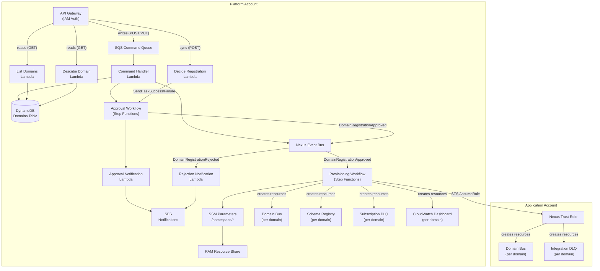
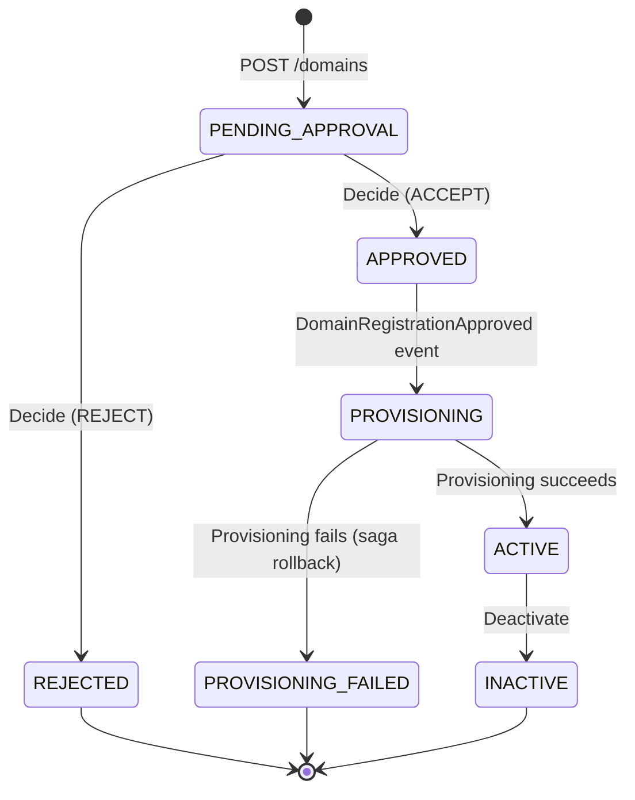
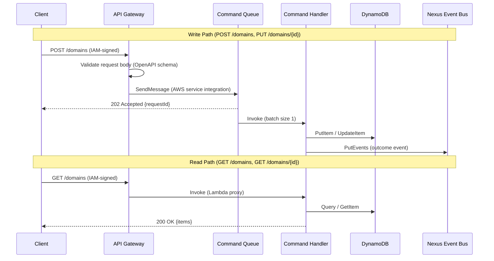
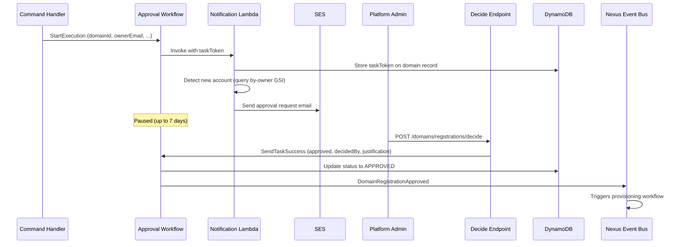
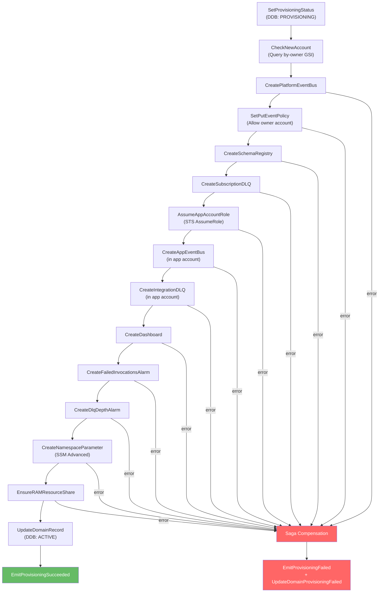
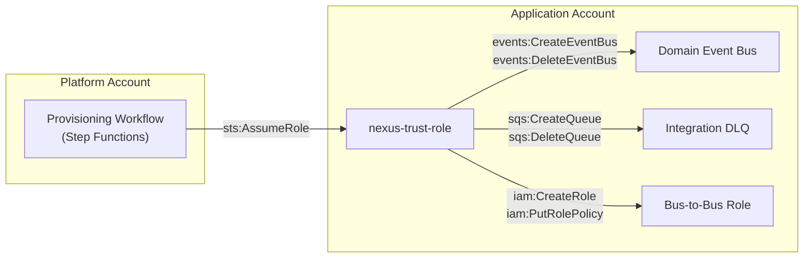
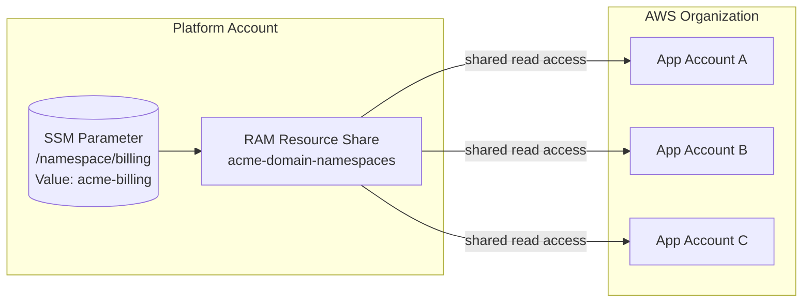

# EventBridge Nexus Architecture

## The Problem

Cross-account EventBridge is powerful but operationally expensive. Setting up event routing between accounts requires creating event buses, rules, IAM roles, resource policies, DLQs, and monitoring in both producer and consumer accounts. For a single domain integration:

- A developer manages **12+ AWS resources** across two accounts
- First-event latency is **1-2 days** of infrastructure wrangling
- Each team reinvents the same resource topology with subtle drift
- Platform teams have no visibility into which domains exist or who owns them

EventBridge Nexus eliminates this complexity. It gives platform teams a governance layer for domains and routing, while application teams get a simple API to register, publish, and subscribe to events without ever touching EventBridge resources directly.

---

## System Overview

Nexus runs in a dedicated **platform account** and provisions domain resources into **application accounts** via cross-account IAM roles. All control-plane state lives in the platform account; application accounts only contain the resources their domains need.



### Key Design Decisions

- **Single SAM template** (`template.yaml`) defines all platform-account resources
- **One Lambda per API operation** — small, focused functions with least-privilege IAM
- **Reads are synchronous** (API Gateway -> Lambda -> DynamoDB); writes are asynchronous (API Gateway -> SQS -> Lambda -> EventBridge)
- **Step Functions for workflows** — no intermediate Lambdas for AWS API calls; uses SDK integrations with JSONata

> For the rationale behind these decisions, see [decisions.md](decisions.md).

---

## Domain Lifecycle

A domain moves through a well-defined status progression from registration to active use:



| Status | Meaning |
|--------|---------|
| `PENDING_APPROVAL` | Registration submitted, awaiting human decision |
| `APPROVED` | Approved by platform admin, provisioning not yet started |
| `REJECTED` | Registration denied, owner notified via email |
| `PROVISIONING` | Infrastructure creation in progress |
| `ACTIVE` | All resources created, domain is operational |
| `PROVISIONING_FAILED` | Infrastructure creation failed, compensating transactions completed |
| `INACTIVE` | Domain deactivated, resources remain but domain is non-operational |

---

## API Layer

The REST API uses IAM authorization and is defined in `api/openapi.yaml`. Write operations are asynchronous — API Gateway validates the request body and pushes it directly to SQS without invoking a Lambda.



### Endpoints

| Method | Path | Type | Handler |
|--------|------|------|---------|
| `POST` | `/domains` | Async (SQS) | `domain-command-handler` (register) |
| `GET` | `/domains` | Sync (Lambda proxy) | `list-domains` |
| `GET` | `/domains/{domainId}` | Sync (Lambda proxy) | `describe-domain` |
| `PUT` | `/domains/{domainId}` | Async (SQS) | `domain-command-handler` (update) |
| `POST` | `/domains/registrations/decide` | Sync (Lambda proxy) | `decide-registration` |

The command handler Lambda receives SQS messages with a `HttpMethod` message attribute and dispatches to the appropriate handler (`register` for POST, `update` for PUT).

---

## Approval Workflow

Domain registration requires human approval before any infrastructure is created. The approval workflow uses the Step Functions **waitForTaskToken** pattern to pause execution until a platform administrator calls the decide endpoint.



**Rejection path:** If the admin rejects, the workflow updates status to `REJECTED`, emits `DomainRegistrationRejected`, and an EventBridge rule triggers the rejection notification Lambda to email the domain owner.

**New account detection:** The notification Lambda queries the `by-owner` GSI to check if the owner account has any existing `ACTIVE` domains. If this is the first domain for that account, the approval email flags it with a trust-stack deployment advisory.

> Workflow definition: `domain-management/state-machines/approval.asl.yaml`

---

## Provisioning Workflow

The provisioning workflow is triggered by the `DomainRegistrationApproved` event on the nexus bus. It creates all domain infrastructure across both the platform and application accounts using Step Functions SDK integrations (no intermediate Lambdas).

### Resource Creation Sequence



### Resources Created Per Domain

| Resource | Account | Naming Convention |
|----------|---------|-------------------|
| Event bus | Platform | `{org}-{env}-{domain}-domain-bus` |
| PutEvents policy | Platform | Allows owner account to publish |
| Schema registry | Platform | `{org}-{env}-{domain}-schema-registry` |
| Subscription DLQ | Platform | `{org}-{env}-{domain}-subscription-dlq` |
| Event bus | App | `{org}-{env}-{domain}-domain-bus` |
| Integration DLQ | App | `{org}-{env}-{domain}-integration-dlq` |
| CloudWatch dashboard | Platform | `{org}-{env}-{domain}-domain-dashboard` |
| Failed invocations alarm | Platform | `{org}-{env}-{domain}-failed-invocations` |
| DLQ depth alarm | Platform | `{org}-{env}-{domain}-dlq-depth` |
| SSM parameter | Platform | `/namespace/{domain}` |
| RAM resource share | Platform | `{org}-domain-namespaces` (shared) |

### Saga Compensation (Rollback)

If any provisioning step fails, the workflow walks backwards through all previously created resources and deletes them before marking the domain as `PROVISIONING_FAILED`. This is a **compensating transaction** pattern (saga):

```mermaid
graph RL
    start["StartCompensation"] --> intdlq{"IntegrationDLQ<br/>exists?"}
    intdlq -->|yes| delintdlq["Delete Integration DLQ"]
    intdlq -->|no| appbus{"AppEventBus<br/>exists?"}
    delintdlq --> appbus
    appbus -->|yes| delappbus["Delete App Event Bus"]
    appbus -->|no| dlqalarm{"DlqDepthAlarm<br/>exists?"}
    delappbus --> dlqalarm
    dlqalarm -->|yes| deldlqalarm["Delete DLQ Depth Alarm"]
    dlqalarm -->|no| failedalarm{"FailedInvocAlarm<br/>exists?"}
    deldlqalarm --> failedalarm
    failedalarm -->|yes| delfailedalarm["Delete Failed Invoc Alarm"]
    failedalarm -->|no| dashboard{"Dashboard<br/>exists?"}
    delfailedalarm --> dashboard
    dashboard -->|yes| deldash["Delete Dashboard"]
    dashboard -->|no| subdlq{"SubscriptionDLQ<br/>exists?"}
    deldash --> subdlq
    subdlq -->|yes| delsubdlq["Delete Subscription DLQ"]
    subdlq -->|no| registry{"SchemaRegistry<br/>exists?"}
    delsubdlq --> registry
    registry -->|yes| delreg["Delete Schema Registry"]
    registry -->|no| platbus{"PlatformBus<br/>exists?"}
    delreg --> platbus
    platbus -->|yes| delplatbus["Delete Platform Event Bus"]
    platbus -->|no| fail["EmitProvisioningFailed"]
    delplatbus --> fail

    style start fill:#f66,color:#fff
    style fail fill:#f66,color:#fff
```



Compensation is **best-effort** — if a delete fails, the error is captured in a `compensationErrors` array and included in the `DomainProvisioningFailed` event payload. This ensures the workflow always completes, even if cleanup is partial.

> Workflow definition: `domain-management/state-machines/provisioning.asl.yaml`

---

## Cross-Account Trust Model

Nexus provisions resources in application accounts by assuming a trust role. Each application account deploys a **trust stack** (CloudFormation template) that creates the IAM role with scoped permissions.



### Trust Role Permissions

The trust role (`{org}-{env}-nexus-trust-role`) grants three scoped policies:

| Policy | Actions | Resource Scope |
|--------|---------|---------------|
| EventBusManagement | `events:Create/Delete/Describe/PutPermission/RemovePermission` | `{org}-{env}-*` event buses |
| DlqManagement | `sqs:Create/Delete/Set/GetQueueAttributes` | `{org}-{env}-*` queues |
| BusToBusRoleManagement | `iam:Create/Delete/Put/DeleteRolePolicy/GetRole` | `{org}-{env}-b2b-*` roles |

The trust role's `AssumeRolePolicyDocument` allows two principals from the platform account:
1. The **Nexus function role** (trust anchor for Lambda-based operations)
2. The **Provisioning workflow role** (for Step Functions SDK integrations)

### Onboarding a New Application Account

1. Deploy `trust-stack.yaml` in the application account
2. Pass the Nexus stack outputs (`NexusFunctionRoleArn`, `ProvisioningWorkflowRoleArn`) as parameters
3. The trust role is immediately available for Nexus to assume

> See [trust-stack-deployment.md](../trust-stack-deployment.md) for step-by-step onboarding instructions.

---

## Resource Namespace Convention

All Nexus-managed resources follow a consistent naming pattern:

```
{org}-{env}-{domain}-{resource-suffix}
```

For example, for organization `acme`, environment `prod`, domain `billing`:

```
acme-prod-billing-domain-bus          (EventBridge bus)
acme-prod-billing-schema-registry     (Schema registry)
acme-prod-billing-subscription-dlq    (Platform DLQ)
acme-prod-billing-integration-dlq     (App account DLQ)
acme-prod-billing-domain-dashboard    (CloudWatch dashboard)
```

The pattern is configurable via the `NamespacePattern` SAM parameter (default: `{org}-{env}-{domain}`). The `NamespaceResolver` in `lib/nexus-common/src/namespace.rs` handles all resource name generation.

### Domain Namespace (Environment-Independent)

Each domain also has an environment-independent **namespace identity**: `{org}-{domain}` (e.g., `acme-billing`). This is stored as an SSM Advanced Parameter at `/namespace/{domain}` and shared across the entire AWS Organization via RAM resource share.



Application accounts can discover domains by reading SSM parameters locally, without any cross-account IAM configuration.

---

## Event Bus and Lifecycle Events

The **nexus bus** (`{org}-{env}-nexus-bus`) carries all internal lifecycle events. It is the backbone for workflow orchestration — events trigger Step Functions executions and EventBridge rules invoke notification Lambdas.

### Event Catalog

| Detail Type | Source | Emitted By | Triggers |
|------------|--------|-----------|----------|
| `RegisterDomainSucceeded` | `nexus.domain-management` | Command handler (register) | — |
| `RegisterDomainFailed` | `nexus.domain-management` | Command handler (register) | — |
| `UpdateDomainSucceeded` | `nexus.domain-management` | Command handler (update) | — |
| `UpdateDomainFailed` | `nexus.domain-management` | Command handler (update) | — |
| `DomainRegistrationApproved` | `nexus.domain-management` | Approval workflow | Provisioning workflow |
| `DomainRegistrationRejected` | `nexus.domain-management` | Approval workflow | Rejection notification Lambda |
| `DomainProvisioningSucceeded` | `nexus.domain-management` | Provisioning workflow | — |
| `DomainProvisioningFailed` | `nexus.domain-management` | Provisioning workflow | — |

All events use the source prefix `nexus.domain-management`. The `DomainRegistrationApproved` event is the key orchestration trigger — it initiates the provisioning workflow via an EventBridge rule on the nexus bus.

---

## Data Model

A single `domains` DynamoDB table stores both domain metadata and registration state. This was a deliberate choice over separate tables — the domain entity and its registration lifecycle are the same concern.

### Table Schema

| Attribute | Type | Key |
|-----------|------|-----|
| `domainId` | String | Partition key (PK) |
| `domainName` | String | GSI: `by-name` (PK) |
| `ownerAccountId` | String | GSI: `by-owner` (PK) |
| `status` | String | GSI: `by-status` (PK) |
| `description` | String | — |
| `ownerEmail` | String | — |
| `tags` | Map | — |
| `resourceArns` | Map | — (populated after provisioning) |
| `taskToken` | String | — (Step Functions task token) |
| `decidedBy` | String | — |
| `justification` | String | — |
| `createdAt` | String (ISO 8601) | — |
| `updatedAt` | String (ISO 8601) | — |
| `approvedAt` | String (ISO 8601) | — |
| `rejectedAt` | String (ISO 8601) | — |
| `errorDetail` | String | — |

### Access Patterns

| Pattern | Index | Key Condition |
|---------|-------|---------------|
| Get domain by ID | Table (PK) | `domainId = :id` |
| Check domain name uniqueness | `by-name` | `domainName = :name` |
| List domains by owner | `by-owner` | `ownerAccountId = :acct` |
| List domains by status | `by-status` | `status = :status` |
| Detect new account | `by-owner` | `ownerAccountId = :acct` + filter `status = ACTIVE` |

The table uses `PAY_PER_REQUEST` billing with point-in-time recovery enabled and a `Retain` deletion policy.

---

## Infrastructure as Code

All infrastructure is defined in a single AWS SAM template (`template.yaml`) with CloudFormation. Step Functions workflows are defined in YAML with JSONata query language.

### Project Structure

```
evb-nexus/
├── api/
│   └── openapi.yaml                          # OpenAPI 3.0 contract (embedded in SAM)
├── domain-management/
│   ├── functions/
│   │   ├── decide-registration/              # Sync: approve/reject decisions
│   │   ├── describe-domain/                  # Sync: get domain by ID
│   │   ├── domain-command-handler/           # Async: register + update commands
│   │   ├── list-domains/                     # Sync: list/filter domains
│   │   ├── send-approval-notification/       # Approval email (invoked by workflow)
│   │   └── send-rejection-notification/      # Rejection email (EventBridge rule)
│   └── state-machines/
│       ├── approval.asl.yaml                 # Human-in-the-loop approval
│       └── provisioning.asl.yaml             # Resource provisioning + saga rollback
├── lib/
│   └── nexus-common/                         # Shared library (models, DDB helpers, API, validation, namespace)
├── docs/
│   ├── development/
│   │   ├── architecture.md                   # This document
│   │   ├── decisions.md                      # Decision log
│   │   └── testing.md                        # Testing strategy
│   └── trust-stack-deployment.md             # App account onboarding guide
├── template.yaml                             # SAM template (all platform-account resources)
├── trust-stack.yaml                          # CloudFormation for app account trust role
└── Cargo.toml                                # Rust workspace root
```

### Tech Stack

| Layer | Technology |
|-------|-----------|
| Language | Rust (cargo-lambda, aws-sdk-rust, serde, tokio) |
| API | REST via API Gateway with IAM authorization |
| Database | DynamoDB (PAY_PER_REQUEST, single table) |
| Workflows | Step Functions (YAML, JSONata, SDK integrations) |
| Notifications | SES (approval and rejection emails) |
| Namespace sharing | SSM Advanced Parameters + RAM |
| IaC | AWS SAM / CloudFormation |
| Runtime | `provided.al2023` (ARM64, 256 MB) |

---

## Cross-References

| Document | Purpose |
|----------|---------|
| [decisions.md](decisions.md) | Why things are built this way — architectural decision log |
| [testing.md](testing.md) | Testing strategy, smithy-mocks patterns, TDD workflow |
| [trust-stack-deployment.md](../trust-stack-deployment.md) | Step-by-step guide for onboarding application accounts |
| [api/openapi.yaml](../../api/openapi.yaml) | Full API contract with request/response schemas |
| [template.yaml](../../template.yaml) | SAM template — source of truth for all platform resources |
| [trust-stack.yaml](../../trust-stack.yaml) | Trust role CloudFormation template |
