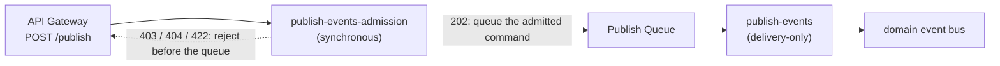

# Publish Validation at Ingest — Design Deep Dive

How Konductor decides whether a publish request becomes an event, why the
machinery is shaped the way it is, and what each piece guarantees. This
document assumes no prior involvement in the design: every concept is
introduced before it is used, and every mechanism is paired with the failure
it exists to prevent.

Read this if you are about to modify the publish path, review a change to it,
or explain its behavior to a producer team. For the producer-facing how-to,
see [Publishing Events](../publishing-events.md); for the decision-log entry,
see [decisions.md](decisions.md) (`validate-at-ingest`).

## 1. The failure this design eliminates

The publish path used to work like this:

```text
POST /publish ──▶ API Gateway ──▶ SQS queue ──▶ consumer Lambda ──▶ domain bus
                   (202 here)                      │
                                                   └─ authorization, schema
                                                      resolution, and payload
                                                      handling happened HERE
```

API Gateway answered `202 Accepted` the moment the request body was well-formed
and sitting in the queue. Everything that could make a publish *wrong* — the
caller having no publisher binding, the domain being disabled, the schema not
existing, the payload not matching the schema — was discovered later, inside an
asynchronous consumer the caller could not observe.

The result was a systematic failure mode: **producers learned about broken
publishes only by absence.** An event that never arrives looks exactly like an
event that is merely slow. The caller got `202`, logged success, and moved on.
Debugging started downstream, with a consumer team asking "where is my event?",
and worked backwards through platform logs.

One incident made the cost concrete: a producer appended a schema version that
*removed* a field (a breaking change disguised as an append). Events stamped
with the new version no longer matched what consumers expected, and nothing in
the platform flagged it — nothing ever checked conformance. The append itself
was legal; there was no enforcement point anywhere in the pipeline.

The design goal follows directly: **move every decidable failure to the
synchronous side of the queue, so the API answer is always actionable.** If the
platform can know a publish will not deliver, the caller must hear it in the
response, with enough detail to fix it.

## 2. The promise of `202`

The redesign turns `202 Accepted` from "your request is queued" into a promise:

> A `202` means the caller was authenticated and authorized, the target domain
> is live, the payload conforms to the schema's latest version, and the event
> is durably queued. Delivery from that point is the platform's problem.

Everything that can be decided synchronously is decided synchronously. Only two
things remain asynchronous, because they are physically impossible to settle at
request time: the domain being disabled *between* admission and delivery (a
genuine race, handled by a delivery-time recheck), and transient EventBridge
failures (handled by the queue's retry machinery, unchanged).

## 3. The two halves: admission and delivery

The publish path is now two Lambda functions with a queue between them:



**Admission** (`publish-events-admission`) runs synchronously behind
`POST /publish`. It performs every check that can fail, in a deliberate order,
and enqueues only publishes that passed all of them. Its single write — the
`SendMessage` to the queue — *is* the commit: once that succeeds, the event is
durable and the caller gets `202`.

**Delivery** (`publish-events`) consumes the queue. It performs no
authorization, no schema fetch, and no payload validation. It re-checks domain
liveness, builds the canonical envelope, and calls `PutEvents`.

Why split, instead of one function that validates and delivers synchronously?

- **The queue boundary is worth keeping.** It absorbs publish bursts, decouples
  ingest availability from EventBridge availability, and gives delivery retries
  somewhere durable to live. A fully synchronous path would re-introduce
  backpressure coupling the queue exists to remove.
- **Blast radius.** A delivery bug (bad envelope construction, an EventBridge
  API change) delays events but cannot block ingest; producers keep getting
  actionable answers. An admission bug blocks ingest loudly (visible `503`s),
  which is the correct trade — silent acceptance of unvalidatable events is the
  failure mode this design exists to remove.
- **Least privilege.** Delivery no longer needs to read the authorization
  bindings table or the schema registry, so its IAM role loses both. The queue
  enforces the same boundary: IAM grants `SendMessage` to the admission role
  only, and a resource policy on the queue denies `sqs:SendMessage` to every
  other principal — so even a same-account workload with broad SQS permissions
  cannot inject a command that skips validation. The deliberate trade-off:
  console/CLI DLQ redrive is denied too. The correct re-drive is re-publishing
  through `/publish` — the DLQ retains the original message body for exactly
  that, and re-admission re-validates rather than bypassing the gate.

## 4. What admission checks, and why in that order

Each request walks a fixed sequence. The order is not incidental; each step is
justified by what it protects:

1. **Request shape (`400`).** The body must be exactly
   `{domain, eventName, data, idempotencyKey?}`. Unknown fields are rejected —
   a caller who believes they supplied a version, a registry, or a source must
   learn immediately that the platform ignored nothing by accident.
2. **Authorization (`403`).** The grant engine decides `schema:publish` on the
   domain *before* the domain is looked up. This is deliberate: checking
   existence first would let an unauthorized caller probe which domains and
   schemas exist by comparing `403` and `404`. Denial before access discloses
   nothing.
3. **Domain liveness (`404`).** The domain must exist and be `ACTIVE`. A
   disabled domain rejects all publishes — this is how platform operators drain
   a domain without touching bindings.
4. **Schema resolution (`404`).** The latest version of `{org}-{domain}@{eventName}`
   is resolved from the stage-selected environment's registry. The schema is
   the contract the payload is about to be checked against; without it there is
   nothing to validate.
5. **Payload conformance (`422`).** `data` is validated against that schema
   document, compiled as JSON Schema draft-4. Violations come back as a list of
   human-readable, instance-located messages (`"total": -5 is less than the
   minimum of 0`), capped so a pathological payload cannot produce an unbounded
   response.
6. **Envelope deliverability (`400`).** Admission constructs the exact
   EventBridge entry the delivery step would send — same source, detail-type,
   version stamp, and payload — and rejects the request if it fails structural
   or size validation (256 KiB entry limit). Without this step, a conforming
   but oversized payload would earn a `202` and then fail deterministically on
   every delivery retry into the DLQ: the silent-drop failure in a new costume.
7. **Enqueue (`202`).** Only now does anything durable happen.

Steps 2–6 each answer *before* touching anything the caller is not entitled to
know about, and no step writes anything except the last.

## 5. Reading the answers

| Status | Meaning | What the caller should do |
|--------|---------|---------------------------|
| `400` | The request body itself is malformed (missing field, unknown field, bad event name), or the resulting event entry would exceed EventBridge's size limit | Fix the request shape; shrink the payload |
| `403` | No publisher binding for this principal on this domain | Ask the platform team for a binding |
| `404` | Domain missing/inactive, or no schema for this event in this environment | Check domain status; register the schema first |
| `422` | The payload violates the schema's latest version | Fix the payload (violations are listed in `message`) |
| `503` | The platform could not *evaluate* the request (registry unreachable, stored schema unusable, queue write failed) | Retry with backoff — this is never a rejection |

Two distinctions are load-bearing:

**`422` versus `400`.** A `400` says "this is not a well-formed publish
request"; a `422` says "this is a perfectly good publish request whose payload
breaks the event contract." Keeping them separate lets monitoring distinguish
client bugs (400 — the caller's HTTP code is wrong) from contract drift (422 —
the caller's *data* diverged from the schema), which have different owners and
different urgencies.

**`503` is never a rejection.** A `503` means Konductor could not determine
whether the publish is valid — the registry timed out, or a stored schema
cannot be compiled. Failing closed with a retryable answer is the only honest
move: pretending the publish is fine recreates the silent-drop failure, and
pretending it is invalid punishes producers for a platform problem.

## 6. The schema cache and the refresh-before-reject rule

Calling the Schemas API on every publish would add a network hop and a hard
dependency to the hot path, so admission keeps an in-memory cache keyed by
`(environment, schema)` holding `{version, content, fetchedAt}`, with a TTL of
at most 60 seconds.

A cache introduces an obvious hazard: what if a producer appends schema version
4, immediately publishes a version-4-shaped payload, and the cache still holds
version 3? The new payload fails validation against the stale schema and gets a
spurious `422`. This is not a corner case — "append schema, publish new shape"
is the *normal* evolution workflow.

The rule that eliminates it: **a cached schema may admit, but it may not
reject.** When validation fails against a cached entry, admission force-fetches
the schema from the registry and validates once more against the authoritative
latest version. The `422` is returned only if the payload fails against the
fresh schema too. A false rejection caused by cache staleness is therefore
impossible; the cache only ever saves the *admission* path a registry call.

What about the symmetric case — a payload that passes the stale schema but
would fail the fresh one? Under the platform's additive-only evolution norm
(new versions add fields and loosen constraints; they never remove), any
payload valid under version N is valid under every later version, so stale
*acceptance* cannot admit anything the current schema forbids. The norm is
enforced mechanically: `POST /schemas/versions` rejects any append that
tightens relative to the current latest version (the append-time
compatibility gate, `gate-schema-promotion`), so a stale cache entry can only
ever lag behind on loosenings — exactly the direction the force-fetch on
rejection already covers.

One boundary is absolute: **the registry is the only authority on schema
content.** The cache is an availability hedge, refreshed on any doubt; no
DynamoDB projection or denormalized copy is ever consulted for the conformance
decision. A platform with two sources of truth for the contract will
eventually disagree with itself.

## 7. The earned stamp

Every event Konductor delivers carries `metadata.schemaVersion`, and consumers
use it to interpret the payload. For that stamp to mean anything, it must be
*earned*: the version recorded must be the version the payload was actually
validated against.

Admission sets the `SchemaVersion` SQS message attribute to the version it
validated, and delivery copies that attribute into the envelope **verbatim** —
it never re-resolves "latest" at delivery time. The alternative (resolve at
delivery) would break the invariant whenever a version is appended while a
message sits in the queue: the event would carry a stamp for a version its
payload was never checked against.

The accepted consequence: if version 5 is appended between admission and
delivery, the event is stamped version 4 — the version it provably conforms
to. Consumers migrating to version 5 should treat the stamp as a statement
about the payload, not about the registry's current state.

## 8. What the delivery consumer still does

"Delivery-only" does not mean "trusts blindly." Three responsibilities remain:

- **Domain liveness recheck.** A domain can be disabled in the seconds between
  admission and delivery; that transition must take effect for events already
  queued. This is the one synchronous check that cannot be moved to admission,
  because the race is real.
- **Envelope structural validation.** Before `PutEvents`, the constructed
  envelope is checked (positive version, non-empty identity, serializable,
  within EventBridge's 256 KB entry limit). An invalid *generated* envelope
  means the platform's own code is broken — it is reported for retry, never
  partially delivered.
- **Retry semantics, unchanged.** Transient `PutEvents` failures are reported
  for retry; retries exhaust to the publish DLQ with all attributes intact.
  `publishedAt` derives from the SQS `SentTimestamp`, which is fixed when the
  message is first sent and survives every in-queue retry — so automatic
  retries always keep the original publish time. The one exception is a DLQ
  *redrive*, which re-sends as a new message with a new `SentTimestamp`; given
  the queue's admission-only write policy, the sanctioned re-drive path is
  re-publishing through `/publish`, which stamps a fresh ingest time by
  definition.

## 9. Why schemas are draft-4 only, enforced at write time

Validation is only as reliable as the stored schemas. If a registry could hold
a document that does not compile — malformed JSON, a non-object, an OpenAPI 3.0
document, a draft-2020-12 schema using draft-4-incompatible keywords — then
every publish against it would fail at admission with `503`, forever. The
platform would have traded "events silently dropped" for "events rejected
loudly for a reason nobody can fix at publish time."

So the invariant is enforced at the only two places schemas enter the system:
`POST /schemas` and `POST /schemas/versions` reject any `schemaType` other than
`JSONSchemaDraft4` (`400`), and compile the content as draft-4 before writing
(`400` on failure). **Nothing unvalidatable is ever stored**, which is what
makes "admission can always validate" a guarantee rather than a hope. Draft-4
specifically is what EventBridge Schemas supports; compilation is pinned to
draft-4 semantics regardless of the document's `$schema` keyword, so ambiguity
is a defect (`503`), never a silent reinterpretation.

An audit of every org registry before rollout found exactly one schema
(`acme-billing@OrderNotification`, already draft-4), so the transitional
carve-out for legacy OpenAPI 3.0 content was dropped rather than shipped.

## 10. What this design deliberately does not do

- **Caller-declared or pinned schema versions.** Producers cannot publish
  "against version 3." Allowing it would couple producers to consumer migration
  schedules and make the stamp meaningless (declared, not earned). The contract
  is always the latest version.
- **Overlap windows** (accept either of the last N versions). Weakens the
  contract to a union that no consumer can rely on, for marginal producer
  convenience the refresh-before-reject rule already provides.
- **Validating at delivery and DLQ-ing invalid events.** Preserves the
  silent-drop failure mode with extra steps: the publisher still learns
  nothing, and now operations owns a DLQ full of contract violations.
- **Schema-on-read** (consumers validate). Spreads the enforcement cost across
  every consumer, guarantees inconsistent enforcement, and answers the
  producer's "was my event valid?" question never.
- **API Gateway request validators.** They check request shape against a static
  model; they cannot compile a registry-resolved draft-4 document or evaluate
  `data` against it. Shape checking stays at the edge (and in serde);
  conformance checking needs the schema, which only admission has.

## 11. Where things live

| Piece | Location |
|-------|----------|
| Admission handler | `event-streams/functions/publish-events-admission/` |
| Delivery consumer | `event-streams/functions/publish-events/` |
| Validation, cache, draft-4 compile gate | `lib/konductor-common/src/schema_validation.rs` |
| Principal envelope serialization | `lib/konductor-common/src/principal_context.rs` (`to_sqs_attributes`) |
| Schema write gates (draft-4 400s) | `event-streams/functions/schema-admin/` |
| Infrastructure (queue policy, IAM, alarm) | `konductor-core-stack.yaml` |
| API contracts (`/publish` responses) | `api/openapi-oauth.yaml`, `api/openapi-iam.yaml` |
| Contract tests | `lib/konductor-common/tests/api_surfaces.rs` |

Operations: a `PublishUnavailable` metric filter on the admission log feeds the
`konductor-publish-admission-unavailable-alarm` — any firing means ingest is
degraded (registry outage, unusable stored schema, or queue failure) and
publishers are seeing `503`s.
