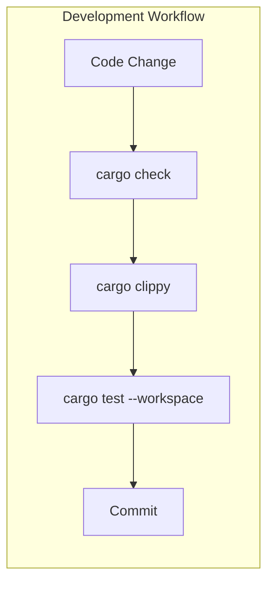

# Testing Guide

## TDD: Red/Green/Refactor

> **Scope:** What to test is defined by the priority test flows in AGENTS.md —
> critical paths, not every function. The cycle below describes how to work
> when implementing those flows.

Follow test-driven development when implementing features:

```text
┌─────────────────────────────────────────────────────────────┐
│                    RED → GREEN → REFACTOR                   │
├─────────────────────────────────────────────────────────────┤
│                                                             │
│   1. RED     Write a failing test that defines expected     │
│              behavior. Run it - it MUST fail.               │
│                                                             │
│   2. GREEN   Write minimal code to make the test pass.      │
│              No more, no less. Run test - it MUST pass.     │
│                                                             │
│   3. REFACTOR  Clean up the code (extract, rename, etc.)    │
│                while keeping the test green.                │
│                                                             │
│   Repeat for each behavior/scenario.                        │
│                                                             │
└─────────────────────────────────────────────────────────────┘
```

**Key principles:**

- Tests guide implementation, not the other way around
- Never change a test to make it pass - change the implementation
- Each cycle should be small (minutes, not hours)
- Commit after each green phase (locally; consolidate into conventional commits before review — see AGENTS.md git workflow)

**Anti-patterns to avoid:**

- Writing implementation first, then tests to match
- Writing multiple tests before any implementation
- Changing test assertions to match buggy behavior
- Skipping the refactor phase

## Test Strategy Overview



## Test Types

| Type | Location | Command | Purpose |
|------|----------|---------|---------|
| Unit Tests | `src/*.rs` (inline `#[cfg(test)]` modules) | `cargo test --workspace` | Test isolated logic within each crate |
| Handler Tests | `src/*.rs` (inline `#[cfg(test)]` with smithy-mocks) | `cargo test --workspace` | Test handler behavior with mocked AWS SDK clients |
| Full Suite | — | `make test` | Run all tests across the workspace |

## Commands

```bash
# Run all tests across the workspace
make test

# Run tests for a specific crate
cargo test -p konductor-common

# Run a single test by name
cargo test -p konductor-common default_pattern_resolves_correctly

# Run tests with output visible (nocapture)
cargo test --workspace -- --nocapture

# Check compilation without running tests
make check
```

## Unit Tests

Place unit tests in a `#[cfg(test)]` module at the bottom of the source file they exercise. This keeps tests co-located with the code they verify.

```rust
pub fn event_bus_name(org: &str, env: &str, domain: &str) -> String {
    format!("{org}-{env}-{domain}-event-bus")
}

#[cfg(test)]
mod tests {
    use super::*;

    #[test]
    fn event_bus_name_includes_suffix() {
        let result = event_bus_name("acme", "prod", "billing");
        assert_eq!(result, "acme-prod-billing-event-bus");
    }
}
```

**Guidelines:**

- One `mod tests` block per source file
- Use `use super::*;` to import the parent module
- Test function names should describe the behavior, not the function name
- Prefer `assert_eq!` / `assert_ne!` over bare `assert!` for better failure messages

## Handler Tests

Handler-level tests that exercise the full request-to-response path with mocked AWS SDK clients serve as the project's integration tests. These live inline in `src/` alongside the handler code, not in separate `tests/` directories.

A `tests/` directory (which compiles as a separate crate with access to the library's public API) may be used in the future for cross-crate scenarios. Currently, all handler tests are inline because each Lambda crate has a single entry point.

See the [Mocking AWS SDK Clients](#mocking-aws-sdk-clients-with-smithy-mocks) section below for the smithy-mocks pattern used in handler tests.

## Async Tests

Lambda handlers and AWS SDK calls are async. Use `#[tokio::test]` for async test functions. All async handler tests use smithy-mocks with injected clients (see sections below):

```rust
#[cfg(test)]
mod tests {
    use super::*;

    #[tokio::test]
    async fn handler_returns_success_for_valid_input() {
        // Mock clients built with smithy-mocks — see below.
        let result = handle(&ddb, &eb, &sfn, &request).await;
        assert!(result.is_ok());
    }
}
```

## Handler Structure for Testability

To use smithy-mocks, handler functions must accept SDK clients as parameters rather than constructing them internally. The `main.rs` entrypoint builds real clients from AWS config; the handler function receives them as arguments. This separation is what allows smithy-mocks to inject mock clients in tests.

```rust
// src/main.rs — thin entrypoint: build clients once, pass by reference
#[tokio::main]
async fn main() -> Result<(), Error> {
    tracing_subscriber::fmt().json().with_env_filter(EnvFilter::from_default_env()).init();
    let config = aws_config::load_defaults(BehaviorVersion::latest()).await;
    let ddb = aws_sdk_dynamodb::Client::new(&config);
    let ddb_ref = &ddb;
    lambda_runtime::run(service_fn(move |event| async move {
        handler::handle(ddb_ref, event).await
    }))
    .await
}

// src/handler.rs — testable, accepts clients as params
pub async fn handle(
    ddb: &aws_sdk_dynamodb::Client,
    event: LambdaEvent<Value>,
) -> Result<Value, Error> { ... }
```

Handlers that build their own clients inside the handler function cannot be tested with smithy-mocks without refactoring. See also the rust-reviewer droid (section 6, Crate and Module Design) for the client-init and thin-handler rules.

## Mocking AWS SDK Clients with Smithy-Mocks

Use [`aws-smithy-mocks`](https://docs.aws.amazon.com/sdk-for-rust/latest/dg/testing-smithy-mocks.html) to test Lambda handlers that call AWS services. Mock clients are real SDK client types with canned responses, so no mock-specific code is needed in production handlers. However, handlers must accept SDK clients as parameters — see [Handler Structure for Testability](#handler-structure-for-testability) above.

### Setup

SDK crates need the `test-util` feature enabled in the workspace `Cargo.toml`:

```toml
[workspace.dependencies]
aws-sdk-dynamodb = { version = "1", features = ["test-util"] }
aws-smithy-mocks = "0.2"
```

Each crate that needs mock tests adds a dev-dependency:

```toml
[dev-dependencies]
aws-smithy-mocks = { workspace = true }
```

### Writing mock tests

Create mock rules for each SDK operation, build a mock client, and pass it to the function under test:

```rust
use aws_sdk_dynamodb::operation::put_item::PutItemError;
use aws_smithy_mocks::{mock, mock_client};

#[tokio::test]
async fn rejects_duplicate_domain_with_failed_event() {
    let put_rule = mock!(aws_sdk_dynamodb::Client::put_item).then_error(|| {
        PutItemError::ConditionalCheckFailedException(
            aws_sdk_dynamodb::types::error::ConditionalCheckFailedException::builder().build(),
        )
    });
    let ddb = mock_client!(aws_sdk_dynamodb, [&put_rule]);

    let result = handle(&ddb, &eb, &sfn, &request).await;

    assert!(result.is_ok()); // handler emits failed event, does not error
    assert_eq!(put_rule.num_calls(), 1);
}
```

### Key patterns

**Sequential rules** — when a function makes multiple calls to the same service, use `RuleMode::Sequential`:

```rust
let ddb = mock_client!(
    aws_sdk_dynamodb,
    RuleMode::Sequential,
    [&query_rule, &put_rule]
);
```

**Request matching** — verify the mock received expected inputs:

```rust
let put_rule = mock!(aws_sdk_dynamodb::Client::put_item)
    .match_requests(|req| {
        req.item()
            .map(|items| items.contains_key("description"))
            .unwrap_or(false)
    })
    .then_output(|| PutItemOutput::builder().build());
```

**Error simulation** — test failure paths:

```rust
let error_rule = mock!(aws_sdk_dynamodb::Client::query)
    .then_error(|| QueryError::InternalServerError(
        InternalServerError::builder().build()
    ));
```

**Call verification** — confirm the mock was (or was not) invoked:

```rust
assert_eq!(rule.num_calls(), 1);
```

### When to use smithy-mocks vs trait abstractions

| Interaction pattern | Approach |
|---|---|
| SDK call appears in one function | Smithy-mocks directly |
| Same query/mutation pattern across 3+ functions | Extract a domain trait (e.g., `DomainRepository`) |
| Fire-and-forget (EventBridge, SES) | Smithy-mocks directly |

Prefer smithy-mocks by default. Only introduce trait abstractions when the same AWS interaction pattern is genuinely duplicated across multiple functions — driven by DRY, not by the need to mock.

## Error Case Testing

Use pattern matching or `assert!(result.is_err())` to verify error paths:

```rust
#[test]
fn rejects_empty_domain_name() {
    let result = validate_domain_name("");
    assert!(result.is_err());
}

#[test]
fn rejects_domain_name_with_special_chars() {
    let result = validate_domain_name("billing@v2!");

    match result {
        Err(e) => assert!(e.to_string().contains("invalid")),
        Ok(_) => panic!("expected validation error"),
    }
}
```

## Test Organization Conventions

```text
crate-root/
├── src/
│   ├── main.rs           ← thin entrypoint (no tests)
│   ├── handler.rs        ← unit + handler tests at bottom via #[cfg(test)]
│   ├── register.rs       ← unit + handler tests at bottom via #[cfg(test)]
│   └── validation.rs     ← unit tests at bottom via #[cfg(test)]
└── tests/                ← reserved for future cross-crate scenarios (currently empty)
```

- All tests go inline in the module they test via `#[cfg(test)]`
- Handler tests with smithy-mocks live in the `#[cfg(test)]` module; use a nested `mod handle_tests` block when a file mixes many pure-logic tests with handler tests (e.g. register.rs)
- Name test functions descriptively: `rejects_empty_domain_name` not `test_1`

## CI Considerations

- `make check` runs `cargo fmt --check`, `cargo check`, and `cargo clippy -- -D warnings` (zero warnings policy)
- `make test` runs `cargo test --workspace`
- Both must pass before merging
- SAM build (`make build`) compiles release binaries for Lambda deployment
