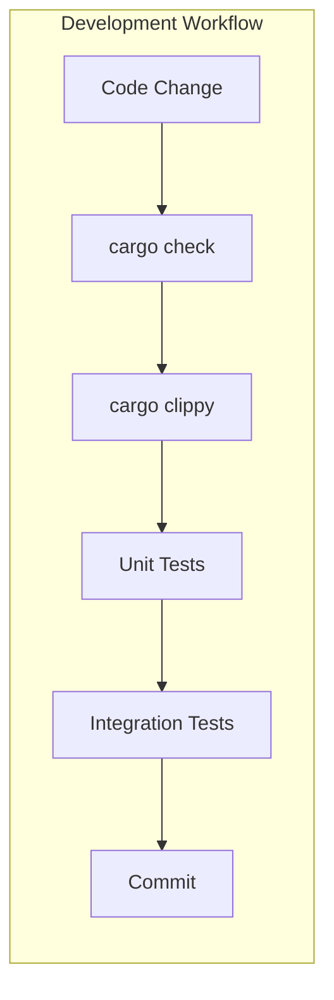

# Testing Guide

## TDD: Red/Green/Refactor

Follow test-driven development when implementing features:

```
┌─────────────────────────────────────────────────────────────┐
│                    RED → GREEN → REFACTOR                   │
├─────────────────────────────────────────────────────────────┤
│                                                             │
│   1. RED     Write a failing test that defines expected     │
│              behavior. Run it - it MUST fail.               │
│                                                             │
│   2. GREEN   Write minimal code to make the test pass.      │
│              No more, no less. Run test - it MUST pass.     │
│                                                             │
│   3. REFACTOR  Clean up the code (extract, rename, etc.)    │
│                while keeping the test green.                │
│                                                             │
│   Repeat for each behavior/scenario.                        │
│                                                             │
└─────────────────────────────────────────────────────────────┘
```

**Key principles:**
- Tests guide implementation, not the other way around
- Never change a test to make it pass - change the implementation
- Each cycle should be small (minutes, not hours)
- Commit after each green phase

**Anti-patterns to avoid:**
- Writing implementation first, then tests to match
- Writing multiple tests before any implementation
- Changing test assertions to match buggy behavior
- Skipping the refactor phase

## Test Strategy Overview



## Test Types

| Type | Location | Command | Purpose |
|------|----------|---------|---------|
| Unit Tests | `src/*.rs` (inline `#[cfg(test)]` modules) | `cargo test --workspace` | Test isolated logic within each crate |
| Integration Tests | `tests/*.rs` (per crate) | `cargo test --workspace` | Test cross-module behavior and AWS SDK interactions |
| Full Suite | — | `make test` | Run all tests across the workspace |

## Commands

```bash
# Run all tests across the workspace
make test

# Run tests for a specific crate
cargo test -p nexus-common

# Run a single test by name
cargo test -p nexus-common default_pattern_resolves_correctly

# Run tests with output visible (nocapture)
cargo test --workspace -- --nocapture

# Check compilation without running tests
make check
```

## Unit Tests

Place unit tests in a `#[cfg(test)]` module at the bottom of the source file they exercise. This keeps tests co-located with the code they verify.

```rust
pub fn event_bus_name(env: &str, org: &str, domain: &str) -> String {
    format!("{env}-{org}-{domain}-event-bus")
}

#[cfg(test)]
mod tests {
    use super::*;

    #[test]
    fn event_bus_name_includes_suffix() {
        let result = event_bus_name("prod", "acme", "billing");
        assert_eq!(result, "prod-acme-billing-event-bus");
    }
}
```

**Guidelines:**
- One `mod tests` block per source file
- Use `use super::*;` to import the parent module
- Test function names should describe the behavior, not the function name
- Prefer `assert_eq!` / `assert_ne!` over bare `assert!` for better failure messages

## Integration Tests

For cross-module or AWS SDK behavior, place tests in a `tests/` directory at the crate root. Each `.rs` file in `tests/` compiles as a separate crate with access to the library's public API.

```
lib/nexus-common/
├── src/
│   └── lib.rs
└── tests/
    └── domain_lifecycle.rs
```

```rust
use nexus_common::NamespaceResolver;

#[test]
fn resolver_produces_consistent_naming() {
    let resolver = NamespaceResolver::default_pattern();
    let bus = resolver.event_bus_name("prod", "acme", "billing");
    let registry = resolver.schema_registry_name("prod", "acme", "billing");

    assert!(bus.starts_with("prod-acme-billing"));
    assert!(registry.starts_with("prod-acme-billing"));
}
```

## Async Tests

Lambda handlers and AWS SDK calls are async. Use `#[tokio::test]` for async test functions:

```rust
#[cfg(test)]
mod tests {
    use super::*;

    #[tokio::test]
    async fn handler_returns_success_for_valid_input() {
        let event = serde_json::json!({
            "domain_name": "billing",
            "owner_account_id": "123456789012"
        });

        let result = handle_request(event).await;
        assert!(result.is_ok());
    }
}
```

## Mocking AWS SDK Clients with Smithy-Mocks

Use [`aws-smithy-mocks`](https://docs.aws.amazon.com/sdk-for-rust/latest/dg/testing-smithy-mocks.html) to test Lambda handlers that call AWS services. This requires zero changes to production code — mock clients are real SDK client types with canned responses.

### Setup

SDK crates need the `test-util` feature enabled in the workspace `Cargo.toml`:

```toml
[workspace.dependencies]
aws-sdk-dynamodb = { version = "1", features = ["test-util"] }
aws-smithy-mocks = "0.2"
```

Each crate that needs mock tests adds a dev-dependency:

```toml
[dev-dependencies]
aws-smithy-mocks = { workspace = true }
```

### Writing mock tests

Create mock rules for each SDK operation, build a mock client, and pass it to the function under test:

```rust
use aws_sdk_dynamodb::operation::query::QueryOutput;
use aws_smithy_mocks::{mock, mock_client, RuleMode};

#[tokio::test]
async fn rejects_duplicate_domain() {
    let query_rule = mock!(aws_sdk_dynamodb::Client::query)
        .match_requests(|req| req.index_name() == Some("by-name"))
        .then_output(|| QueryOutput::builder().count(1).build());

    let ddb = mock_client!(aws_sdk_dynamodb, [&query_rule]);

    let result = handle(&ddb, &eb, &sfn, &request).await;

    assert!(result.is_ok());
    assert_eq!(query_rule.num_calls(), 1);
}
```

### Key patterns

**Sequential rules** — when a function makes multiple calls to the same service, use `RuleMode::Sequential`:

```rust
let ddb = mock_client!(
    aws_sdk_dynamodb,
    RuleMode::Sequential,
    [&query_rule, &put_rule]
);
```

**Request matching** — verify the mock received expected inputs:

```rust
let put_rule = mock!(aws_sdk_dynamodb::Client::put_item)
    .match_requests(|req| {
        req.item()
            .map(|items| items.contains_key("description"))
            .unwrap_or(false)
    })
    .then_output(|| PutItemOutput::builder().build());
```

**Error simulation** — test failure paths:

```rust
let error_rule = mock!(aws_sdk_dynamodb::Client::query)
    .then_error(|| QueryError::InternalServerError(
        InternalServerError::builder().build()
    ));
```

**Call verification** — confirm the mock was (or was not) invoked:

```rust
assert_eq!(rule.num_calls(), 1);
```

### When to use smithy-mocks vs trait abstractions

| Interaction pattern | Approach |
|---|---|
| SDK call appears in one function | Smithy-mocks directly |
| Same query/mutation pattern across 3+ functions | Extract a domain trait (e.g., `DomainRepository`) |
| Fire-and-forget (EventBridge, SES) | Smithy-mocks directly |

Prefer smithy-mocks by default. Only introduce trait abstractions when the same AWS interaction pattern is genuinely duplicated across multiple functions — driven by DRY, not by the need to mock.

## Error Case Testing

Use pattern matching or `assert!(result.is_err())` to verify error paths:

```rust
#[test]
fn rejects_empty_domain_name() {
    let result = validate_domain_name("");
    assert!(result.is_err());
}

#[test]
fn rejects_domain_name_with_special_chars() {
    let result = validate_domain_name("billing@v2!");

    match result {
        Err(e) => assert!(e.to_string().contains("invalid")),
        Ok(_) => panic!("expected validation error"),
    }
}
```

## Test Organization Conventions

```
crate-root/
├── src/
│   ├── lib.rs
│   ├── handler.rs        ← unit tests at bottom via #[cfg(test)]
│   ├── domain.rs         ← unit tests at bottom via #[cfg(test)]
│   └── validation.rs     ← unit tests at bottom via #[cfg(test)]
└── tests/
    ├── registration.rs   ← integration tests (public API only)
    └── lifecycle.rs      ← integration tests (public API only)
```

- Unit tests go inline in the module they test
- Integration tests go in `tests/` and only use the crate's public API
- Name test functions descriptively: `rejects_empty_domain_name` not `test_1`

## CI Considerations

- `make check` runs `cargo check` and `cargo clippy -- -D warnings` (zero warnings policy)
- `make test` runs `cargo test --workspace`
- Both must pass before merging
- SAM build (`make build`) compiles release binaries for Lambda deployment
