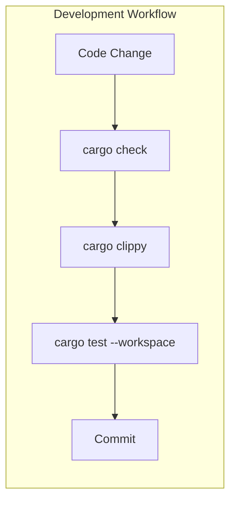

# Testing Guide

Use this guide to test critical behavior in Konductor for Amazon EventBridge. It covers the development cycle, Rust handler tests, browser tests, and local validation commands. For the test-first rule and the priority test flows, see [Testing Strategy in AGENTS.md](../../AGENTS.md#testing-strategy).

## TDD: red/green/refactor

> **Scope:** Every new behavior in a feature or fix (Rust handlers and shared
> library, the web console, and scripts) is built test-first. Test behavior,
> not every function; the priority flows in AGENTS.md get the deepest coverage.

Follow test-driven development (TDD) for each behavior you add or change:

```text
┌─────────────────────────────────────────────────────────────┐
│                    RED → GREEN → REFACTOR                   │
├─────────────────────────────────────────────────────────────┤
│                                                             │
│   1. RED     Write a failing test that defines expected     │
│              behavior. Run it - it MUST fail.               │
│                                                             │
│   2. GREEN   Write minimal code to make the test pass.      │
│              No more, no less. Run test - it MUST pass.     │
│                                                             │
│   3. REFACTOR  Clean up the code (extract, rename, etc.)    │
│                while keeping the test green.                │
│                                                             │
│   Repeat for each behavior/scenario.                        │
│                                                             │
└─────────────────────────────────────────────────────────────┘
```

Apply these principles:

- Tests guide implementation, not the other way around
- Fix an incorrect implementation rather than weakening a valid test
- Keep each cycle short (minutes, not hours)
- Commit after each green phase locally, then consolidate into conventional commits before review. See [Git workflow](../../AGENTS.md#git-workflow).

### Seeing RED

Run only the new test so the failure is easy to read:

| Stack | Command |
| ----- | ------- |
| Rust | `cargo test -p <crate> <test_name>` |
| Web console (from `web/`) | `pnpm exec playwright test tests/ui/<spec>.spec.ts -g "<test title>"` |
| Scripts | `uv run --with pytest pytest scripts/tests/<file>.py -k <test_name>` |

The failure must come from the missing behavior: an assertion failure, or in Rust a compile error naming only the function, field, or variant the test introduces. A typo, an unrelated compile error, or a fixture that fails during setup is not RED; fix it and run again.

A bug fix starts RED with a test that reproduces the bug. A pure refactor adds no behavior, so it has no RED step; the existing tests stay green throughout.

Avoid these practices:

- Writing implementation first, then tests to match
- Treating a test written after its implementation as RED without seeing it fail
- Writing multiple tests before any implementation
- Changing test assertions to match buggy behavior
- Skipping the refactor phase

## Test strategy overview

Run compilation checks, lint checks, and tests before committing:



## Test types

Choose the test type that exercises the behavior you need to verify.

| Type | Location | Command | Purpose |
|------|----------|---------|---------|
| Unit tests | `src/*.rs` (inline `#[cfg(test)]` modules) | `cargo test --workspace` | Test isolated logic within each crate |
| Handler tests | `src/*.rs` (inline `#[cfg(test)]` with smithy-mocks) | `cargo test --workspace` | Test handler behavior with mocked AWS SDK clients |
| Full suite | Not applicable | `make test` | Run all tests across the workspace |

## Commands

Run the full suite, a single crate, or a named test with the following commands:

```bash
# Run all tests across the workspace
make test

# Run tests for a specific crate
cargo test -p konductor-common

# Run a single test by name
cargo test -p konductor-common default_pattern_resolves_correctly

# Run tests with output visible (nocapture)
cargo test --workspace -- --nocapture

# Check compilation without running tests
make check
```

## Browser UI tests (Playwright)

The web console has an isolated-browser suite (`pnpm test:ui` from `web/`) with no dependency on a deployed stack:

- **Identity**: the dev-only `konductorTestSession` sessionStorage seam (`web/app/stores/session.ts`) mirrors a Cognito ID-token payload, letting a test run as `platform-admin`, `platform-auditor`, or a team group. The seam is compiled out of production (`import.meta.env.DEV` is statically false).
- **API**: feature-flow tests fulfill every `/dev/**` call with the in-test route mock (`web/tests/ui/api.ts`)—per-test mutable state drives conflicts, stale activations, delayed busy states, and error modes deterministically. The mock mirrors the real OpenAPI surface (`code` + `message` on errors). Component/gallery specs use the isolation fixture (`web/tests/ui/fixtures.ts`), which stubs `config.json` and blocks external traffic and same-origin API calls instead.
- **Server**: Playwright starts `nuxi dev --host 127.0.0.1 --port 3100` itself; bind IPv4 explicitly (the default binds IPv6-only on macOS, which defeats the readiness poll).
- **Scope**: journey flows (create → preview → save → conflict → activate → inspect), role restrictions, error/loading/empty states, narrow viewports, keyboard/dialog focus, plus rendered `Nx*` wrapper behavior on `/design-system` (labels and states, modal focus/dismissal, confirmation busy/retry, notification timing and overlapping pause conditions, enlarged text, reduced motion) and protected-route redirects to sign-in. Known accessibility gaps are recorded in the change's task notes rather than asserted as passing.

```bash
cd web
pnpm exec playwright install chromium
pnpm test:ui
pnpm lint
pnpm typecheck
pnpm build
```

No Cognito account, real data, or authentication bypass is needed. Tests must never submit operations against a live service.

Write user interface (UI) tests with role or label locators (`getByRole`, `getByLabel`). Scope them by card heading because visible text repeats across panels. Prefer strict-mode failures to brittle CSS selectors.

Toast text appears twice in the document object model (DOM): the visible toast and an `aria-hidden` announcement copy from Reka. Assert toast messages with `{ exact: true }`.

For manual review, `make web-dev` keeps its AWS-backed configuration and API proxy, then opens `/design-system` in the default browser when Nuxt starts. It uses Nuxt's actual port (normally 3000). Plain `pnpm dev` does not automatically open a browser. Gallery demos make no service writes, but other pages connect to the live backend.

The browser-opener helper has separate dependency-free tests: run `node --test tests/dev/open-gallery.test.mjs` from `web/`. These stub the browser launch and verify platform commands, the actual port, opt-in behavior, and graceful failure without opening a real browser.

Screenshots/traces go to ignored `web/test-results/`; preserve review evidence in ignored `web/ui-evidence/` before another run clears results. Capture the gallery at 390 px and 1440 px before and after visual changes. Inspect the images rather than treating screenshot creation as visual approval.

For timing-sensitive tests, `page.clock.install()` alone does not freeze time. Use `tests/ui/clock.ts` to install before gallery navigation and explicitly pause after page readiness, before creating notifications. Advance only simulated time with `runFor`; account for any rendering frames in the total lifetime (the polite-announcement test spends 50ms on Reka's two animation frames, then 5850ms before checking the six-second expiry boundary). Keep non-clock tests on ordinary browser time. Assert focus or hover before advancing a paused interval, and wait for dialogs to be visible before taking one-shot bounding boxes. Do not replace these preconditions with sleeps, forced clicks, or retries.

For an investigation, use a unique output directory per invocation so an isolated rerun cannot erase a full-suite failure. The following captures unfiltered output, revision, command, elapsed time, and the actual test exit status. Run from the repository root; replace the test arguments as needed:

```bash
(
  set -eu
  cd web
  mkdir -p "$PWD/ui-evidence/stabilize-ui-test-timing"
  run_dir=$(mktemp -d "$PWD/ui-evidence/stabilize-ui-test-timing/run.XXXXXX")
  git rev-parse HEAD > "$run_dir/revision.txt"
  printf '%s\n' "pnpm exec playwright test --reporter=list --output=$run_dir/results" > "$run_dir/command.txt"
  started=$(date +%s)
  date -u > "$run_dir/started.txt"
  set +e
  pnpm exec playwright test --reporter=list --output="$run_dir/results" > "$run_dir/output.log" 2>&1
  code=$?
  set -e
  finished=$(date +%s)
  printf 'exit=%s\nelapsed_seconds=%s\nevidence=%s\n' "$code" "$((finished-started))" "$run_dir" | tee "$run_dir/result.txt"
  cat "$run_dir/output.log"
  exit "$code"
)
```

Inspect the failed assertion and trace before rerunning. These are isolated mocked tests; keep evidence local and do not record credentials or live user data. A passing isolated test does not explain a full-suite failure, and current machine load does not establish the cause of an earlier slow run.

Automated accessible-name/description checks are not a screen-reader audit. Before acceptance, review the gallery with a screen reader, true browser zoom, keyboard-only operation, and reduced motion. The automated 200% root-font-size case covers enlarged text, not browser zoom. Verify modal focus entry/restoration and confinement, confirmation Cancel-first/busy states, F8 notification navigation, polite announcements, and independent dismissal. Record unavailable tooling or authentication-blocked consumer checks explicitly; do not claim those checks passed.

## Keeping `target/` small

This workspace builds 30+ Lambda crates, and a full test-suite build used to
leave `target/` at 5-15 GB. Two facts explain most of that, and both have
cheaper alternatives than `cargo clean`:

**Debug info dominates dev builds.** The workspace sets
`debug = "line-tables-only"` for local crates and `debug = 0` for dependencies
(root `Cargo.toml`), which keeps panic backtraces readable while roughly
halving the dev tree (~2.4 GB for a full workspace test build). Panics still
print file:line; you lose only local-variable inspection in a debugger.

**Cargo never garbage-collects.** Every dependency update or branch switch
leaves the old fingerprinted artifacts in `target/debug/deps` alongside the
new ones—weeks of updates accumulate, which is how the directory balloons
between cleans. Instead of a full `cargo clean` (which forces a full rebuild
of ~600 crates):

```bash
# Prune artifacts not touched in 30 days, keep everything fresh
cargo sweep --time 30            # cargo install cargo-sweep, once

# Drop only the cross-compiled Lambda tree (recreated by make build)
cargo clean --target aarch64-unknown-linux-gnu && rm -rf target/lambda

# Drop one crate's artifacts
cargo clean -p publish-events
```

Everyday habits that keep builds small and fast:

- Iterate with `make check` (`cargo check` emits metadata only—no codegen,
  a fraction of the size and time of a build).
- Test the crate you are changing (`cargo test -p <pkg>`) instead of
  `--workspace`; each test binary links the full AWS SDK surface.
- `CARGO_INCREMENTAL=0` trades slower rebuilds for ~0.5 GB less disk; the
  default (on) is usually the right call on a dev machine.

## Unit tests

Place unit tests in a `#[cfg(test)]` module at the bottom of the source file they exercise. This keeps tests co-located with the code they verify.

```rust
pub fn event_bus_name(org: &str, env: &str, domain: &str) -> String {
    format!("{org}-{env}-{domain}-event-bus")
}

#[cfg(test)]
mod tests {
    use super::*;

    #[test]
    fn event_bus_name_includes_suffix() {
        let result = event_bus_name("acme", "prod", "billing");
        assert_eq!(result, "acme-prod-billing-event-bus");
    }
}
```

Use these conventions for unit tests:

- One `mod tests` block per source file
- Use `use super::*;` to import the parent module
- Name test functions after the behavior, not the function under test
- Prefer `assert_eq!` or `assert_ne!` to bare `assert!` for clearer failure messages

## Handler tests

Handler-level tests that exercise the full request-to-response path with mocked AWS SDK clients serve as the project's integration tests. These live inline in `src/` alongside the handler code, not in separate `tests/` directories.

A `tests/` directory (which compiles as a separate crate with access to the library's public API) may be used in the future for cross-crate scenarios. Currently, all handler tests are inline because each Lambda crate has a single entry point.

For the handler test pattern, see [Mocking AWS SDK clients](#mocking-aws-sdk-clients-with-smithy-mocks).

## Async tests

AWS Lambda handlers and AWS SDK calls are asynchronous. Use `#[tokio::test]` for asynchronous test functions. Handler tests use smithy-mocks with injected clients:

```rust
#[cfg(test)]
mod tests {
    use super::*;

    #[tokio::test]
    async fn handler_returns_success_for_valid_input() {
        // Mock clients built with smithy-mocks — see below.
        let result = handle(&ddb, &eb, &sfn, &request).await;
        assert!(result.is_ok());
    }
}
```

## Handler structure for testability

To use smithy-mocks, handler functions must accept SDK clients as parameters rather than constructing them internally. The `main.rs` entrypoint builds real clients from AWS config; the handler function receives them as arguments. This separation is what allows smithy-mocks to inject mock clients in tests.

```rust
// src/main.rs — thin entrypoint: build clients once, pass by reference
#[tokio::main]
async fn main() -> Result<(), Error> {
    tracing_subscriber::fmt().json().with_env_filter(EnvFilter::from_default_env()).init();
    let config = aws_config::load_defaults(BehaviorVersion::latest()).await;
    let ddb = aws_sdk_dynamodb::Client::new(&config);
    let ddb_ref = &ddb;
    lambda_runtime::run(service_fn(move |event| async move {
        handler::handle(ddb_ref, event).await
    }))
    .await
}

// src/handler.rs — testable, accepts clients as params
pub async fn handle(
    ddb: &aws_sdk_dynamodb::Client,
    event: LambdaEvent<Value>,
) -> Result<Value, Error> { ... }
```

Handlers that build their own clients inside the handler function cannot be tested with smithy-mocks without refactoring. See also the rust-reviewer droid (section 6, Crate and Module Design) for the client-init and thin-handler rules.

## Mocking AWS SDK clients with Smithy-mocks

Use [aws-smithy-mocks](https://docs.aws.amazon.com/sdk-for-rust/latest/dg/testing-smithy-mocks.html) to test Lambda handlers that call AWS services. Mock clients use real SDK client types with predefined responses. Production handlers need no mock-specific code, but they must accept SDK clients as parameters. See [Handler structure for testability](#handler-structure-for-testability).

### Setup

SDK crates need the `test-util` feature enabled in the workspace `Cargo.toml`:

```toml
[workspace.dependencies]
aws-sdk-dynamodb = { version = "1", features = ["test-util"] }
aws-smithy-mocks = "0.2"
```

Each crate that needs mock tests adds a dev-dependency:

```toml
[dev-dependencies]
aws-smithy-mocks = { workspace = true }
```

### Writing mock tests

Create mock rules for each SDK operation, build a mock client, and pass it to the function under test:

```rust
use aws_sdk_dynamodb::operation::put_item::PutItemError;
use aws_smithy_mocks::{mock, mock_client};

#[tokio::test]
async fn rejects_duplicate_domain_with_failed_event() {
    let put_rule = mock!(aws_sdk_dynamodb::Client::put_item).then_error(|| {
        PutItemError::ConditionalCheckFailedException(
            aws_sdk_dynamodb::types::error::ConditionalCheckFailedException::builder().build(),
        )
    });
    let ddb = mock_client!(aws_sdk_dynamodb, [&put_rule]);

    let result = handle(&ddb, &eb, &sfn, &request).await;

    assert!(result.is_ok()); // handler emits failed event, does not error
    assert_eq!(put_rule.num_calls(), 1);
}
```

### Key patterns

**Sequential rules**—when a function makes multiple calls to the same service, use `RuleMode::Sequential`:

```rust
let ddb = mock_client!(
    aws_sdk_dynamodb,
    RuleMode::Sequential,
    [&query_rule, &put_rule]
);
```

**Request matching**—verify the mock received expected inputs:

```rust
let put_rule = mock!(aws_sdk_dynamodb::Client::put_item)
    .match_requests(|req| {
        req.item()
            .map(|items| items.contains_key("description"))
            .unwrap_or(false)
    })
    .then_output(|| PutItemOutput::builder().build());
```

**Error simulation**—test failure paths:

```rust
let error_rule = mock!(aws_sdk_dynamodb::Client::query)
    .then_error(|| QueryError::InternalServerError(
        InternalServerError::builder().build()
    ));
```

**Call verification**—confirm the mock was (or was not) invoked:

```rust
assert_eq!(rule.num_calls(), 1);
```

### When to use smithy-mocks vs trait abstractions

| Interaction pattern | Approach |
|---|---|
| SDK call appears in one function | Smithy-mocks directly |
| Same query/mutation pattern across 3+ functions | Extract a domain trait (for example, `DomainRepository`) |
| Fire-and-forget (EventBridge, SES) | Smithy-mocks directly |

Prefer smithy-mocks by default. Introduce a trait abstraction only when multiple functions duplicate the same AWS interaction pattern, not solely to support mocks.

## Error case testing

Use pattern matching or `assert!(result.is_err())` to verify error paths:

```rust
#[test]
fn rejects_empty_domain_name() {
    let result = validate_domain_name("");
    assert!(result.is_err());
}

#[test]
fn rejects_domain_name_with_special_chars() {
    let result = validate_domain_name("billing@v2!");

    match result {
        Err(e) => assert!(e.to_string().contains("invalid")),
        Ok(_) => panic!("expected validation error"),
    }
}
```

## Test organization conventions

Keep tests in the module they exercise, as the following layout shows:

```text
crate-root/
├── src/
│   ├── main.rs           ← thin entrypoint (no tests)
│   ├── handler.rs        ← unit + handler tests at bottom via #[cfg(test)]
│   ├── register.rs       ← unit + handler tests at bottom via #[cfg(test)]
│   └── validation.rs     ← unit tests at bottom via #[cfg(test)]
└── tests/                ← reserved for future cross-crate scenarios (currently empty)
```

- All tests go inline in the module they test via `#[cfg(test)]`
- Handler tests with smithy-mocks live in the `#[cfg(test)]` module; use a nested `mod handle_tests` block when a file mixes many pure-logic tests with handler tests (for example, register.rs)
- Name test functions descriptively: `rejects_empty_domain_name` not `test_1`

## CI considerations

Continuous integration (CI) runs the same checks available locally:

- `make check` runs `cargo fmt --check`, `cargo check`, and `cargo clippy -- -D warnings` (zero warnings policy)
- `make test` runs `cargo test --workspace`
- Both must pass before merging
- SAM build (`make build`) compiles release binaries for Lambda deployment
