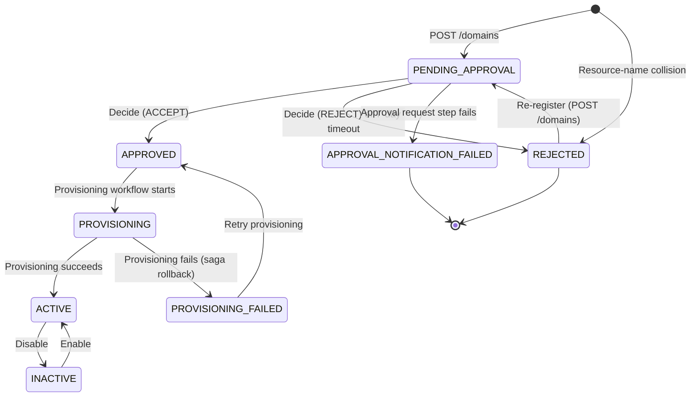

# Domain statuses

[Documentation home](../README.md)

Status definitions and owner actions, separated from API procedures.

## Domain lifecycle

A domain moves through a well-defined status progression from registration to active use:

| Status | Meaning |
|--------|---------|
| `PENDING_APPROVAL` | Registration submitted, awaiting a platform administrator's decision for up to 7 days |
| `APPROVED` | Approved by a platform administrator, or queued for a provisioning retry; provisioning not yet started |
| `REJECTED` | Registration denied by an approver, by the 7-day approval timeout (`decidedBy: system:timeout`), or before approval by the resource-name collision check (`decidedBy: system`). The name can be registered again. |
| `APPROVAL_NOTIFICATION_FAILED` | The approval workflow could not record or send the approval request, so no decision was made; operator intervention needed |
| `PROVISIONING` | Infrastructure creation in progress |
| `ACTIVE` | All resources created, domain is operational |
| `PROVISIONING_FAILED` | Infrastructure creation failed, compensating transactions completed; a platform administrator can retry provisioning |
| `INACTIVE` | Disabled by a platform administrator. Resources, subscriptions, and entitlements stay in place, but the publish, schema, and subscription APIs reject the domain until it is enabled again. |

Only platform administrators decide registrations and change a domain's state. Enable, disable, and provisioning retries all go through `POST /domains/{domainName}/state`.

## Owner actions

The [state diagram](#domain-lifecycle) shows how a domain moves between statuses. This table says what you can do in each one. A refused registration changes no record, so it never gets a status of its own. `GET /domains/{domainName}` returns `404`, or the unchanged earlier record if one already held the name; see [what happens next](../guides/domains.md#what-happens-next).

| Status | Meaning | What to do |
|--------|---------|-------------|
| `PENDING_APPROVAL` | Registration submitted, awaiting platform team decision | Wait for the decision. When notifications are enabled, an email tells you the outcome. A request left undecided for 7 days is rejected. Contact your platform team if it takes longer than expected. |
| `APPROVED` | Approved, provisioning not yet started | Nothing—this is a transient state. You should see `PROVISIONING` within seconds. |
| `REJECTED` | Registration denied by an approver, by the 7-day timeout, or by the resource-name collision check | Read `decidedBy` and `justification` in `GET /domains/{domainName}`, or the reason in the email you received. OAuth team callers get `404` from that route for a domain that was never approved, so without the email, ask your platform team for the reason. If `decidedBy` is `system`, ask your platform team to remove the colliding resources. Otherwise, correct the submission if needed. Then re-register under the same name. |
| `APPROVAL_NOTIFICATION_FAILED` | The approval request could not be delivered; nobody rejected the domain | Contact your platform team. After they fix the cause and remove the record, re-register. See [domain recovery](../operations/domain-recovery.md#approval_notification_failed). |
| `PROVISIONING` | Infrastructure creation in progress across all environments | Wait. Typically completes within 1-2 minutes. Poll `GET /domains/{domainName}` to check. |
| `ACTIVE` | All resources created, domain is operational | Start using your event buses. See [Provisioned Resources](resources.md#provisioned-resources). |
| `PROVISIONING_FAILED` | Resource creation failed, rollback completed | Contact your platform team. They can inspect the Step Functions execution history and retry provisioning. When notifications are enabled, you also receive a provisioning-issue email. |
| `INACTIVE` | Disabled by the platform team | Contact your platform team. Publish, schema, and subscription requests for the domain are rejected until they enable it again. |

### Environment snapshot

The environments your domain is provisioned into are determined by the platform configuration at registration time, not by your request. Every approved domain is provisioned into the full platform-configured list (default: `dev`, `staging`, `prod`). This list is snapshotted onto your domain record at registration time and does not change if the platform team adds or removes environments later.
