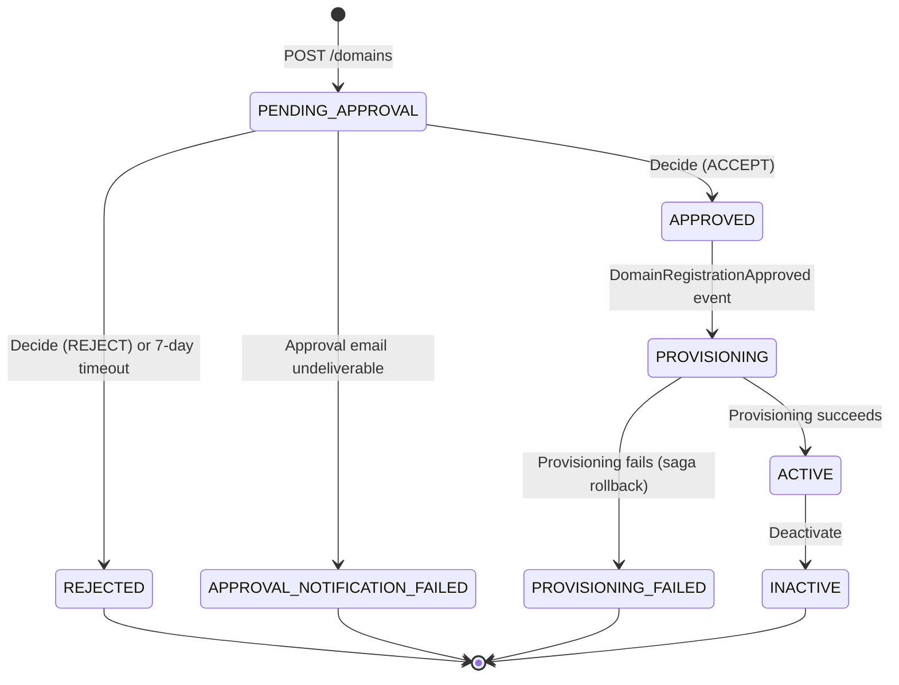

# Domain statuses

[Documentation home](../README.md)

Status definitions and owner actions, separated from API procedures.

> **Review pending:** [D02](../reference/documentation-discrepancies.md#d02) records conflicting or unverified guidance retained from the previous documentation. This reorganization does not resolve it.

## Domain lifecycle

A domain moves through a well-defined status progression from registration to active use:



| Status | Meaning |
|--------|---------|
| `PENDING_APPROVAL` | Registration submitted, awaiting human decision |
| `APPROVED` | Approved by platform admin, provisioning not yet started |
| `REJECTED` | Registration denied by approver (or expired unanswered after 7 days), owner notified via email |
| `APPROVAL_NOTIFICATION_FAILED` | Approval request email could not be delivered—no decision was made; operator intervention needed |
| `PROVISIONING` | Infrastructure creation in progress |
| `ACTIVE` | All resources created, domain is operational |
| `PROVISIONING_FAILED` | Infrastructure creation failed, compensating transactions completed |
| `INACTIVE` | Domain deactivated, resources remain but domain is non-operational |

## Owner actions

Your domain moves through a well-defined status progression:

```text
                 POST /domains
                      │
                      ▼
              PENDING_APPROVAL
                      │
          ┌───────────┴───────────┐
          │                       │
       Approve                 Reject
          │                       │
          ▼                       ▼
      PROVISIONING            REJECTED
          │                  (terminal)
          │
    ┌─────┴──────┐
    │            │
    ▼            ▼
  ACTIVE   PROVISIONING_FAILED
```

| Status | Meaning | What to do |
|--------|---------|-------------|
| `PENDING_APPROVAL` | Registration submitted, awaiting platform team decision | Wait for approval email. Contact platform team if it takes longer than expected. |
| `APPROVED` | Approved, provisioning not yet started | Nothing—this is a transient state. You should see `PROVISIONING` within seconds. |
| `REJECTED` | Registration denied | Review the rejection email for justification. Correct the submission and re-register under the same name. |
| `PROVISIONING` | Infrastructure creation in progress across all environments | Wait. Typically completes within 1-2 minutes. Poll `GET /domains/{domainName}` to check. |
| `ACTIVE` | All resources created, domain is operational | Start using your event buses. See [Provisioned Resources](resources.md#provisioned-resources). |
| `PROVISIONING_FAILED` | Resource creation failed, rollback completed | Check the provisioning failure email. Contact your platform team—they can inspect Step Functions execution history for details. |

### Environment snapshot

The environments your domain is provisioned into are determined by the platform configuration at registration time, not by your request. Every approved domain is provisioned into the full platform-configured list (default: `dev`, `staging`, `prod`). This list is snapshotted onto your domain record at registration time and does not change if the platform team adds or removes environments later.
