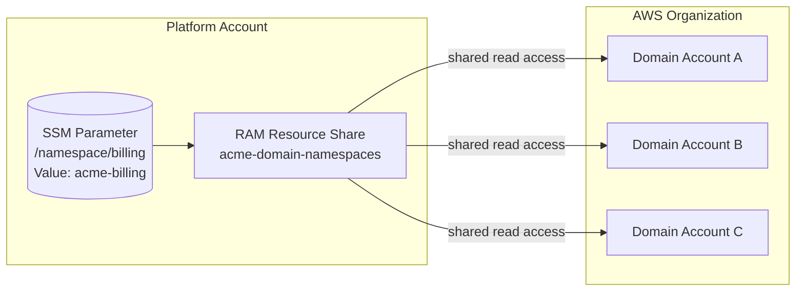

# Resources and naming

[Documentation home](../README.md)

The inventory below distinguishes platform-owned resources from application-side resources and defines their names.

## Provisioned resources

When your domain reaches `ACTIVE`, Konductor has created resources in two AWS accounts across all your environments:

### Platform account resources (per environment)

| Resource | Name pattern | Purpose |
|----------|-------------|---------|
| Event bus | `{org}-{env}-{domain}-event-bus` | Inbound event bus for your domain |
| PutEvents policy | (attached to event bus) | Allows your owner account to publish events |
| Schema registry | `{org}-{env}-{domain}-schema-registry` | EventBridge schema registry for discovery |
| Subscription DLQ | `{org}-{env}-{domain}-subscription-dlq` | Dead-letter queue for failed subscription deliveries |
| CloudWatch dashboard | `{org}-{env}-{domain}-dashboard` | Operational monitoring dashboard |
| Failed invocations alarm | `{org}-{env}-{domain}-failed-invocations-alarm` | Alarm for failed event invocations |
| DLQ depth alarm | `{org}-{env}-{domain}-dlq-depth-alarm` | Alarm for DLQ message accumulation |

### Domain account resources (per environment)

| Resource | Name pattern | Purpose |
|----------|-------------|---------|
| Event bus | `{org}-{env}-{domain}-event-bus` | Your domain's event bus in your account |
| Integration DLQ | `{org}-{env}-{domain}-integration-dlq` | Dead-letter queue for failed integrations |

### Domain-level resources (environment-independent)

| Resource | Name | Purpose |
|----------|------|---------|
| SSM parameter | `/namespace/{domain}` | Namespace identifier shared across the organization via RAM |
| AWS Resource Access Manager (AWS RAM) resource share | `{org}-domain-namespaces` | Organization-wide sharing of domain namespace parameters |

### Naming convention example

For org `acme`, domain `billing`, environment `dev`:

```text
acme-dev-billing-event-bus          (platform account)
acme-dev-billing-schema-registry    (platform account)
acme-dev-billing-subscription-dlq   (platform account)
acme-dev-billing-dashboard          (platform account)
acme-dev-billing-event-bus          (domain account)
acme-dev-billing-integration-dlq    (domain account)
/namespace/billing                  (SSM parameter, shared via RAM)
```

The platform-side and app-side event buses share the same name—they live in different accounts, so there is no collision.

## Resource namespace convention

Konductor distinguishes **platform resources** (the singleton control plane) from **domain resources** (one set per environment per domain).

**Platform resources**—fixed `konductor-*` pattern, no org or environment segment (Konductor is a singleton per AWS account):

```text
konductor-bus                             (konductor event bus)
konductor-domains                         (domains table)
konductor-api                             (API Gateway)
konductor-function-role                   (Lambda trust-anchor role)
konductor-provisioning-workflow-role      (Step Functions execution role)
```

The domain-account **trust role** is the one exception: it carries the org prefix as `{org}-konductor-trust-role` (for example, `acme-konductor-trust-role`) so multiple organizations sharing a domain account don't collide.

**Domain resources**—`{org}-{env}-{domain}-*`, one set per environment in the `Environments` platform parameter:

```text
acme-prod-billing-event-bus           (EventBridge bus)
acme-prod-billing-schema-registry     (Schema registry)
acme-prod-billing-subscription-dlq    (Platform DLQ)
acme-prod-billing-integration-dlq     (Domain account DLQ)
acme-prod-billing-dashboard           (CloudWatch dashboard)
```

The domain pattern is configurable via the `NamespacePattern` SAM parameter (default: `{org}-{env}-{domain}`), fixed at setup—syntax and lifecycle are defined in the [configuration contract](configuration.md). The `NamespaceResolver` in `lib/konductor-common/src/namespace.rs` handles domain-resource name generation. The platform pattern (`konductor-*`) is fixed.

The `konductor` name is reserved—the register-domain handler rejects it so no domain can collide with the platform namespace.

### Domain namespace (environment-independent)

Each domain also has an environment-independent **namespace identity**: `{org}-{domain}` (for example, `acme-billing`). This is stored as an SSM Advanced Parameter at `/namespace/{domain}` and shared across the entire AWS organization via RAM resource share.



Domain accounts can discover domains by reading SSM parameters locally, without any cross-account IAM configuration.

## Related topics

[Provisioning and rollback](../architecture/provisioning.md) explains creation order. [Service quotas](../operations/service-quotas.md) owns capacity estimates. [Guardrails](../operations/guardrails.md) describes the account-ownership boundary in console links.
